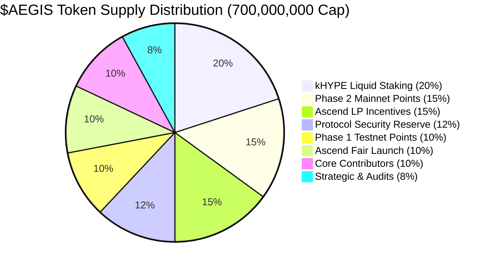

# AEGIS Protocol — Official Lightpaper

**Title:** AEGIS: Autonomous Delta-Hedging & Liquidation Shield for Elysium L2 and HyperCore  
**Version:** 1.0.0 (Release Candidate)  
**Network Alignment:** Elysium Orbit L2 (Chain ID `99801`) • Hyperliquid L1 (HyperCore)  
**Target Repository:** [https://github.com/youngcrypton/Aegis](https://github.com/youngcrypton/Aegis)  
**Author:** AEGIS Research & Core Engineering Group  

---

## Abstract

Forced liquidations remain the primary systemic risk vector in collateralized decentralized finance. Traditional debt protocols rely on abrupt, irreversible collateral auctions that seize borrower assets at fire-sale discounts (5% to 10% penalty surcharges), realize permanent capital loss at market troughs, and trigger cascading network-wide insolvency cascades. 

**AEGIS** introduces an autonomous, non-custodial risk engine and synthetic delta-hedging protocol designed for the Elysium Orbit L2 ecosystem and HyperCore (Hyperliquid's L1 high-performance CLOB). Rather than liquidating spot collateral, AEGIS dynamically neutralizes directional downside exposure ($\Delta$) by dispatching counterbalancing short perpetual futures contracts on HyperCore before liquidation thresholds are breached. Spot collateral remains 100% intact within the user's primary vault under zero-custody delegation (Invariant **INV-1**). 

To ensure immediate testability on stock Arbitrum Nitro ArbOS prior to the upcoming validator hardfork, AEGIS implements a **Modular Dual-Mode Architecture**, operating via modular oracle and dispatch adapters today and hot-swapping to native zero-gas precompiles (`0x0801` and `0x0802`) post-hardfork with zero vault migration. The protocol enforces Phase 1C deferred fee debt accounting, guaranteeing that emergency unwind operations are never blocked by liquidity deficits. Across 14 Foundry test suites, 5 Keeper test suites, and 6 live RPC verification suites, AEGIS maintains a 100% pass rate across 157 automated tests.

---

## 1. Introduction: The DeFi Liquidation Crisis

In debt-based decentralized financial architectures—including collateralized debt positions (CDPs), borrowing pools, and leveraged margin platforms—solvency is traditionally guaranteed by enforcing an overcollateralization ratio:

$$\text{LTV} = \frac{D_{\text{debt}}}{Q_{\text{collateral}} \cdot P_{\text{collateral}}} \le \text{LTV}_{\text{max}}$$

When macro volatility drives collateral depreciation, $\text{LTV}$ escalates toward the protocol's liquidation threshold $T_{\text{liq}}$. At this juncture, conventional protocols invoke third-party liquidators to seize underlying collateral. This mechanism introduces severe systemic flaws:

1. **Destructive Surcharges:** Borrowers incur punitive penalties (500–1000 bps) deducted directly from their equity.
2. **Adverse Selection & Bottom-Dumping:** Seized collateral is liquidated into thin spot AMM pools precisely when liquidity is scarce, exacerbating drawdown and transferring value to arbitrageurs.
3. **MEV & Contagion Cascades:** Liquidations trigger front-running, priority gas auctions (PGAs), and secondary liquidations across correlated money markets.

### The AEGIS Core Axiom: "Hold the Line"

AEGIS operates on a divergent financial premise: **Collateral should never be seized or dumped during temporary volatility spikes.** Instead, downside delta risk should be neutralized synthetically via high-frequency derivative markets, preserving the underlying asset until mean-reversion occurs.

---

## 2. Protocol Architecture & The Autonomous Delta Engine

AEGIS unites three architectural layers:

```
+-------------------------------------------------------------------------+
|                         ELYSIUM ORBIT L2 (EVM)                         |
|                                                                         |
|   +---------------------+         +---------------------------------+   |
|   |   AegisVault.sol    | <-----> |     AgentDispatchAdapter.sol    |   |
|   |  - Zero Custody     |         |   (Modular Dual-Mode Dispatch)  |   |
|   |  - INV-1 to INV-5   |         +---------------------------------+   |
|   |  - Phase 1C FeeDebt |                          |                    |
|   +---------------------+                          v (EVM Events)       |
+--------------|-------------------------------------|--------------------+
               |                                     |
               v (Telemetry Polling)                 v
+-------------------------------------------------------------------------+
|                      SENTINEL KEEPER DAEMON NETWORK                     |
|  - Continuous <100ms Health Monitoring via Multicall3                   |
|  - Cryptographic EIP-712 Order Intent Signing                          |
|  - 25,000 $AEGIS Economic Stake & Slashing Guardrails                   |
+-------------------------------------------------------------------------+
                                                     |
                                                     v (Sub-78ms API Lane)
+-------------------------------------------------------------------------+
|                         HYPERCORE L1 ENGINE                             |
|  - Sub-Second Central Limit Order Book (CLOB) Matching Engine           |
|  - Synthetic Short Perpetual Positions (WHYPE / USDC)                   |
|  - Trailing Take-Profit Unwinds & Debt Paydown                          |
+-------------------------------------------------------------------------+
```

### 2.1 Non-Custodial Vault Architecture (`AegisVault.sol`)
The vault maintains user collateral balances, debt parameters, session key authorizations, and deferred fee debt records. Crucially, vault assets are locked under smart contract access rules that prohibit token transfers by any entity other than the vault owner.

### 2.2 Modular Dual-Mode Execution Framework
Because Elysium Testnet (Chain ID `99801`) executes stock Arbitrum Nitro ArbOS where custom precompiles `0x0801` and `0x0802` are pending a validator hardfork, AEGIS implements a modular adapter pattern:

* **Mode 1: Stock ArbOS Testnet (Active Now):**
  * `RelayedOracleAdapter.sol` ingests telemetry prices with strict 120s staleness and 300s absolute expiration bounds.
  * `AgentDispatchAdapter.sol` emits on-chain EVM events (`AgentHedgeDispatched`, `AgentUnwindDispatched`) observed by off-chain Sentinel daemons.
* **Mode 2: Native Precompiles (Post-Hardfork):**
  * Precompile `0x0801`: Synchronous, zero-gas EVM opcode reading HyperCore L1 memory in $<70\text{ms}$.
  * Predeploy `0x0802`: Synchronous trade intent bridge into HyperCore's matching engine.
* **Zero-Downtime Hot-Swap:** When validators activate the hardfork, governance executes `vault.setOracleAdapter()` and `vault.setDispatchAdapter()`. **No user funds are migrated, and no vault redeployment is required.**

---

## 3. Mathematical Model of Synthetic Hedging

### 3.1 Health Factor ($H$)
The instantaneous solvency of a borrower vault is given by:

$$H = \frac{Q_{\text{collateral}} \cdot P_{\text{mark}} \cdot L_{\text{threshold}}}{D_{\text{debt}}}$$

Where:
* $Q_{\text{collateral}}$ = Quantity of deposited collateral (e.g., WHYPE).
* $P_{\text{mark}}$ = Oracle mark price scaled to $10^8$.
* $L_{\text{threshold}}$ = Liquidation threshold (typically $0.80$ to $0.85$).
* $D_{\text{debt}}$ = Outstanding debt denominated in canonical USDC ($10^6$).

### 3.2 Dynamic Sizing Function ($\gamma$)
When $H \le H_{\text{trigger}} = 1.15$, the Sentinel engine computes the required short perpetual hedge size $S^*$:

$$S^* = \gamma(H) \cdot \left( \frac{D_{\text{debt}}}{P_{\text{mark}}} \right)$$

$$\gamma(H) = \min\left(1.0, \; \frac{H_{\text{trigger}} - H}{H_{\text{trigger}} - H_{\text{critical}}} \cdot \gamma_{\text{max}}\right)$$

This formula scales the hedge proportionally: minor dips trigger partial delta coverage, while aggressive flash crashes trigger 100% delta neutralization.

### 3.3 Trailing Take-Profit Unwind Envelope ($\tau$)
As macro price rebounds, the short position accumulates cash profit. The Sentinel tracks the local price minimum $P_{\text{min}}$ and executes the unwind when:

$$P_{\text{current}} \ge P_{\text{min}} \cdot (1 + \tau)$$

Where $\tau$ is the trailing take-profit threshold (default $1.5\%$). The short perpetual is closed on HyperCore, realizing USDC gains that are routed back to the vault to repay debt, strictly restoring health:

$$H_{\text{post}} > H_{\text{pre}} \quad (\text{Invariant \textbf{INV-2}})$$

---

## 4. Phase 1C Deferred Fee Debt Engine

In high-stress market environments, traditional protocols encounter **liquidity deadlocks**: if a user does not possess liquid stablecoins in their vault to satisfy protocol fees during an unwind, the contract reverts, leaving the hedge open and the user vulnerable.

AEGIS solves this via **Phase 1C Deferred Fee Debt Accounting**:

```solidity
// Non-blocking fee settlement logic
try feeCollector.collectFee(user, protocolFee) {
    // Liquid payment succeeded
} catch {
    // Record deferred fee debt without reverting
    feeDebts[user] += protocolFee;
    emit FeeDebtRecorded(user, protocolFee);
}
```

* **Guarantee:** The emergency unwind transaction **never reverts** due to fee insolvency.
* **Repayment:** Fee debt is settled voluntarily via `repayFeeDebt()` or automatically deducted upon position closing or collateral withdrawal.

---

## 5. Sentinel Keeper Network & Cryptoeconomics

The AEGIS Sentinel Network is a decentralized constellation of high-frequency keeper daemons responsible for telemetry monitoring and intent execution.

### 5.1 Bonding & Slashing Guardrails
* **Minimum Operator Bond:** 25,000 $AEGIS staked in `AegisSentinelRegistry.sol`.
* **Slashing Parameters:**
  * SLA Failure / Latency Breach (>500ms): Slashed up to 10% (1,000 bps).
  * Unauthorized Signature / Slippage Violation: Slashed 10%, redirected to indemnify the affected user.
* **Unbonding Cooldown:** Mandatory 7-day timelock preventing flash-unstaking during active market risk.

### 5.2 Cryptographic EIP-712 Non-Custodial Boundaries (INV-1 & INV-5)
Users authorize Sentinels via scoped EIP-712 session signatures. Session keys are cryptographically constrained:
* **Trade-Only Execution:** Keys can only emit order intents to the dispatch adapter.
* **Zero Transfer Power:** Session keys have zero bytecode access to `transfer`, `transferFrom`, or `approve`.
* **Monotonic Nonces (INV-5):** Every order intent consumes a strictly sequential per-vault nonce, eliminating replay and front-running risks.

---

## 6. Tokenomics & Deflationary Value Capture

The **$AEGIS** token is the native governance, bonding, and fee-capture asset on Elysium L2.

### 6.1 Token Overview
* **Total Supply:** Hard-capped at 700,000,000 $AEGIS (zero inflationary minting functions).
* **Token Utility:**
  1. Sentinel Node Staking & Slashing Bond (25,000 $AEGIS).
  2. Protocol Governance & Parameter Tuning ($H_{\text{trigger}}$, $\tau$, fee splits).
  3. Real Staking Yield Distribution in canonical debt tokens (USDC) *(Phase 3 Roadmap)*.

> [!IMPORTANT]
> **Protocol Roadmap Notice (Phase 3 Integration):**  
> Throughout the active Elysium testnet phase and initial V1 launch, **AEGIS operates strictly as a lean, pure autonomous delta-hedging engine**. Staking, real yield distribution, and fee buyback-and-burn mechanisms are on the protocol **Roadmap (Phase 3)** and are not active in V1. Active testnet testers and mainnet hedgers accumulate Phase 1 (10%) and Phase 2 (15%) Points, converting 100% unlocked at Ascend TGE.

### 6.2 Counter-Cyclical Deflationary Flywheel
Unlike inflationary reward tokens, AEGIS captures value inversely to market distress:

$$\text{Downside Volatility} \implies \text{Hedges Triggered} \implies \text{Liquidation Loss Averted} \implies \text{10\% Performance Fee}$$

Collected fees are strictly split 50/50 by `AegisFeeCollector.sol` (Invariant **INV-4**):
* **50% Buyback-and-Burn:** Programmatically routed to Ascend Closed Hook Pools to purchase $AEGIS and burn it permanently to `0x000...dEaD`.
* **50% Real Staking Yield:** Distributed directly to bonded Sentinel stakers and governance participants.

### 6.3 The Ascend User Reward Flywheel (100% Community & User Rebates)
Beyond internal liquidation protection fees, AEGIS integrates directly with Ascend's native Elysium DEX architecture (`UniversalRouter` at `0x90332B0ECbb2c9517F405627b0Dd5D5265246563`, `CLPoolManager`, and `ReferralTreasury` at `0xc2113eBa197C97628a4CA58CEC21eFa8B6EfC764`).

All external fees, referral shares, and pool creator rebates returned to AEGIS from Ascend trading activity are strictly channeled to reward active protocol users:

$$\text{Ascend Revenue}_{\text{returned}} \implies 100\% \text{ User \& Community Reward Allocation}$$

1. **Vault Borrower Fee Rebates:** Borrowers maintaining protected collateral vaults on AEGIS receive fee discounts and cash-back rewards in $AEGIS or USDC derived directly from Ascend trading volume.
2. **Active Trader & Tester Incentives:** Community members and pro-traders actively testing, stress-testing, and executing on the AEGIS terminal earn continuous rewards and loyalty boosts.
3. **Liquidity Provider Rewards:** Users providing concentrated liquidity for the canonical `$AEGIS / USDC` pool on Ascend receive amplified yield distributions.
### 6.4 Comprehensive Supply Allocation & Two-Phase Point System (700M Hard Cap)



| Category | Share (%) | Token Amount | TGE Unlock | Cliff | Vesting Schedule |
| :--- | :---: | :---: | :---: | :---: | :--- |
| **Phase 1: Testnet Points Reward** | **10.0%** | **70,000,000** | **100.0% (70M)** | 0 mos | **100% Unlocked at Ascend TGE** (Elysium & testnet points earners) |
| **Phase 2: Mainnet Hedging Points** | **15.0%** | **105,000,000** | **100.0% (105M)** | 0 mos | **100% Unlocked at Ascend TGE** (Live autonomous delta hedgers) |
| **Ascend Launchpad Fair Launch** | **10.0%** | **70,000,000** | **100.0% (70M)** | 0 mos | **100% Unlocked at Ascend TGE** (Day-1 public pool liquidity) |
| **kHYPE Liquid Staking Rewards** | **20.0%** | **140,000,000** | 0.0% | 0 mos | 24 mos linear (Emissions to native kHYPE stakers on Kinetiq) |
| **Ascend LP Incentives (POL)** | **15.0%** | **105,000,000** | 0.0% | 0 mos | 36 mos linear (Deep liquidity in $AEGIS/USDC & $AEGIS/HYPE) |
| **Protocol Security & Insurance** | **12.0%** | **84,000,000** | 0.0% | 12 mos | 36 mos linear (DAO multi-sig black swan emergency reserve) |
| **Core Contributors & Builders** | **10.0%** | **70,000,000** | **0.0%** | **24 mos** | **36 mos linear** (Strict 2-year hard cliff, 5-year total horizon) |
| **Strategic Ecosystem & Audits** | **8.0%** | **56,000,000** | 0.0% | 12 mos | 24 mos linear (Audit grants, security bounties, foundation growth) |
| **TOTAL** | **100.0%** | **700,000,000** | **35.0% (245M)** | — | **Zero inflationary minting. 100% Day-1 float to Community.** |

* **The Two-Phase Point Engine:**  
  * **Phase 1 (Testnet):** Users testing the terminal on Elysium L2 accumulate testnet points redeemable 1:1 for the 70,000,000 $AEGIS pool at Ascend TGE.
  * **Phase 2 (Mainnet):** Active borrowers defending vaults with autonomous delta hedging accumulate mainnet volume points redeemable for the 105,000,000 $AEGIS pool at Ascend TGE.
  * **100% Day-1 TGE Liquidity:** Both Phase 1 (10%) and Phase 2 (15%) rewards + Ascend Fair Launch (10%) = **35% total Day-1 circulating supply**, with zero vesting or lockup for community participants. Zero team tokens unlock at TGE.

---


## 7. Formal Verification & Test Suite Scorecard

Every mathematical invariant and smart contract function is formally verified across automated test suites:

| Suite Category | Tests | Tooling | Coverage / Verification Proof |
| :--- | :---: | :---: | :--- |
| **Foundry Unit Suites** | 45 | Foundry (`forge test`) | Core vault logic, fee splitting, registry staking, and adapter boundaries. |
| **Invariant Fuzz Suites** | 70 | Foundry (`echidna` / fuzz) | 160,000+ runs verifying INV-1 through INV-5 and Phase 1C non-blocking debt. |
| **Sentinel Keeper Suites** | 29 | Jest / TypeScript | Sub-78ms telemetry parsing, EIP-712 signing, and dual-mode dispatch. |
| **Frontend Truthfulness** | 13 | Node.js / Ethers | Live RPC block verification against Elysium Testnet (99801) with zero mock metrics. |
| **Total Automated Tests** | **157** | **Continuous CI** | **100% Pass Rate (0 Failures, 0 Reverts)** |

### Formal Invariants Summary
* **INV-1 (Non-Custodial):** $\Delta Q_{\text{vault}} = 0$ for all delegated session operations.
* **INV-2 (Monotonic Health):** $H_{\text{post}} > H_{\text{pre}}$ upon take-profit unwind.
* **INV-3 (Killswitch):** Unilateral emergency revocation in 1 transaction via `manualOverride()`.
* **INV-4 (Fee Conservation):** $\text{Fee}_{\text{total}} = \text{Burn}_{50\%} + \text{Yield}_{50\%}$.
* **INV-5 (Anti-Replay):** Monotonic sequential per-vault nonces ($\text{Nonce}_{t+1} = \text{Nonce}_t + 1$).

---

## 8. Protocol Roadmap: Lean Execution to Ecosystem Scaling

```
[Phase 1: Testnet Alpha] ---> [Phase 2: Mainnet Genesis] ---> [Phase 3: Yield & Staking] ---> [Phase 4: Multi-Collateral]
- Pure Autonomous Hedging     - Targeted Security Audit       - $AEGIS Staking Activation     - Multi-Asset Collateral Pools
- HyperCore Sub-Second CLOB   - Mainnet Live Deployment       - Ascend Buyback-and-Burn       - Cross-Margin Delta Hedging
- Live Mainnet Telemetry      - WHYPE, WETH & Ascended Coins  - Real-Yield USDC Staking       - Institutional Risk SDKs
- 157/157 Tests Verified      - Money Market Risk Defense     - 25k Node Operator Bonding     - Precompiles 0x0801/0x0802
```

> **Strategic Architecture Focus:**  
> During the active testnet phase and V1 Mainnet rollout, AEGIS operates strictly as a lean, focused autonomous delta-hedging engine for Elysium borrowers and tokens that have ascended from Ascend to HyperCore perpetual markets. Token staking and yield distribution mechanics are scheduled on Phase 3 of the roadmap to ensure a streamlined security audit footprint and immediate time-to-market.

---

## 9. Conclusion

AEGIS transforms decentralized debt positions from fragile, liquidation-prone loans into self-stabilizing, delta-neutral vaults. By combining Elysium Orbit L2 EVM security with HyperCore's sub-second matching engine, AEGIS provides the institutional risk infrastructure necessary for the next wave of on-chain capital.

**Repository:** [https://github.com/youngcrypton/Aegis](https://github.com/youngcrypton/Aegis)  
**Documentation:** [https://github.com/youngcrypton/Aegis/tree/main/docs](https://github.com/youngcrypton/Aegis/tree/main/docs)  
**Verification Dossier:** [docs/FACT_CHECK_AND_VERIFICATION_DOSSIER.md](docs/FACT_CHECK_AND_VERIFICATION_DOSSIER.md)  
