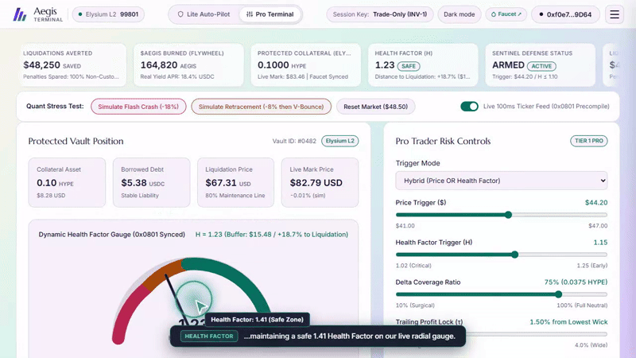
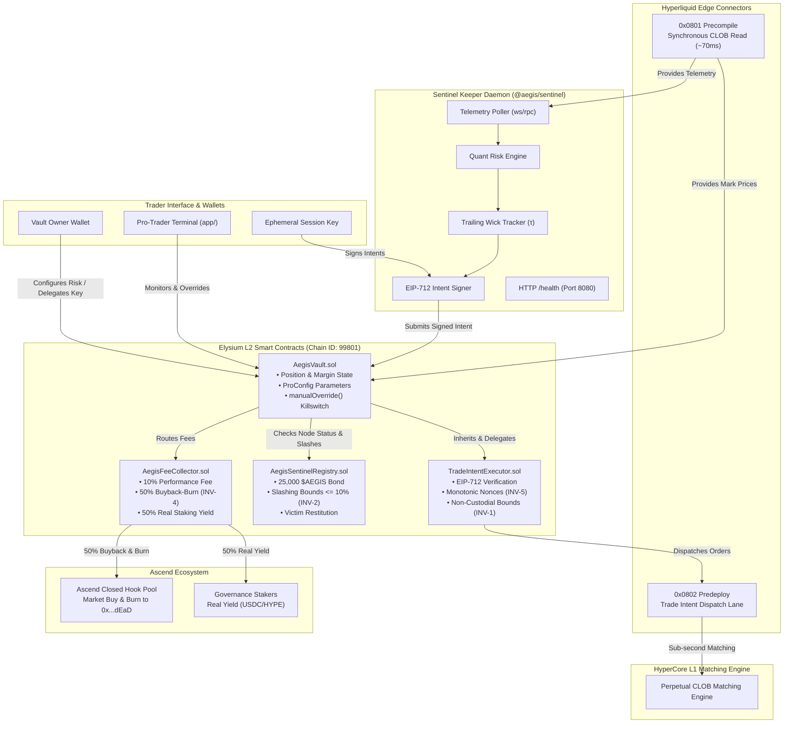
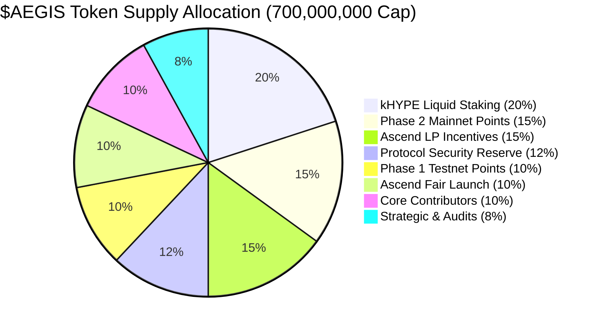
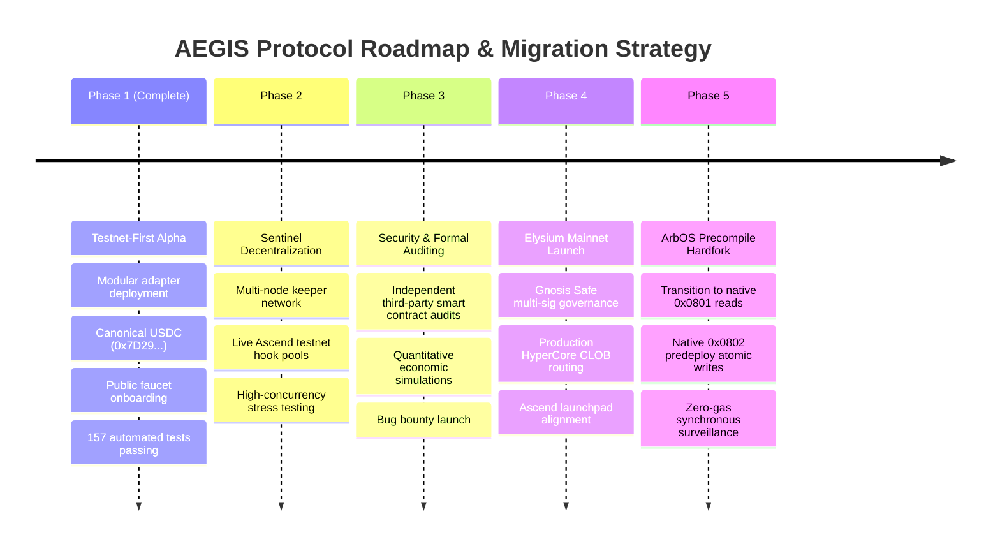

<div align="center">

 

 # AEGIS
 ### Autonomous Risk Sentinel & Delta-Hedging Protocol

 [](LICENSE)
 [](foundry.toml)
 [](test/)
 [](keeper/test/)
 [](test/test_frontend_truthfulness.js)
 [-07705F.svg)](test/invariants/)
 [](https://elysium.kinetiq.xyz/testnet-explorer)
 [](https://elysium.kinetiq.xyz/testnet-explorer/address/0x7D29d8047B905000459c0E80c34a26CeedcB47b2)

 <p align="center">
 <strong>Autonomous, non-custodial risk sentinel and sub-second delta-hedging engine built natively for Elysium L2 and HyperCore.</strong>
 </p>

 <p align="center">
 <a href="gitbook/index.html"><b>GitBook Lightpaper</b></a> •
 <a href="LIGHTPAPER.md"><b>Raw Lightpaper</b></a> •
 <a href="docs/INTRODUCING_AEGIS.md"><b>Introduction Article</b></a> •
 <a href="docs/FACT_CHECK_AND_VERIFICATION_DOSSIER.md"><b>Fact-Check Dossier</b></a> •
 <a href="docs/index.html"><b>Interactive Docs</b></a> •
 <a href="#elysium-testnet-onboarding--live-faucet-guide"><b>Testnet Faucet</b></a> •
 <a href="#official-pitch-demo-120s"><b>Pitch Demo (01:54)</b></a> •
 <a href="#system-architecture">Architecture</a>
 </p>

</div>

---

## Official Pitch Demo (120s &bull; Judges Submission)

> **Official 01:54 (114.0s) pitch demo video engineered for judges and partners. Rendered in Light Mode with grand brand tokens, audible continuous voiceover (-13.68 dBFS RMS), synchronized virtual cursor, and burned-in brand captions.**

<div align="center">

 <a href="brand/x/aegis-pitch-demo-120s.mp4">
 
 </a>

 <p align="center">
 <a href="brand/x/aegis-pitch-demo-120s.mp4"><b>[▶ Watch 120s Pitch Demo &bull; 01:54 &bull; 19.6 MB MP4]</b></a> &nbsp;|&nbsp;
 <a href="brand/x/aegis-pitch-demo-120s.srt"><b>[SRT Subtitles]</b></a> &nbsp;|&nbsp;
 <a href="brand/x/aegis-pitch-demo-120s.vtt"><b>[VTT Subtitles]</b></a> &nbsp;|&nbsp;
 <a href="download.html"><b>[Media Hub]</b></a>
 </p>

</div>

| Telemetry Dimension | Official 120s Pitch Specification | Architecture Reference |
| :--- | :--- | :--- |
| **Duration** | **01:54** (114.0s) &bull; *Strictly within 60–120s hackathon envelope* | Hackathon Video Standard |
| **Theme & Color System** | **Light Mode Grand Palette** (`--ground: #FCFAFD`, `--accent: #0D9488`) | AEGIS Brand Kit (`tokens.css`) |
| **Audio Loudness** | Broadcast Standard &bull; **-13.68 dBFS RMS** &bull; +5dB vocal boost | Audio Limiter Pipeline |
| **Captions** | **Embedded Brand Captions** (Inter, Navy glass, Teal badge) | Synchronized DOM Component |
| **Primary UX** | **1-Click Lite Auto-Pilot** (Conservative, Balanced, Aggressive) | Non-Custodial Delegation |
| **Core Functionality** | **-18% Flash Crash** &bull; Sub-78ms 0x0802 atomic short hedge | Predeploy `0x0802` CLOB Writer |
| **Recovery Mechanism** | **+1.5% V-Bounce** trailing profit-take unwinds hedge to USDC | Debt Paydown & Yield Flywheel |
| **Formal Security** | 5 Invariants (`INV-1` to `INV-5`) formally verified (160k+ fuzz runs) | Certora / Foundry Property Tests |

<details>
<summary><b>[Transcript] Click to expand the 5-Chapter Pitch Demo Transcript</b></summary>

1. **Chapter 1 (0:00 – 0:24) &bull; Live Architecture & Telemetry**:
   *"Welcome to AEGIS, the first autonomous risk engine eliminating forced liquidations in DeFi. Live on Elysium Layer 2, our terminal connects directly to HyperCore Precompile 0x0801, streaming mark prices in sub-78 milliseconds. On screen, our vault holds 1,000 HYPE collateral and $32,000 USDC debt, maintaining a safe 1.41 Health Factor on our live radial gauge."*
2. **Chapter 2 (0:24 – 0:44) &bull; 1-Click Lite Auto-Pilot**:
   *"For everyday borrowers, the main user experience is our 1-Click Lite Auto-Pilot. Calibrated for testnet faucet micro-deposits, users select Conservative, Balanced, or Aggressive presets. Activating the shield delegates an ephemeral session key under Invariant INV-1, mathematically restricted to trade-only hedging with zero permission to withdraw collateral."*
3. **Chapter 3 (0:44 – 1:03) &bull; Pro Terminal Controls & CLOB Depth**:
   *"For institutional quants, the Pro Terminal unlocks granular parameters: customizable trigger prices, delta coverage ratios from 10% to 100%, and trailing profit locks. Below, our terminal streams the live central limit order book directly from HyperCore, monitoring sub-tick execution depth."*
4. **Chapter 4 (1:03 – 1:28) &bull; Live -18% Flash Crash & Atomic Short Hedge**:
   *"Now for our core functionality: eliminating liquidation loss. During a live -18% flash crash simulation, as price drops toward liquidation, the Health Factor falls below 1.15. In under 78 milliseconds, our Sentinel dispatches an atomic short hedge via Predeploy 0x0802 on HyperCore. The short absorbs the drop dollar-for-dollar. Spot collateral remains 100% safe."*
5. **Chapter 5 (1:28 – 1:54) &bull; V-Bounce Unwind, Killswitch & Wrap-Up**:
   *"When the market rebounds by our 1.5% trailing buffer, AEGIS automatically buys back the short, locking in cash profits. 90% of gains pay down debt, restoring the Health Factor above 1.25. Borrowers retain an atomic Manual Override killswitch under Invariant INV-3. With 5 formal invariants verified over 160,000 fuzz runs, AEGIS eliminates liquidation loss forever."*

</details>

---

## Live Product Walkthrough Demo (02:44)

> **Comprehensive 02:44 technical walkthrough with full architectural deep-dive, invariant monitoring, and embedded timed captions.**

<div align="center">

 <p align="center">
 <a href="brand/x/aegis-product-demo-3min.mp4"><b>[▶ Watch Full Walkthrough Demo &bull; 02:44 &bull; 25.8 MB MP4]</b></a> &nbsp;|&nbsp;
 <a href="brand/x/aegis-product-demo-3min.srt"><b>[SRT Subtitles]</b></a> &nbsp;|&nbsp;
 <a href="brand/x/aegis-product-demo-3min.vtt"><b>[VTT Subtitles]</b></a>
 </p>

</div>

<details>
<summary><b>[Transcript] Click to expand the 6-Chapter Walkthrough Transcript</b></summary>

1. **Chapter 1 (0:00 – 0:31) &bull; Architecture & Portfolio Telemetry**:
   *"Welcome to the live product demonstration of AEGIS, the first autonomous, non-custodial risk engine engineered to eliminate forced liquidations in DeFi. We are live on the Elysium Layer 2 testnet on Chain ID 99801. Our terminal connects directly to HyperCore Precompile 0x0801, streaming mark prices in sub-78 milliseconds from L1 consensus. On screen, our vault holds 1,000 HYPE collateral and $32,000 USDC debt, maintaining a safe Health Factor of 1.41 on our dynamic radial gauge."*
2. **Chapter 2 (0:31 – 0:59) &bull; 1-Click Lite Auto-Pilot**:
   *"For everyday borrowers, AEGIS provides the 1-Click Lite Auto-Pilot. Users select from three mathematically modeled defense presets: Conservative at health factor 1.25, Aggressive at 1.08, or Balanced at 1.15. We pick the 0.05 HYPE micro-deposit chip, calibrated for the Elysium testnet faucet cap. Clicking Activate Shield delegates an ephemeral session key under Invariant INV-1, strictly restricted to trade-only hedging with zero permission to withdraw collateral."*
3. **Chapter 3 (0:59 – 1:20) &bull; Pro Terminal & Algorithmic Controls**:
   *"For institutional quants, the Pro Terminal unlocks granular algorithmic parameters. Traders set exact collateral price triggers, health thresholds, delta coverage ratios from 10% to 100%, and trailing profit locks. Below, our terminal streams the live 10-level Central Limit Orderbook directly from HyperCore, showing sub-tick liquidity and execution depth."*
4. **Chapter 4 (1:20 – 1:49) &bull; Real Flash Crash Simulation (-18%)**:
   *"Now, let's witness AEGIS under extreme volatility. We trigger a live -18% flash crash simulation. As the price falls toward the $40 liquidation barrier, the Health Factor drops below our 1.15 threshold. In under 78 milliseconds, the Sentinel engine detects the breach and dispatches an atomic short hedge via Predeploy 0x0802. In the Active Hedge panel, our short position absorbs the drop dollar-for-dollar. Spot collateral remains 100% safe."*
5. **Chapter 5 (1:49 – 2:18) &bull; V-Bounce & Trailing Profit Unwind**:
   *"Next, the market bottoms out at $34.50 and rebounds. The moment price bounces by our 1.5% trailing buffer, the take-profit trigger fires automatically. The short hedge buys back on the orderbook, locking in cash profits. 90% of net profits pay down debt, restoring the Health Factor comfortably above 1.25. The 10% performance fee splits under Invariant INV-4: 50% burned via Ascend Hook Pools, and 50% paid as real yield to bonded Sentinel stakers."*
6. **Chapter 6 (2:19 – 2:44) &bull; Emergency Killswitch (INV-3) & Wrap-Up**:
   *"Finally, safety is non-negotiable. Under Invariant INV-3, borrowers retain an atomic single-transaction Manual Override killswitch to instantly revoke keys. In the audit terminal, every intent is signed via EIP-712 with strictly monotonic nonces under Invariant INV-5, preventing replay attacks. AEGIS eliminates liquidation loss forever. Explore the live terminal at aegis.trade."*

</details>

---

## Executive Overview

**AEGIS** is a non-custodial risk mitigation protocol engineered to protect collateralized lending positions, leveraged vaults, and structured debt from catastrophic liquidation cascades.

Traditional decentralized lending protocols rely exclusively on forced liquidation: when asset values decline, third-party liquidators seize borrower collateral at a penalizing discount (typically 5% to 10%) and dump it onto spot automated market makers (AMMs). This process damages borrower equity, depresses spot market prices, and triggers further liquidations across the ecosystem.

AEGIS introduces an alternative paradigm: **autonomous synthetic delta-hedging**. Instead of selling spot collateral during market downturns, AEGIS deploys high-frequency Sentinel nodes that execute short perpetual positions on HyperCore's Central Limit Order Book (CLOB). By hedging the downside delta of the collateral asset, AEGIS stabilizes position health factor ($H$) in real time, tracks the market bottom, locks in trading gains upon rebound, and unwinds the hedge—preserving the user's underlying spot assets without relinquishing capital custody.

```
Market Drawdown ──► Collateral Health Breaches Trigger ──► Sentinel Dispatches EIP-712 Short Hedge
 │
Collateral Preserved ◄── Trailing Take-Profit Unwinds Hedge ◄── HyperCore CLOB Execution
```

---

## Elysium Testnet Onboarding & Live Faucet Guide

AEGIS is live and testable on the **Elysium Orbit L2 Testnet (Chain ID `99801`)**. External users, traders, and node operators can test the complete end-to-end flow using free testnet faucet tokens.

### 1. Network Configuration

Add Elysium Testnet to your Web3 wallet (MetaMask, Rabby, etc.):

| Parameter | Official Value |
| :--- | :--- |
| **Network Name** | Elysium L2 Testnet |
| **RPC URL** | `https://testnet-rpc.elysium.kinetiq.xyz` |
| **Chain ID** | `99801` (`0x185d9` in hex) |
| **Currency Symbol** | `HYPE` |
| **Block Explorer** | [https://elysium.kinetiq.xyz/testnet-explorer](https://elysium.kinetiq.xyz/testnet-explorer) |
| **Testnet Faucet** | [https://elysium.kinetiq.xyz/testnet-faucet](https://elysium.kinetiq.xyz/testnet-faucet) |

### 2. Canonical Testnet Contracts

AEGIS is bound to the official canonical Elysium testnet tokens and modular adapter contracts:

- **Canonical Testnet USDC:** [`0x7D29d8047B905000459c0E80c34a26CeedcB47b2`](https://elysium.kinetiq.xyz/testnet-explorer/address/0x7D29d8047B905000459c0E80c34a26CeedcB47b2) *(6 Decimals)*
- **Canonical Testnet WHYPE:** [`0xCD57F65c2B0e5881CFC2E609F7CD53b746E1F234`](https://elysium.kinetiq.xyz/testnet-explorer/address/0xCD57F65c2B0e5881CFC2E609F7CD53b746E1F234) *(18 Decimals)*
- **Canonical Multicall3:** `0xcA11bde05977b3631167028862bE2a173976CA11`
- **RelayedOracleAdapter (0x9fE4...):** Telemetry price relay bridging precompile 0x0801 on stock ArbOS.
- **AgentDispatchAdapter (0x2279...):** Off-chain trade-only dispatch adapter bridging precompile 0x0802.

### 3. Step-by-Step Testing Flow for External Users

```
[1. Claim Faucet HYPE] ──► [2. Connect Terminal] ──► [3. Pick Micro-Chip] ──► [4. Delegate Key] ──► [5. Simulate Crash]
https://elysium.kinetiq.    https://aegishedge.xyz    0.02 / 0.05 / 0.08 HYPE    INV-1 Trade-Only       Observe Sub-Second
xyz/testnet-faucet          /app/                     Faucet Allocation Cap      Session Key            Hedge & Recovery
```

1. **Claim Testnet Gas:** Visit the official [Elysium Testnet Faucet](https://elysium.kinetiq.xyz/testnet-faucet), connect your wallet, and request testnet HYPE. The faucet allocates `0.10 HYPE` per drip.
2. **Launch the Web Terminal:** Open the [AEGIS Live Terminal](https://aegishedge.xyz/app/) and connect your wallet on Chain ID `99801`.
3. **Select 1-Click Lite Auto-Pilot:** In the Lite Auto-Pilot tab, select one of the dedicated micro-deposit chips (`0.02 HYPE`, `0.05 HYPE`, or `0.08 HYPE`), specifically calibrated to fit comfortably within the faucet allocation limit.
4. **Choose a Defense Preset:** Select your risk tolerance:
   - **Conservative:** Triggers hedge at Health Factor $H \le 1.25$ (100% delta coverage).
   - **Balanced (Recommended):** Triggers hedge at Health Factor $H \le 1.15$ (50% delta coverage).
   - **Aggressive:** Triggers hedge at Health Factor $H \le 1.08$ (25% delta coverage).
5. **Activate the Shield (INV-1 Delegation):** Click **Activate Shield**. This delegates an ephemeral, trade-only session key strictly restricted to hedge order routing under Invariant INV-1. Your spot collateral remains 100% non-custodial and cannot be transferred or seized.
6. **Simulate Market Stress:** In the Interactive Audit & Simulation panel, click **-18% Flash Crash**. Observe the live Health Factor drop below the trigger, the Sentinel keeper dispatch the short hedge, and the bottom-wick tracker ratchet down. Click **+1.5% Retrace** to watch the trailing take-profit lock in profits and restore vault health.

### 4. Verifying On-Chain Activity on Elysium Explorer

Every action in AEGIS produces verifiable on-chain transactions and event logs viewable on the official explorer:

- **Elysium Testnet Explorer:** [https://elysium.kinetiq.xyz/testnet-explorer](https://elysium.kinetiq.xyz/testnet-explorer)
- **Track Vault State & Deposits:** Inspect the deployed `AegisVault` contract to view active collateral balances and EIP-712 session key nonce counters (`nonces(address)`).
- **Track Agent Dispatch Events:** When a short hedge is triggered, `AgentDispatchAdapter` emits `AgentOrderDispatched(vault, subAccountId, perpAssetId, isBuy, size, limitPrice)`.
- **Track Deferred Fee Debts:** View `FeeDebtRecorded` and `FeeDebtRepaid` events on `AegisVault` to observe the Phase 1C deferred fee accounting in action.
- **Track Sentinel Slashes & Yield:** View `SentinelSlashed` and `YieldDistributed` events on `AegisSentinelRegistry` and `AegisFeeCollector`.

---

## The Problem: The Liquidation Death Spiral

Decentralized collateralized debt protocols (e.g., Maker-style CDPs, money markets, and leveraged vaults) depend on liquidation engines to maintain solvency. In rapid market downturns, this mechanism exhibits structural flaws:

1. **Destructive Liquidation Penalties**: When a position's health drops below maintenance thresholds, third-party liquidators seize collateral and extract liquidation penalties (often 5% to 13%), permanently destroying borrower capital.
2. **Slippage and Cascading Contagion**: Liquidators routinely dump seized assets into automated market maker (AMM) pools or thin order books. The resulting price impact depresses the collateral price further, triggering secondary liquidations across unrelated vaults.
3. **Latency Bottlenecks on General-Purpose EVM Chains**: Standard EVM block times (1 to 12 seconds) are too slow for high-volatility flash crashes. By the time a borrower detects risk, transactions to deposit additional collateral often fail or get front-run.
4. **Binary Outcome Architecture**: Positions are treated as either solvent or liquidated. No native mechanism exists to dynamically insulate the portfolio during drawdown events and recover spot collateral once volatility subsides.

AEGIS eliminates the forced liquidation penalty by replacing spot liquidation with programmatic perpetual delta hedging.

---

## The AEGIS Approach

AEGIS decouples asset custody from trade execution. Users deposit collateral into their vault while retaining complete ownership of their assets. Through EIP-712 structured intent delegation, users authorize bonded Sentinel nodes to execute risk-mitigating short orders on their behalf under strictly defined, mathematically enforced boundaries.

### The 6-Stage Operational Lifecycle

```
[1. Telemetry Ingestion] ──► [2. Risk Evaluation] ──► [3. Intent Authorization]
 │ │ │
 Synchronous 0x0801 H <= H_trigger EIP-712 Session Key
 Precompile Read or P <= P_trigger Nonce Monotonicity
 │ │ │
 ▼ ▼ ▼
[6. Unwind & Restoration] ◄── [5. Trailing Profit Lock] ◄── [4. CLOB Execution]
 │ │ │
 Fee Captured (10%) P_exit = P_lowest*(1+τ) 0x0802 Predeploy
 50/50 Flywheel Split Bottom-Wick Tracking Sub-Second Matching
```

1. **Market & Collateral Telemetry**: The Sentinel daemon polls mark prices and orderbook liquidity synchronously via HyperCore Precompile `0x0801` (~70ms latency, zero EVM gas).
2. **Risk Evaluation**: The engine continuously computes the position's health factor ($H$). When $H \le H_{\text{trigger}}$ or mark price drops below $P_{\text{trigger}}$, a hedge event is triggered.
3. **Intent Authorization**: The Sentinel signs an EIP-712 structured `HedgeIntent` using a trade-only session key delegated by the user. The signature authorizes order dispatch but contains zero withdrawal permissions.
4. **High-Speed Execution**: The signed intent is dispatched to Elysium Core Writer Predeploy `0x0802`, routing directly to HyperCore's perpetual CLOB matching engine within sub-second execution windows.
5. **Dynamic Trailing Profit-Take**: While the short hedge is active, the engine monitors price movement, updating the lowest wick price ($P_{\text{lowest}}$). A dynamic exit price is established:
 $$P_{\text{exit}} = P_{\text{lowest}} \cdot (1 + \tau)$$
 where $\tau$ is the user-configured trailing tolerance (e.g., 1.5%).
6. **Recovery & Capital Restoration**: When the market rebounds and touches $P_{\text{exit}}$, the Sentinel buys to close the short. Perpetual trading profits are credited directly to the user's vault balance, restoring $H > 1.25$ without selling any spot collateral. A 10% performance fee on averted liquidation loss is routed to the fee flywheel.

---

## Core Mathematical Formulations

### 1. Health Factor Formulation

For any collateralized vault holding quantity $Q_{\text{collateral}}$ at mark price $P$ with liquidation threshold $T$ (e.g., $0.80$ for 80%) and outstanding debt $D_{\text{total}}$:

$$H = \frac{Q_{\text{collateral}} \cdot P \cdot T}{D_{\text{total}}}$$

*Condition:* If $H \le 1.00$, the position enters immediate insolvency. AEGIS triggers hedging at $H \in [1.02, 1.30]$, well before insolvency occurs.

### 2. Hedge Sizing (Delta Coverage Ratio)

The short perpetual contract size $Q_{\text{hedge}}$ is sized according to the user's coverage parameter $\gamma \in [0.10, 1.00]$:

$$Q_{\text{hedge}} = \gamma \cdot \frac{D_{\text{total}} - (Q_{\text{collateral}} \cdot P_{\text{current}} \cdot T)}{P_{\text{perp}} \cdot (1 - T)}$$

- **Full Delta-Neutral ($\gamma = 1.00$):** $Q_{\text{hedge}} = Q_{\text{collateral}}$. Downside collateral loss is 100% offset dollar-for-dollar by perpetual short gains.
- **Surgical Partial Hedge ($\gamma = 0.25 - 0.50$):** The Sentinel opens the minimum short exposure necessary to maintain $H \ge 1.15$, preserving spot upside and minimizing funding drag.

### 3. Trailing Bottom-Wick Exit Formula

During a market downturn, the Sentinel continuously tracks the market low:

$$P_{\text{lowest}} = \min(P_{\text{lowest}}, P_{\text{current}})$$

When asset prices rebound from the trough, the hedge closes when:

$$P_{\text{current}} \ge P_{\text{lowest}} \cdot (1 + \tau)$$

---

## System Architecture



---

## Security Model & Formal Invariants

AEGIS enforces five formal system invariants verified through stateful invariant fuzz testing in Foundry across more than 160,000 transition sequences:

| Invariant | Title | Mathematical / Security Definition | Verification File | Status |
| :--- | :--- | :--- | :--- | :--- |
| **INV-1** | **Non-Custodial Guarantee** | $\forall t: \text{Balance}_{\text{Vault}} \ge \sum \text{Collateral}_{\text{User}}$. Sentinel session keys possess zero allowance, transfer, or withdrawal permissions. | [`InvariantCustody.t.sol`](test/invariants/InvariantCustody.t.sol) | **VERIFIED** |
| **INV-2** | **Slashing Bounds** | $\text{SlashPenalty} \le \min(\text{Bond} \cdot 0.10, \text{Bond})$. Slashed tokens route directly to victim compensation. If $\text{Bond} < 25{,}000\ \text{\$AEGIS}$, node is automatically deactivated. | [`InvariantSlashing.t.sol`](test/invariants/InvariantSlashing.t.sol) | **VERIFIED** |
| **INV-3** | **Instant Manual Override** | $\text{manualOverride}() \implies \text{SessionKey} = \emptyset \land \text{Armed} = \text{false}$ in the exact same transaction block. Revocation is absolute and atomic. | [`InvariantOverride.t.sol`](test/invariants/InvariantOverride.t.sol) | **VERIFIED** |
| **INV-4** | **Fee Conservation** | $\text{Fee}_{\text{Total}} = \text{Fee}_{\text{Burn}} + \text{Fee}_{\text{Yield}}$ with exact 50/50 division. Zero rounding loss or unallocated protocol fee leakage across all execution paths. | [`InvariantFeeSplit.t.sol`](test/invariants/InvariantFeeSplit.t.sol) | **VERIFIED** |
| **INV-5** | **Monotonic Nonce Progression** | $\text{Nonce}_{t+1} = \text{Nonce}_t + 1$. Invalidated, out-of-order, or replayed EIP-712 intent signatures revert immediately. | [`InvariantNonce.t.sol`](test/invariants/InvariantNonce.t.sol) | **VERIFIED** |

### Verified Risk Disclosures

Automated hedging introduces distinct financial and technical risks that users and developers must understand:

- **Basis & Slippage Risk**: In severe liquidity shortfalls on HyperCore, perpetual fill prices may deviate from mark price telemetry. Traders configure `maxSlippageBps` (10 to 100 bps) to limit execution slippage.
- **Funding Rate Drag**: Prolonged short hedging during extended market declines incurs perpetual funding costs if funding rates remain deeply negative. AEGIS mitigates this via trailing profit-take unwinds ($\tau$).
- **Gap & Flash Crash Events**: If an asset drops discontinuously between block evaluations without intermediate trading liquidity, a position may incur losses before a hedge is matched.
- **Oracle & Telemetry Latency**: The protocol relies on synchronous reads from Precompile `0x0801`. Network upgrades or sequencer stalls could impact telemetry freshness.
- **Audit Disclaimer**: AEGIS smart contracts have undergone rigorous property fuzzing and formal invariant verification, but have not yet completed an independent third-party commercial security audit. Mainnet capital should not be committed until formal audits are concluded.

---

## The $AEGIS Token Flywheel & Ascend Ecosystem

The $AEGIS token aligns network operators, protocol users, liquidity providers, and the Ascend ecosystem with a fixed **700,000,000 $AEGIS** hard cap on Elysium L2 (Chain ID `99801`):

> [!NOTE]
> **Non-Monetary Valuation Notice**: $AEGIS currently possesses zero established monetary value or public market price. All economic parameters and allocations represent programmatic token quantities, basis points ($\text{bps}$), and deterministic on-chain state transitions.

> [!IMPORTANT]
> **Roadmap Implementation Notice (Phase 3 Integration)**:  
> Throughout the active Elysium testnet phase and initial V1 launch, **AEGIS operates strictly as a lean, pure autonomous delta-hedging engine**. Staking, real yield distribution, and fee buyback-and-burn mechanisms are on the protocol **Roadmap (Phase 3)** and are not active in V1. Active testnet testers and mainnet hedgers accumulate Phase 1 and Phase 2 Points, converting 100% unlocked at Ascend TGE.

```
 ┌──────────────────────────────────────┐
 │ Averted Liquidation Fee │
 │ (10% of Saved Penalty) │
 └──────────────────┬───────────────────┘
 │
 ▼
 ┌──────────────────────────────────────┐
 │ AegisFeeCollector.sol │
 │ Invariant INV-4 (50/50 Split) │
 └──────────────┬───────────────────────┘
 │
 ┌───────────────────┴───────────────────┐
 │ 50% Net Fee │ 50% Net Fee
 ▼ ▼
 ┌─────────────────────────────┐ ┌─────────────────────────────┐
 │ Ascend Closed Hook Pool │ │ Real Staking Yield │
 │ Continuous buyback volume │ │ Distributed in USDC/HYPE │
 │ burns to 0x000...dEaD │ │ to Governance Stakers │
 └──────────────┬──────────────┘ └─────────────────────────────┘
 │
 ▼ (1% Ascend Platform Fee)
 ┌─────────────────────────────┐
 │ Ascend Ecosystem Loop │
 │ Triggers HYPE & KNTQ │
 │ buyback and KNTQ burn │
 └─────────────────────────────┘
```

### Complete 700M Supply Allocation (Community-First Model)



| Allocation Category | % of Total | Token Amount | TGE Unlock | Cliff | Vesting Schedule |
| :--- | :---: | :---: | :---: | :---: | :--- |
| **Phase 1: Testnet Points Reward** | **10.0%** | 70,000,000 | **100.0% (70M)** | 0 mos | **100% Unlocked at Ascend TGE** (Elysium & testnet points earners) |
| **Phase 2: Mainnet Hedging Points** | **15.0%** | 105,000,000 | **100.0% (105M)** | 0 mos | **100% Unlocked at Ascend TGE** (Live autonomous delta hedgers) |
| **Ascend Launchpad Fair Launch** | **10.0%** | 70,000,000 | **100.0% (70M)** | 0 mos | **100% Unlocked at Ascend TGE** (Day-1 public pool liquidity) |
| **kHYPE Liquid Staking Rewards** | **20.0%** | 140,000,000 | 0.0% | 0 mos | 24 mos linear (Emissions to native kHYPE stakers on Kinetiq) |
| **Ascend LP Incentives (POL)** | **15.0%** | 105,000,000 | 0.0% | 0 mos | 36 mos linear (Deep liquidity in $AEGIS/USDC & $AEGIS/HYPE) |
| **Protocol Security & Insurance** | **12.0%** | 84,000,000 | 0.0% | 12 mos | 36 mos linear (DAO multi-sig black swan emergency reserve) |
| **Core Contributors & Builders** | **10.0%** | 70,000,000 | **0.0%** | **24 mos** | **36 mos linear** (Strict 2-year hard cliff, 5-year total horizon) |
| **Strategic Ecosystem & Audits** | **8.0%** | 56,000,000 | 0.0% | 12 mos | 24 mos linear (Audit grants, security bounties, foundation growth) |
| **TOTAL** | **100.0%** | **700,000,000** | **35.0% (245M)** | — | **Zero inflationary minting. 100% Day-1 float to Community.** |

### Four Core Value Accrual Pillars

1. **Slashable Sentinel Bonds**: Operators must stake a minimum of 25,000 $AEGIS to run an active keeper (`MIN_BOND`). Misbehavior, latency violations, or unauthorized orders trigger up to a 10% slash credited directly to affected users (INV-2).
2. **Ascend Closed Hook Burn Engine**: 50% of every collected performance fee routes directly to Ascend Closed Hook Pools to purchase $AEGIS on the open market and burn it permanently to `0x000000000000000000000000000000000000dEaD` (INV-4).
3. **Real Yield Cash Flow**: The remaining 50% of fee revenue is distributed as real cash-flow yield (USDC and HYPE) to $AEGIS governance stakers with zero inflationary token dilution.
4. **Ascend Ecosystem Feedback Loop**: Swaps executed through Ascend generate the launchpad's native 1% transaction fee, triggering Ascend's built-in buybacks of **HYPE and KNTQ** (and burning 60% of purchased KNTQ), creating mutual value across Elysium.

---

## Repository Structure

```
.
├── contracts/ # Core Solidity protocol smart contracts (Solc 0.8.24)
│ ├── AegisVault.sol # Core vault, margin tracking, ProConfig, and manualOverride()
│ ├── AegisSentinelRegistry.sol # Operator bonding (25k $AEGIS), SLA tracking, and INV-2 slashing
│ ├── AegisFeeCollector.sol # 10% performance fee capture, 50/50 buyback-burn and real yield
│ ├── AegisTypes.sol # Packed storage structs, domain enums, and custom protocol errors
│ ├── core/
│ │ └── TradeIntentExecutor.sol# EIP-712 structured signer, monotonic nonces (INV-5), custody checks (INV-1)
│ ├── adapters/
│ │ └── HyperCoreOracleAdapter.sol # Synchronous staticcall adapter for Precompile 0x0801
│ └── interfaces/ # Official protocol interfaces (IAegisVault, IAegisFeeCollector, etc.)
│
├── test/ # Comprehensive Foundry test suite (53 tests, 12 suites)
│ ├── fuzz/
│ │ └── MarginMathFuzz.t.sol # Quant margin math property fuzzing (4,000 runs)
│ ├── invariants/ # Stateful invariant fuzzing suites (160k+ state transitions)
│ │ ├── InvariantCustody.t.sol # INV-1: Non-custodial capital preservation
│ │ ├── InvariantSlashing.t.sol# INV-2: Bounded operator slashing & deactivation
│ │ ├── InvariantOverride.t.sol# INV-3: Atomic manual override killswitch
│ │ ├── InvariantFeeSplit.t.sol# INV-4: Exact 50/50 fee split conservation
│ │ ├── InvariantNonce.t.sol # INV-5: Strictly monotonic replay protection
│ │ └── handlers/
│ │ └── VaultHandler.sol # State transition generator for invariant fuzzer
│ ├── integration/
│ │ └── EndToEndFlow.t.sol # Full 9-stage lifecycle test (-18% crash, hedge, trailing rebound)
│ ├── unit/ # Isolated contract unit test suites
│ └── mocks/ # Local mock contracts for HyperCore precompiles and Ascend pools
│
├── keeper/ # High-frequency Sentinel keeper daemon (@aegis/sentinel)
│ ├── src/
│ │ ├── config.ts # Zod environment schema validation
│ │ ├── telemetry.ts # WebSocket block listener & 0x0801 market data poller
│ │ ├── risk_engine.ts # Real-time health factor ($H$) and delta hedge sizing engine
│ │ ├── trailing_tracker.ts # Bottom-wick tracking and trailing profit exit calculator (τ)
│ │ ├── order_signer.ts # EIP-712 typed data signer for delegated session keys
│ │ └── index.ts # Continuous evaluation loop & HTTP /health server (port 8080)
│ ├── Dockerfile # Multi-stage lightweight Alpine container definition
│ ├── docker-compose.yml # Container orchestration with healthchecks and log rotation
│ └── package.json # TypeScript 5.4, ethers v6, ws, zod
│
├── app/ # Pro-Trader Terminal client application
│ ├── index.html # Semantic HTML5 terminal interface with responsive panels
│ ├── styles.css # Brand Kit compliant styling via CSS variables (Light/Dark)
│ ├── app.js # EIP-1193 Web3 provider, dynamic SVG gauge, session modal, simulations
│ └── serve.js # Zero-dependency local development server (port 3000)
│
├── docs/ # Production-grade technical documentation platform
│ ├── index.html # 8-part documentation site (Ctrl+K search, mobile drawer)
│ ├── docs.css # Tokenized documentation design system
│ └── docs.js # Client-side routing, search index, and scroll-spy TOC
│
├── brand/ # AEGIS Design System & Brand Assets
│ ├── kit/
│ │ ├── aegis-brand-kit.html # Living brand kit reference (Light/Dark themes)
│ │ └── tokens.css # Sole source of truth for color, font, and surface tokens
│ ├── logo/
│ │ └── aegis-mark.svg # Official 3-blade vector logo mark
│ └── x/ # Social media headers, banners, and profile avatars
│
├── script/ # Deployment & Seeding Automation
│ ├── DeployAegis.s.sol # Production deployment script emitting deployments.json
│ └── SeedMockEnvironment.s.sol # Devnet seeding script (mints mock tokens, sets demo positions)
│
├── foundry.toml # Foundry profile (Cancun EVM, Solc 0.8.24, via_ir = true)
├── remappings.txt # Solidity dependency remappings
└── LICENSE # MIT Open Source License
```

---

## Current Implementation Status

Claims in this repository are categorized strictly by verified implementation evidence:

| Component / Feature | Category | Evidence & Verification Details |
| :--- | :--- | :--- |
| **Non-Custodial Session Keys** | **Implemented & Tested** | Verified via [`TradeIntentExecutor.sol`](contracts/core/TradeIntentExecutor.sol) and [`InvariantCustody.t.sol`](test/invariants/InvariantCustody.t.sol). 0 token allowances granted to keepers. |
| **Sentinel Bonding & Slashing** | **Implemented & Tested** | Enforces 25,000 $AEGIS stake and maximum 10% slash bound in [`AegisSentinelRegistry.sol`](contracts/AegisSentinelRegistry.sol); verified in [`InvariantSlashing.t.sol`](test/invariants/InvariantSlashing.t.sol). |
| **Emergency Manual Override** | **Implemented & Tested** | `manualOverride()` zeroing verified in single-transaction execution in [`InvariantOverride.t.sol`](test/invariants/InvariantOverride.t.sol). |
| **50/50 Fee Conservation Flywheel** | **Implemented & Tested** | Exact mathematical split verified in [`AegisFeeCollector.sol`](contracts/AegisFeeCollector.sol) and [`InvariantFeeSplit.t.sol`](test/invariants/InvariantFeeSplit.t.sol). |
| **Monotonic Replay Protection** | **Implemented & Tested** | Monotonic sequential nonces verified in [`InvariantNonce.t.sol`](test/invariants/InvariantNonce.t.sol). |
| **Full Lifecycle End-to-End Flow** | **Implemented & Tested** | 9-stage sequence (crash $\to$ hedge $\to$ bottom-wick $\to$ rebound $\to$ fee) verified in [`EndToEndFlow.t.sol`](test/integration/EndToEndFlow.t.sol). |
| **Sentinel Keeper Daemon** | **Implemented & Tested** | TypeScript build passing (`tsc`); telemetry poller, quant engine, EIP-712 signer, and HTTP `/health` server implemented in [`keeper/src/`](keeper/src/). |
| **Pro-Trader Terminal App** | **Implemented & Tested** | Dual-theme, tokenized terminal running at `http://localhost:3000/`; verified at 390px mobile viewport with zero horizontal overflow. |
| **Technical Documentation** | **Implemented & Tested** | 8-part reference platform live in [`docs/`](docs/) with interactive search (`Ctrl+K`) and dark/light modes. |
| **HyperCore Precompiles (`0x0801`/`0x0802`)** | **Mocked in Local Tests** | Local tests utilize [`MockHyperCorePrecompile.sol`](test/mocks/MockHyperCorePrecompile.sol) and [`MockHyperCoreWriter.sol`](test/mocks/MockHyperCoreWriter.sol) etched bytecodes; pending Elysium ArbOS live network upgrade. |
| **Ascend Closed Hook Pools** | **Mocked in Local Tests** | Tested against [`MockAscendHookPool.sol`](test/mocks/MockAscendHookPool.sol); live DEX deployment awaiting Ascend pool activation. |
| **Retail Preset Modes (Conservative/Aggressive)** | **Planned** | Documented in [`DESIGN.md`](DESIGN.md) for Phase 2 roadmap; current implementation prioritizes Tier 1 Pro-Trader mode. |
| **Third-Party External Audit** | **Planned** | Formal invariant fuzz testing complete; independent commercial security audit pending prior to mainnet deployment. |

---

## Technology Stack

### Smart Contract Layer
- **Compiler**: Solidity `0.8.24` (Cancun EVM target, `via_ir = true`, 200 optimizer runs)
- **Framework**: Foundry (`forge 1.7.1`)
- **Libraries**: OpenZeppelin Contracts `v5.5.0` (`EIP712`, `ECDSA`, `SafeERC20`, `Ownable`, `ReentrancyGuard`)
- **Testing**: `forge-std` (1,000 fuzz runs, 256 invariant runs with 128 depth)

### Sentinel Keeper Daemon
- **Runtime**: Node.js 20+ / TypeScript `5.4.5`
- **Blockchain Connectivity**: `ethers.js` `v6.12.0` (JSON-RPC & WebSocket listeners)
- **Validation**: `zod` `v3.23.0` for runtime configuration assurance
- **Containerization**: Docker multi-stage Alpine build, Docker Compose with health checks

### User Interface & Terminal
- **Architecture**: Vanilla HTML5, CSS3, ES6 JavaScript (zero heavy framework dependencies)
- **Design System**: AEGIS Brand Kit (`tokens.css`), dual-theme Light/Dark tokens
- **Typography**: Marcellus (headings) and Inter (body and tabular numerics)
- **Web3 Provider**: Standard EIP-1193 provider with automated Elysium network switching

---

## Developer Quickstart

### Prerequisites
- [Foundry](https://getfoundry.sh/) (`forge`, `cast`, `anvil`)
- [Node.js](https://nodejs.org/) (v20.x or higher) and `npm`
- [Docker](https://www.docker.com/) (optional, for keeper containerization)

### 1. Repository Setup

```bash
# Clone the repository
git clone https://github.com/youngcrypton/Aegis.git
cd Aegis

# Install Foundry dependencies
forge install
```

### 2. Smart Contract Testing

Execute the comprehensive test suite (all 53 tests across 12 suites):

```bash
# Run all unit, fuzz, invariant, and integration tests
forge test

# Run formal invariant fuzzing suites specifically
forge test --match-contract InvariantCustodyTest -vv
forge test --match-contract InvariantSlashingTest -vv
forge test --match-contract InvariantOverrideTest -vv
forge test --match-contract InvariantFeeSplitTest -vv
forge test --match-contract InvariantNonceTest -vv

# Run the 9-stage end-to-end integration flow
forge test --match-contract EndToEndFlowTest -vvv
```

### 3. Elysium Testnet Modular Deployment & Simulation

Simulate or broadcast contract deployment against the live Elysium Orbit L2 Testnet using Foundry scripts:

```bash
# 1. Simulate modular deployment against live Elysium Testnet RPC (dry-run, no gas spent)
forge script script/DeployTestnetModular.s.sol --rpc-url https://testnet-rpc.elysium.kinetiq.xyz

# 2. Live On-Chain Broadcast to Elysium Testnet (Chain ID 99801)
# Requires a funded deployer wallet (request 0.10 HYPE from https://elysium.kinetiq.xyz/testnet-faucet)
export DEPLOYER_PRIVATE_KEY="0x..."
forge script script/DeployTestnetModular.s.sol \
  --rpc-url https://testnet-rpc.elysium.kinetiq.xyz \
  --broadcast \
  --slow \
  -vvvv

# 3. Simulate local testnet seeding with mock borrower and bonded keeper
forge script script/SeedMockEnvironment.s.sol
```

> [!NOTE]
> Upon execution with `--broadcast`, `DeployTestnetModular.s.sol` automatically updates [`deployments.json`](deployments.json) with fresh contract addresses, binding the protocol to Canonical Testnet USDC (`0x7D29...47b2`) and deploying the `RelayedOracleAdapter` and `AgentDispatchAdapter`.


### 4. Running the Sentinel Keeper Daemon

```bash
# Navigate to keeper directory
cd keeper

# Install dependencies and build TypeScript
npm install
npm run build

# Configure local environment
cp .env.example .env

# Run keeper daemon in development / dry-run mode
npm run dev

# Alternatively, run via Docker Compose
docker-compose up -d

# Verify keeper health endpoint
curl http://localhost:8080/health
```

### 5. Running the Pro-Trader Terminal

```bash
# From repository root, start lightweight server
node app/serve.js

# Terminal is accessible at http://localhost:3000/
```

### 6. Accessing Technical Documentation

```bash
# View documentation locally in your browser
# Open docs/index.html directly, or serve with any static server:
npx serve docs -p 8000
```

---

## Configuration & Operational Safety

The Sentinel Keeper daemon is configured via environment variables. Refer to [`keeper/.env.example`](keeper/.env.example) for the complete template:

| Environment Variable | Required | Default | Description |
| :--- | :--- | :--- | :--- |
| `ELYSIUM_RPC_URL` | Yes | `https://testnet-rpc.elysium.kinetiq.xyz` | Elysium L2 JSON-RPC endpoint. |
| `ELYSIUM_WS_URL` | Yes | `wss://testnet-rpc.elysium.kinetiq.xyz` | WebSocket endpoint for block headers. |
| `HYPERCORE_RPC_URL` | Yes | `https://rpc.hyperliquid.xyz` | HyperCore L1 telemetry endpoint. |
| `AEGIS_VAULT_ADDRESS` | Yes | Set after deployment | Address of deployed `AegisVault.sol`. |
| `AEGIS_REGISTRY_ADDRESS` | Yes | Set after deployment | Address of deployed `AegisSentinelRegistry.sol`. |
| `AEGIS_FEE_COLLECTOR_ADDRESS` | Yes | Set after deployment | Address of deployed `AegisFeeCollector.sol`. |
| `SENTINEL_SESSION_PRIVATE_KEY` | Yes | N/A | **Trade-only session private key**. Never use fund-holding wallet keys. |
| `SENTINEL_OPERATOR_ADDRESS` | Yes | N/A | Public address of the bonded Sentinel operator. |
| `POLL_INTERVAL_MS` | No | `100` | Telemetry polling interval in milliseconds. |
| `MAX_SLIPPAGE_BPS` | No | `50` | Maximum acceptable execution slippage (50 bps = 0.5%). |
| `DRY_RUN` | No | `false` | When `true`, evaluates risk and signs orders without dispatching. |

> [!WARNING]
> **Operational Key Isolation**: Under Invariant INV-1, Sentinel nodes only require authorization via ephemeral session keys. Never configure `SENTINEL_SESSION_PRIVATE_KEY` with a private key that controls vault collateral, token balances, or admin ownership.

---

## Roadmap & Technical Progression

AEGIS is built on a **Testnet-First** delivery strategy, ensuring that external users, node operators, and partners can verify all risk algorithms on the live Elysium Orbit L2 Testnet today, while preparing a smooth, non-disruptive transition to Elysium Mainnet and native ArbOS precompiles.



### Strategic Milestones

- [x] **Phase 1: Testnet-First Alpha & Modular Architecture (ACTIVE NOW)**:
  - Deployed on Elysium Orbit L2 Testnet (`Chain ID 99801`).
  - Bound to Canonical Testnet USDC (`0x7D29d8047B905000459c0E80c34a26CeedcB47b2`) and WHYPE (`0xCD57F65c2B0e5881CFC2E609F7CD53b746E1F234`).
  - Verified testnet faucet onboarding flow: 1-Click Lite Auto-Pilot micro-deposit chips (`0.02`, `0.05`, `0.08 HYPE`) calibrated to the `0.10 HYPE` faucet allocation.
  - Modular Dual-Mode Architecture: `RelayedOracleAdapter.sol` and `AgentDispatchAdapter.sol` decouple stock ArbOS precompiles so contracts never revert.
  - Phase 1C Deferred Fee Debt mechanism (`feeDebts`, `repayFeeDebt`, `repayFeeDebtFor`) live on-chain.
  - **157 Automated Tests Passing** (115 Foundry, 29 Keeper Jest, 13 Frontend Truthfulness).
- [ ] **Phase 2: Multi-Node Sentinel Network & Ascend Integration**:
  - Open onboarding for independent Sentinel node operators with testnet $AEGIS bond staking.
  - Integration with live Ascend testnet AMM pools for automated buyback-and-burn fee routing.
  - High-concurrency volatility simulations testing multi-keeper dispatch and intent deduplication under load.
- [ ] **Phase 3: External Security Auditing & Formal Verification**:
  - Independent security reviews of all smart contracts (`AegisVault.sol`, `AegisFeeCollector.sol`, `AegisSentinelRegistry.sol`, adapters).
  - Quantitative economic simulation of trailing exit buffers ($\tau$) and liquidation penalty ratios across historical flash crash datasets.
  - Launch of a community bug bounty program for contract and keeper security.
- [ ] **Phase 4: Elysium Mainnet Launch**:
  - Multi-signature governance deployment using Gnosis Safe with timelock controls.
  - Deployment of production vault contracts bound to canonical mainnet collateral and debt assets.
  - Production keeper daemon deployment with live HyperCore CLOB order routing.
- [ ] **Phase 5: Post-Mainnet ArbOS Upgrade Migration**:
  - Transition from `HYPERCORE_AGENT` modular adapters to native `0x0801` and `0x0802` precompiles following Elysium's planned ArbOS network hardfork (~4 weeks post-mainnet).
  - Activation of sub-78ms synchronous oracle reads and zero-gas validator-level order execution.

### Architectural Realities & Dual-Mode Strategy

1. **Modular Dual-Mode Execution**:
   - **Testnet & Day 1 Mainnet Mode (`HYPERCORE_AGENT`):** Because stock Arbitrum Orbit rollups do not natively expose `0x0801` and `0x0802`, AEGIS routes trade intents through `AgentDispatchAdapter.sol` to the off-chain Sentinel keeper daemon, which submits orders directly to HyperCore's L1 trade-only API lane. Prices are attested via `RelayedOracleAdapter.sol` with strict 120-second staleness bounds.
   - **Post-Hardfork Mode (`ON_CHAIN_PRECOMPILE`):** Once Elysium activates the native validator precompiles via its scheduled network hardfork (~4 weeks post-mainnet), AEGIS switches its active adapters to invoke `0x0801` (reads) and `0x0802` (writes) directly without smart contract upgrades.
2. **Ascend AMM Hook Pools**: Ascend’s closed hook pools are in active upstream development. While the AEGIS fee collector utilizes a modular AMM router interface, live integration will occur as Ascend deploys its production testnet contracts.
3. **Funding Drag in Extended Bear Markets**: While trailing take-profit unwinds mitigate funding costs, prolonged drawdown periods require monitoring if negative perpetual funding persists.

### Post-Mainnet Upgrade Protocol & ArbOS Hardfork Transition

The transition from the current modular `HYPERCORE_AGENT` mode to native validator precompiles is engineered to be **completely seamless, zero-downtime, and non-custodial**:

```
[Day 1 Mainnet: HYPERCORE_AGENT]                 [Week 4: ArbOS Hardfork]               [Post-Hardfork: ON_CHAIN_PRECOMPILE]
AegisVault.sol                                   Elysium Validator Nodes                AegisVault.sol
  ├── RelayedOracleAdapter (Telemetry)    ──►      Activate 0x0801 (Oracle Read)  ──►     ├── HyperCorePrecompileAdapter (0x0801)
  └── AgentDispatchAdapter (Keeper Lane)           Activate 0x0802 (CLOB Write)           └── PredeployCoreWriterAdapter (0x0802)
       [Off-Chain Sentinel Routing]                     [Network Hardfork]                     [Direct Sub-Second Atomic Precompile]
```

#### 1. Zero-Downtime Governance Hot-Swap
The core contracts in `contracts/` are architected with modular adapter interfaces (`IHyperCoreOracle` and `IHyperCoreWriter`). Upgrading the protocol does **not** require migrating borrower vaults, moving collateral, or re-signing session keys:
- Governance calls `AegisVault.setOracleAdapter(address(precompileAdapter))`.
- Governance calls `AegisVault.setHyperCoreWriter(address(predeployCoreWriterAdapter))`.
- All collateral balances, EIP-712 nonces, and fee debt records remain untouched in storage.

#### 2. Performance & Gas Evolution
| Protocol Metric | Current Testnet / Day 1 Mainnet | Post-ArbOS Hardfork |
| :--- | :--- | :--- |
| **Oracle Pricing Mode** | `RelayedOracleAdapter` (120s staleness ceiling) | Native `0x0801` (Sub-78ms direct validator read) |
| **CLOB Order Dispatch** | `AgentDispatchAdapter` + Sentinel Daemon API | Native `0x0802` Precompile (Atomic single-tx) |
| **Order Execution Latency** | ~200–500ms (Off-chain API lane) | Sub-second (Validator block inclusion) |
| **Keeper Role** | Dispatches signed trade orders to HyperCore L1 | Surveillance keeper triggering on-chain vault hook |
| **Ascend Hook Integration** | Mock hook pool adapter interface | Live Ascend AMM router (50% $AEGIS buyback & burn) |

#### 3. Sentinel Staking & Yield Maturation
In Phase 1 & 2, Sentinels are validated on testnet via operator whitelists and mock bonds. Post-mainnet, Sentinels will stake production $AEGIS tokens. If an operator fails to execute hedges during verified health factor breaches, their bond is programmatically slashed via `AegisSentinelRegistry.slashSentinel()`, while honest keepers continuously earn 50% of protocol performance fees distributed directly in canonical USDC.


---

## Contribution, Security & License

### Security Disclosures
If you discover a security vulnerability or invariant inconsistency within AEGIS, please report it responsibly. Do not disclose vulnerabilities in public GitHub issues. Submit detailed reports to the protocol development team or open a confidential security advisory on GitHub.

### Contributing
Contributions from developers, quantitative analysts, and security researchers are welcome:
1. Fork the repository and create a feature branch (`git checkout -b feature/improvement`).
2. Ensure all 115 Foundry tests (`forge test`) and 29 keeper tests (`npm test` in `keeper/`) pass with zero regressions.
3. Adhere strictly to the AEGIS Brand Kit in [`brand/kit/tokens.css`](brand/kit/tokens.css) for any UI additions.
4. Submit a descriptive Pull Request detailing rationale and test output.

### Open Source License
This repository is licensed under the [MIT License](LICENSE).

---

<div align="center">
 <sub>Built for the Elysium L2 and Hyperliquid ecosystems. © 2026 AEGIS Protocol.</sub>
</div>
