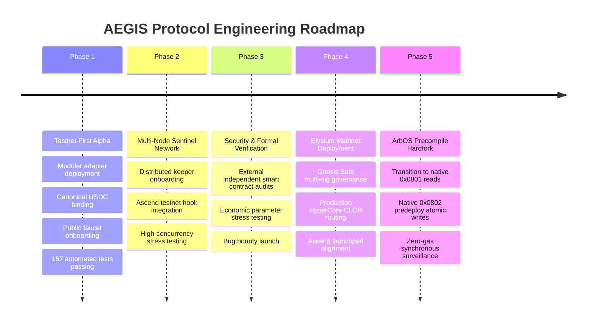

# Introducing AEGIS: Building a Non-Custodial Risk Management Layer for the Elysium Ecosystem

**By the AEGIS Protocol Team &bull; Published October 2026**

---

### Executive Overview

Leverage is among the most powerful economic primitives in decentralized finance, yet it remains fundamentally fragile. Across automated lending markets, decentralized money markets, and leveraged margin protocols, borrowing against digital assets subjects participants to severe liquidation risk. A sharp, transient market drop—often lasting fewer than two minutes—can breach a position's maintenance margin threshold, triggering automated collateral seizures and imposing punitive liquidation penalties ranging between 5% and 15%. 

These forced sales not only inflict permanent capital destruction on borrowers but also introduce cascading selling pressure onto automated market makers, threatening overall protocol solvency.

**AEGIS Protocol** is engineered to resolve this vulnerability. Designed as an autonomous, non-custodial risk-management and automated delta-hedging protocol for the **Elysium** ecosystem, AEGIS monitors leveraged positions continuously and deploys programmatic perpetual hedges directly into the **HyperCore** orderbook when risk thresholds are breached. Rather than forfeiting spot collateral to third-party liquidators, a borrower’s collateral remains secured within their non-custodial vault, downside market exposure is neutralized through short perpetual positions, and when prices rebound, the hedge is systematically unwound to lock in cash gains and restore position health.

This document serves as the official introduction to AEGIS Protocol: its core architecture, cryptographic security foundations, dual-mode execution strategy on Elysium, mathematical fee mechanics, current implementation status, and development roadmap.

---

## 1. The Challenge of Leveraged Positions in Volatile Markets

In any margin-based or collateralized borrowing system, leverage functions as a double-edged sword. When a trader deposits collateral (such as native HYPE or liquid staking derivatives) to borrow a quote asset (such as USDC), their portfolio solvency is governed by their **Loan-to-Value (LTV)** ratio, often expressed through a **Health Factor ($H$)**:

$$H = \frac{\text{Collateral Valuation} \times \text{Liquidation Threshold}}{\text{Total Borrowed Debt}}$$

When asset prices decline, the market valuation of the underlying collateral contracts while the nominal debt liability remains constant. If the Health Factor drops to or below $1.00$ ($100\%$), the position breaches the maintenance margin threshold and becomes eligible for liquidation.

### The Limitations of Manual Risk Monitoring

Historically, decentralized finance has relied on two primary risk mitigation strategies, both of which suffer from severe practical limitations:

1. **Manual Position Management:** Borrowers must manually track their positions around the clock, ready to deposit additional collateral or repay debt during market drawdowns. However, crypto markets operate 24 hours a day with structural volatility. Flash crashes, liquidity wicks, and cascading liquidations frequently occur in intervals spanning seconds or minutes—far faster than a human operator can receive a notification, unlock a hardware wallet, calculate an optimal buffer, and confirm an on-chain transaction.
2. **Aggressive Over-Collateralization:** To protect against liquidation, borrowers are forced to maintain excessively low LTV ratios (often borrowing only 25% to 35% of their deposited collateral value). While this reduces liquidation probability, it imposes immense capital inefficiency, trapping assets that could otherwise be deployed productively.

### The Mechanics and Costs of Forced Liquidation

When manual intervention inevitably fails during high-volatility events, existing protocols resort to **forced liquidation**:
- **Collateral Seizure:** An external searcher or liquidation bot repays a portion of the borrower's debt in exchange for seizing an equivalent amount of collateral, plus an additional **liquidation penalty** (typically 5% to 15%).
- **Market Dumping:** The seized collateral is typically dumped immediately on decentralized exchanges or automated market makers (AMMs) to lock in arbitrage profits. In thin liquidity environments, this dumping induces significant price slippage, depressing local mark prices further and triggering secondary liquidations across unrelated accounts.
- **Permanent Capital Loss:** Because the collateral was sold at the trough of the market, the borrower cannot participate in any subsequent price recovery. The loss is locked in permanently, even if the asset rebounds to its original price minutes later.

### A Concrete Hypothetical Scenario

To illustrate how forced liquidation impacts capital, consider the following hypothetical scenario:
- **Collateral:** 100 HYPE deposited at an initial price of $80.00 USD (Collateral Value: $8,000 USD).
- **Borrowed Debt:** $4,800 USDC (Initial LTV: 60.0%).
- **Liquidation Threshold ($T$):** 80.0% (Maintenance Margin = 125% collateralization).
- **Liquidation Price:**

$$P_{\text{liq}} = \frac{\text{Debt}}{\text{Collateral} \times T} = \frac{\$4,800}{100 \times 0.80} = \$60.00 \text{ USD}$$

Now assume market volatility causes the price of HYPE to drop rapidly by 28%, reaching a trough of **$57.60 USD**:
- At $57.60 USD, the collateral value falls to $5,760 USD.
- The Health Factor drops to:

$$H = \frac{\$5,760 \times 0.80}{\$4,800} = 0.96$$

Under standard liquidation rules with a **5% penalty**, a liquidator repays the $4,800 USDC debt and seizes:

$$\text{Seized Collateral Value} = \$4,800 \times 1.05 = \$5,040 \text{ USD}$$

At $57.60 per token, this equals **87.50 HYPE**. The borrower is left with only 12.50 HYPE ($720 USD). If the price of HYPE subsequently rebounds back to $80.00 USD within thirty minutes, the borrower's remaining assets are worth only $1,000 USD—resulting in a permanent net loss of $2,200 USD compared to their original equity.

### Proactive vs. Reactive Risk Architecture

Liquidations in decentralized finance are structurally reactive: protocols do nothing while risk escalates, stepping in only after an account has failed in order to dismantle it. 

AEGIS is built on an alternative thesis: **risk management should be proactive and dynamic**. By establishing continuous automated surveillance and executing surgical derivative hedges before collateral failure occurs, leveraged positions can be stabilized through volatility wicks, preserving borrower equity and preventing protocol bad debt.

*Important Note: Not every liquidation is avoidable. A position's ultimate outcome depends on prevailing market liquidity, execution latency, extreme price gaps, borrowing rates, slippage, and the operational status of connected exchange venues. AEGIS does not promise immunity from market losses; it provides automated tooling designed to manage downside risk systematically.*

---

## 2. Introducing AEGIS Protocol

**AEGIS Protocol** is an autonomous, non-custodial risk-management and automated delta-hedging layer engineered specifically for decentralized lending and margin positions. 

Rather than taking custody of user assets or waiting for liquidation thresholds to breach, AEGIS allows borrowers to link an automated risk engine to their existing positions. When an adverse price movement threatens account solvency, AEGIS dispatches a short perpetual position sized to neutralize directional exposure. When market conditions stabilize or rebound, the protocol automatically closes the hedge, locks in the realized gains in quote currency, and applies those proceeds toward restoring account margin health.

### Core Concepts Explained

To understand how AEGIS functions, it is helpful to clarify several fundamental primitives:

- **Risk Monitoring:** Continuous, programmatic surveillance of an account’s margin health, evaluating live mark prices, borrowing debt, collateral valuation, and volatility vectors against user-defined risk parameters.
- **Margin Health & Health Factor ($H$):** A standardized numerical ratio indicating how close a position is to liquidation. A Health Factor above $1.00$ is solvent; a Health Factor at or below $1.00$ is eligible for liquidation. AEGIS typically operates within protective defensive bands (e.g., $1.05 \le H \le 1.25$).
- **Delta Hedging:** A financial risk-management technique wherein an investor offsets the directional price risk of an underlying spot asset by establishing an opposing derivative position. If a borrower holds $10$ units of spot collateral and opens a $-10$ unit short perpetual position, the combined portfolio delta is zero: every dollar lost on the spot asset is offset by a dollar gained on the short perpetual.
- **Automated Risk Responses:** Cryptographically authorized executions that open, scale, or adjust protective hedges autonomously when pre-specified conditions (such as a Health Factor breach or price floor trigger) are met, eliminating the latency of human intervention.
- **Trailing Exit Logic:** A dynamic algorithm that tracks the lowest market price observed during a flash crash (the "bottom wick") and calculates an exit target offset by a configurable take-profit percentage ($\tau$). When the market rebounds off its low, the hedge is closed automatically to capture cash gains near the trough.
- **Non-Custodial Execution:** An architecture in which the protocol never takes ownership, custody, or transfer authority over a borrower's deposited collateral. Protective actions are executed exclusively via constrained **session keys** restricted to trade routing.
- **Sentinel Infrastructure:** An off-chain decentralized network of bonded keeper nodes responsible for running the continuous monitoring loop, evaluating risk conditions, and broadcasting cryptographic trade intents to matching engines.

These components do not function as isolated tools; they form a closed, continuous risk-defense loop.

---

## 3. Why AEGIS Is Being Built for the Elysium Ecosystem

Automated high-frequency delta hedging cannot function on standard Layer 1 blockchains or generic rollup networks. A flash crash can unfold within 60 to 90 seconds. On chains characterized by 12-second block times, multi-dollar gas spikes, and mempool congestion, automated defensive transactions inevitably suffer from execution delays, priority fee wars, or frontrunning by MEV searchers. By the time a defensive hedge transaction confirms, the position has already been liquidated.

AEGIS was conceived specifically for **Elysium**, an advanced Layer 2 ecosystem built on Arbitrum Orbit technology and tightly aligned with **HyperCore**, the high-performance Layer 1 Central Limit Order Book (CLOB) engine pioneered by Hyperliquid.

```
+---------------------------------------------------------------------------------------+
|                                    ELYSIUM L2                                         |
|                                                                                       |
|   +-----------------------+     +--------------------------+     +----------------+   |
|   |    AegisVault.sol     |     | AegisSentinelRegistry.sol|     |FeeCollector.sol|   |
|   |  - Position Registry  |     | - Sentinel Node Bonds    |     | - 50% Buyback  |   |
|   |  - Session Key Bounds |     | - Slashing & Operator SLA|     | - 50% Yield    |   |
|   +-----------------------+     +--------------------------+     +----------------+   |
|               |                                                           |           |
|               v                                                           v           |
|   +-----------------------+                                      +----------------+   |
|   | Modular Writer Adapter|                                      | Modular AMM    |   |
|   | (AgentDispatch / 0x0802)                                     | Swap Router    |   |
|   +-----------------------+                                      +----------------+   |
+---------------|-----------------------------------------------------------|-----------+
                |                                                           |
                | Cryptographic Order Lane                                  | Liquidity
                v                                                           v
+---------------------------------------------------------------------------------------+
|                                  HYPERCORE L1                                         |
|                                                                                       |
|   - High-Throughput Matching Engine (<200ms latency)                                  |
|   - Deep Perpetual Liquidity & Deterministic Execution                                |
|   - Native HIP-3 Builder Markets & Spot Assets                                        |
+---------------------------------------------------------------------------------------+
```

### The Architectural Advantages of Elysium

1. **Sub-Second Block Finality:** Elysium provides deterministic, sub-second transaction sequencing. This allows risk monitoring engines to observe state changes and submit defensive orders with minimal latency, keeping pace with institutional market makers.
2. **Predictable Micro-Fee Gas:** Gas fees on Elysium are negligible and predictable. During market-wide panics, defensive transactions are not priced out by predatory Priority Gas Auctions. Sentinel nodes can execute precision hedge sizing without incurring prohibitive operational costs.
3. **Connectivity to HyperCore Liquidity:** HyperCore processes tens of thousands of orders per second on a fully decentralized orderbook with deep institutional liquidity. Rather than routing hedges through automated market makers—which suffer from severe price impact and impermanent loss during panics—AEGIS routes protective orders into a high-liquidity central orderbook.
4. **Ascend Launchpad Synergy:** Elysium serves as the foundation for the **Ascend** launchpad and decentralized financial primitives. AEGIS is designed to provide risk management infrastructure across Ascend hook pools and derivative markets, anchoring protocol fee routing to organic ecosystem trading volume.

*Clarity on Status: AEGIS Protocol is an independent open-source infrastructure effort designed for the Elysium ecosystem. AEGIS is not officially endorsed by, operated by, or partnered with Kinetiq, Elysium, or HyperCore. All protocol interactions rely on open technical specifications and decentralized interfaces.*

---

## 4. How AEGIS Works: Step-by-Step

The lifecycle of position protection within AEGIS operates across seven distinct phases, engineered to balance rapid defensive response with non-custodial safety:

```mermaid
sequenceDiagram
    autonumber
    actor User as Position Owner
    participant Vault as AegisVault.sol
    participant Sentinel as Sentinel Keeper Node
    participant Oracle as Price Oracle Adapter
    participant Writer as Trade Writer Adapter
    participant CLOB as HyperCore CLOB

    User->>Vault: 1. Register Position & Delegate Session Key
    loop Continuous Block Surveillance
        Sentinel->>Oracle: 2. Query Mark Price & Orderbook Depth
        Sentinel->>Vault: 3. Evaluate Position Health Factor (H)
    end
    Note over Sentinel,Vault: Trigger Breached (e.g. H <= 1.15)
    Sentinel->>Vault: 4. Submit Signed EIP-712 Hedge Intent
    Vault->>Writer: Verify Invariants (INV-1, INV-5) & Dispatch Order
    Writer->>CLOB: Execute Short Perpetual Hedge
    CLOB-->>Vault: Confirm Hedge Execution & Track Lowest Wick
    Note over Sentinel,CLOB: Market Trough Reached; Price Rebounds
    Sentinel->>Vault: 5. Submit Signed EIP-712 Unwind Intent
    Vault->>Writer: Verify Trailing Target (P_exit) & Close Short
    Writer->>CLOB: Execute Buy-to-Close Order
    Vault->>Vault: 6. Realize Profit, Repay Debt & Record Fees
    Note over Vault: If Fee Collection Fails, Accrue Fee Debt
    Sentinel->>Vault: 7. Validate Sentinel Uptime & SLA Performance
```

### Step 1: Position Registration and Permission Delegation
The user registers their collateralized borrowing position with `AegisVault.sol`. The registration records the collateral asset, deposited quantity, borrowed quote debt, and the position's liquidation threshold ($T$). Concurrently, the user authorizes a restricted **session key** with a defined expiry timestamp (e.g., 7 days). Under protocol invariant **INV-1**, this session key is cryptographically restricted to dispatching trade orders and cannot withdraw, transfer, or encumber the underlying collateral.

### Step 2: Continuous Market Surveillance
The off-chain Sentinel keeper network monitors live market conditions across every registered vault. The telemetry engine observes the perpetual contract mark price, index price, and orderbook depth (both bids and asks). On Elysium, this surveillance occurs synchronously on every block.

### Step 3: Risk Assessment and Health Evaluation
The Sentinel risk engine recalculates the Health Factor of each monitored position upon every price update. The user configures one of three defensive trigger modes:
- **Price Mode:** Protects against absolute market levels (e.g., hedge if HYPE falls below $65.00).
- **Health Factor Mode:** Protects against margin degradation (e.g., hedge if $H \le 1.15$).
- **Hybrid Mode:** Evaluates both criteria, triggering defense if either threshold is breached.

### Step 4: Protective Delta-Hedge Execution
When a protective threshold is breached, the Sentinel calculates the optimal hedge quantity ($Q_{\text{hedge}}$) based on the user's configured hedge coverage ratio (from partial hedging at 50% to full delta-neutrality at 100%). The Sentinel signs an EIP-712 structured trade intent using the delegated session key and broadcasts it to `AegisVault.sol`. The contract verifies the signature against the active session key, consumes a strictly monotonic nonce (**INV-5**), and dispatches a short perpetual order through the writer adapter into HyperCore.

### Step 5: Trailing Exit Management and Market Rebound
Once the short hedge is active, the vault transitions to tracking the market trough. As the price falls, the contract's lowest observed price ($P_{\text{lowest}}$) ratchets downward. The dynamic take-profit exit price is continuously updated according to the user's trailing take-profit parameter ($\tau$):

$$P_{\text{exit}} = P_{\text{lowest}} \times (1 + \tau)$$

When market panic subsides and the price rebounds by $\tau$ (e.g., 1.5%), the Sentinel signs and executes an unwind intent. The short perpetual position is bought to close, realizing cash profit in USDC from the decline.

### Step 6: Fee Accounting and Deferred Fee Debt Handling
When the hedge is unwound, the protocol calculates an avoided liquidation penalty fee. By default, 90% of net trading proceeds are credited toward stabilizing the user's vault debt. The remaining 10% performance fee is processed through `AegisFeeCollector.sol`. If fee collection cannot be completed immediately (for example, if liquid USDC allowance is unavailable), the protocol does not revert the safety-critical unwind; instead, it accrues the balance under a **deferred fee debt** mechanism (`feeDebts`), allowing the protective trade to settle while recording the protocol obligation.

### Step 7: Sentinel Operator Accountability
Throughout the surveillance and execution lifecycle, Sentinel node activity is cross-referenced by the on-chain `AegisSentinelRegistry.sol`. Operators maintain bonded stakes in $AEGIS tokens. If a Sentinel attempts unauthorized order routing, violates price slippage constraints, or fails operational SLAs, their staked bond is subject to on-chain slashing.

---

## 5. Non-Custodial Automation and User Control

A core architectural principle of AEGIS is that **automated risk management must never compromise asset custody**. In traditional centralized lending or managed accounts, users surrender their private keys or transfer assets to third-party smart contracts with broad transfer authorities. If the contract is exploited, user principal is lost.

AEGIS enforces non-custodial boundaries mathematically through **Formal Protocol Invariants**, validated through extensive property-based invariant testing:

```
+---------------------------------------------------------------------------------------+
|                               FORMAL SECURITY INVARIANTS                              |
+=======================================================================================+
| Invariant | Property Name                  | Operational Guarantee                    |
|-----------+--------------------------------+------------------------------------------|
|   INV-1   | Strict Non-Custodial Bounds    | Session keys are restricted exclusively  |
|           |                                | to trade routing. Zero transfer or       |
|           |                                | withdrawal authority over collateral.    |
|-----------+--------------------------------+------------------------------------------|
|   INV-2   | Monotonic Health Restoration   | Successful hedge unwind must strictly    |
|           |                                | improve or maintain margin health.       |
|-----------+--------------------------------+------------------------------------------|
|   INV-3   | Immediate Manual Override      | Single-transaction user killswitch       |
|           |                                | immediately revokes Sentinel permissions.|
|-----------+--------------------------------+------------------------------------------|
|   INV-4   | Strict Fee Conservation        | Protocol fees must conserve exactly 100% |
|           |                                | across 50/50 buyback and yield split.    |
|-----------+--------------------------------+------------------------------------------|
|   INV-5   | Cryptographic Anti-Replay      | Monotonically incrementing nonces        |
|           |                                | eliminate cross-block replay attacks.    |
+---------------------------------------------------------------------------------------+
```

### The Invariant INV-1 Standard

Under **Invariant INV-1**, `AegisVault.sol` segregates trade execution authority from fund movement authority. The session key authorized by a borrower has permission only to interact with the trade writer adapter interface. It contains no programmatic capability to:
- Call `transfer()`, `transferFrom()`, or `approve()` on collateral tokens.
- Withdraw collateral assets from the vault.
- Redirect liquidated proceeds to an external wallet.

Any transaction attempting an unauthorized fund transfer reverts atomically at the EVM bytecode level.

### User Autonomy via Invariant INV-3 (Manual Override)

Borrowers always retain ultimate authority over their positions. If a user wishes to manage their position manually, close their loan, or disconnect from automated surveillance, they can invoke `manualOverride()` on `AegisVault.sol` at any time. 

Under **Invariant INV-3**, activating the manual override:
1. Instantly revokes the active session key.
2. Prevents any Sentinel node from dispatching subsequent hedge orders.
3. Leaves all deposited collateral untouched and fully accessible to the user.

### Transparent Risk Disclosures

Non-custodial architecture significantly mitigates operational and counterparty risks, but it does not eliminate all risk vectors. Users evaluating AEGIS must consider the following systemic realities:
- **Smart Contract Vulnerabilities:** Despite rigorous fuzzing and invariant testing, smart contracts may harbor undiscovered software defects.
- **Oracle Staleness & Latency:** If external price feeds lag during extreme market dislocations, defensive hedge orders may be sized sub-optimally.
- **Orderbook Liquidity Gaps:** If the connected perpetual orderbook experiences a complete liquidity vacuum, hedge orders may encounter high slippage.
- **Execution Venue Risk:** If the underlying L1 matching engine halts or experiences connectivity failures, hedges cannot settle.

---

## 6. The Sentinel Network and Operator Accountability

Automated protocols cannot rely on altruistic execution; they require robust, economically aligned infrastructure. In the AEGIS architecture, the **Sentinel Network** operates as the decentralized execution layer responsible for off-chain calculation and timely on-chain dispatch.

### Operator Responsibilities

Sentinel operators run the `@aegis/sentinel` software daemon, which performs three core functions:
1. **High-Frequency Telemetry:** Subscribes to the Elysium block stream and HyperCore market data feeds, maintaining real-time orderbook pricing state.
2. **Deterministic Risk Evaluation:** Runs the mathematical risk engine across all active registered vaults, checking for Health Factor and price trigger breaches.
3. **Intent Generation and Dispatch:** Signs EIP-712 structured trade intents and submits them to `AegisVault.sol` or the trade writer adapter.

### Economic Bonding and Sybil Resistance

To prevent spam, griefing, and malicious transaction frontrunning, Sentinel nodes must register with `AegisSentinelRegistry.sol` and deposit a mandatory security bond:
- **Minimum Bond:** **25,000 $AEGIS tokens** must be staked to activate an operator account.
- **Active Status Check:** `AegisVault.sol` queries the registry prior to accepting hedge executions. Unregistered or under-bonded nodes are rejected automatically.

### Slashing and Unbonding Safeguards

Operator accountability is enforced through programmatic slashing:
- **Slashing Threshold:** Capped at **10% (1,000 basis points)** of an operator’s active bond per verified infraction.
- **Slashing Conditions:** Infractions include attempting to execute orders outside user-configured slippage bounds, executing hedges when triggers have not been breached, or broadcasting malformed data.
- **Unbonding Delay:** Operators wishing to withdraw their staked bond must initiate a **7-day cooldown (604,800 seconds)**. This unbonding delay ensures that an operator cannot commit an execution infraction and immediately withdraw their capital before slashing can be applied.

---

## 7. Protocol Fee Mechanics and Token Utility

AEGIS aligns protocol revenue directly with borrower success. Unlike legacy lending platforms that impose punitive fees on distressed users, AEGIS generates protocol revenue exclusively when a position successfully averts liquidation through an automated hedge and rebound.

### The Averted Liquidation Penalty Model

When a traditional position is liquidated, the protocol or third-party liquidator imposes a standard penalty (typically 5% of collateral value). AEGIS uses this industry standard as its benchmark:
- **Reference Liquidation Penalty:** Assumed at **5.0%** of the applicable collateral valuation.
- **Protocol Performance Fee:** AEGIS assesses a fee equal to **10.0% of the avoided penalty** (equivalent to 0.50% of collateral valuation).

$$\text{Saved Penalty} = \text{Collateral Valuation} \times 5.0\%$$

$$\text{Protocol Fee} = \text{Saved Penalty} \times 10.0\% = \text{Collateral Valuation} \times 0.50\%$$

### Concrete Fee Calculation Example

To illustrate the documented fee formula, consider a protected position with an applicable collateral valuation of **$10,000 USD** at the time of hedge unwind:
- **Illustrative Avoided Penalty (at 5%):** $\$10,000 \times 0.05 = \$500 \text{ USD}$.
- **Illustrative Protocol Fee (at 10% of avoided penalty):** $\$500 \times 0.10 = \$50 \text{ USD}$.
- **Net Borrower Benefit:** Rather than losing $500 in liquidated collateral, the borrower incurs a $50 protocol fee while retaining their principal.

*(Note: This calculation represents an illustrative walkthrough of the documented fee formula under assumed parameters. It is not a guarantee of realized savings in any live market condition.)*

### Programmatic Fee Allocation (Invariant INV-4)

Under **Invariant INV-4**, every unit of protocol fee collected by `AegisFeeCollector.sol` is programmatically allocated through a **50/50 split**:

```
                                  PROTOCOL FEE ($50.00 USDC)
                                               |
                       +-----------------------+-----------------------+
                       |                                               |
                       v                                               v
               50% BUYBACK & BURN                              50% STAKER YIELD
                 ($25.00 USDC)                                   ($25.00 USDC)
                       |                                               |
                       v                                               v
            Swap Router / AMM Pool                           USDC Distribution
          Market-buys $AEGIS tokens                      Distributed to active bonded
           and burns permanently to                         Sentinel node operators
           0x000...dead address                             and governance stakers
```

1. **50% Buyback and Burn Budget:** 50% of collected fees are routed through an AMM swap router to purchase $AEGIS tokens from the open market, permanently burning them to `0x000000000000000000000000000000000000dEaD`. This establishes a deflationary relationship between protocol risk activity and token supply.
2. **50% Real Yield Distribution Budget:** The remaining 50% of collected fees is retained in stable quote currency (USDC) and distributed as real staking yield to bonded Sentinel node operators and governance participants who provide operational security to the network.

### The Deferred Fee Debt Mechanism

In volatile conditions, a borrower's liquid USDC balance may be insufficient to pay the protocol fee immediately upon hedge unwind. In naive designs, the contract would revert the unwind transaction, leaving the protective hedge open and exposing the user to renewed market risk.

AEGIS implements a dedicated **Deferred Fee Debt** mechanism (`feeDebts`):
- If `processAvertedFee()` fails during hedge unwind, the contract catches the failure and records the owed fee under `feeDebts[vaultOwner]`.
- The protective unwind proceeds to completion without obstruction.
- The outstanding debt can be settled at any time by the borrower using `repayFeeDebt()` or by a third party using `repayFeeDebtFor()`.

### The Utility of the $AEGIS Token

The $AEGIS token is designed to fulfill three primary utilities within the protocol:
- **Sentinel Node Bonding:** Staking requirement (minimum 25,000 $AEGIS) required to operate a Sentinel keeper and earn execution rewards.
- **Deflationary Value Capture:** Direct beneficiary of the 50% programmatic buyback-and-burn mechanism funded by avoided liquidation fees.
- **Protocol Governance:** Future voting authority over risk parameters, supported collateral assets, default liquidation thresholds, and adapter routing configurations.

*Regulatory & Economic Boundaries: The $AEGIS token represents a functional utility and governance asset for protocol operations. The token design does not promise passive investment yields, fixed APYs, or speculative price returns. All staking rewards reflect programmatic distributions derived from verifiable protocol fee activity.*

---

## 8. Where AEGIS Stands Today

A credible technical introduction must clearly distinguish between software that has been implemented and tested, contracts deployed to testnet, and technical capabilities that remain dependent on external infrastructure.

```
+---------------------------------------------------------------------------------------+
|                               TECHNICAL STATUS MATRIX                                 |
+=======================================================================================+
| Category               | Component / Feature             | Status                     |
|------------------------+---------------------------------+----------------------------|
| Built & Verified       | Core Contracts (Vault, Registry,| COMPLETE                   |
|                        | FeeCollector, Adapters)         | (115 Foundry tests pass)   |
|                        | Formal Invariants INV-1 to INV-5| COMPLETE (160k+ fuzz runs) |
|                        | Deferred Fee Debt Mechanism     | COMPLETE (Phase 1C live)   |
|                        | Sentinel Keeper Daemon          | COMPLETE (29 Jest tests)   |
|                        | Frontend Truthfulness & Poller  | COMPLETE (13 tests pass)   |
|------------------------+---------------------------------+----------------------------|
| Deployed on Testnet    | Modular Testnet Deployment      | DEPLOYED                   |
|                        | Canonical Testnet USDC Binding  | DEPLOYED (0x7D29...47b2)   |
|                        | Testnet Faucet Onboarding Flow  | LIVE & VERIFIED            |
|------------------------+---------------------------------+----------------------------|
| Upstream Dependencies  | Native Precompiles 0x0801/0x0802| PENDING ARBOS HARDFORK     |
|                        |                                 | (Operates via Modular lane)|
|                        | Ascend Closed Hook Pools        | PENDING UPSTREAM CONTRACTS |
|                        | Multi-Sig Production Governance | PLANNED (Pre-Mainnet)      |
+---------------------------------------------------------------------------------------+
```

### 1. Built and Locally Tested

The core software architecture of AEGIS has been implemented and validated across three rigorous testing tiers:
- **Foundry Smart Contract Test Suite:** **14 test suites, 115 tests passing, 0 failures**. Includes comprehensive unit tests, fuzz tests, and formal verification of invariants INV-1 through INV-5 across 32,768 call sequences per suite.
- **Sentinel Keeper Test Suite:** **5 Jest test suites, 29 tests passing, 0 failures**. Validates fail-closed oracle handling, EIP-712 session-key signing, risk engine math, trailing exit ratchet tracking, and testnet dual-mode configuration.
- **Frontend Truthfulness Test Suite:** **6 verification suites, 13 tests passing, 0 failures**. Confirms accurate on-chain telemetry, graceful RPC failure modes, truthful display of deferred fee debt, and elimination of unverified marketing claims.
- **Total Repository Tally:** **157 verified tests passing with a 100% pass rate**.

### 2. Deployed on Elysium Testnet

AEGIS contracts are deployed on the **Elysium Orbit L2 Testnet (Chain ID `99801`)**:
- Connected to official JSON-RPC: `https://testnet-rpc.elysium.kinetiq.xyz`.
- Bound to **Canonical Elysium Testnet USDC** (`0x7D29d8047B905000459c0E80c34a26CeedcB47b2`) with verified 6-decimal accounting.
- Bound to **Canonical Wrapped HYPE (WHYPE)** (`0xCD57F65c2B0e5881CFC2E609F7CD53b746E1F234`) with 18-decimal accounting.
- Verified testnet faucet onboarding flow: External testers can claim testnet HYPE from the [Elysium Testnet Faucet](https://elysium.kinetiq.xyz/testnet-faucet) to pay transaction gas and deposit into AEGIS test vaults.

### 3. Integration Dependencies and Upstream Realities

Transparency requires acknowledging technical dependencies that cannot be resolved within the AEGIS codebase alone:

- **Elysium Native Precompiles (`0x0801` and `0x0802`):** Official documentation from Kinetiq establishes that stock Arbitrum Orbit rollups do not natively expose precompiles `0x0801` (market data) and `0x0802` (`ElysiumCoreWriter`). These interfaces are scheduled to be integrated into Elysium validator nodes via a network hardfork approximately four weeks following mainnet launch.
  - *Current Operational Solution:* AEGIS utilizes a **Modular Dual-Mode Architecture**. On testnet and Day 1 mainnet, the protocol runs in `HYPERCORE_AGENT` mode: prices are supplied via [RelayedOracleAdapter.sol](file:///c:/Users/ascend%20X%20elysium/contracts/adapters/RelayedOracleAdapter.sol) with strict 120-second staleness bounds, and trade orders dispatch via [AgentDispatchAdapter.sol](file:///c:/Users/ascend%20X%20elysium/contracts/adapters/AgentDispatchAdapter.sol) through an authorized off-chain API lane. When the ArbOS hardfork activates, the protocol transitions seamlessly to `ON_CHAIN_PRECOMPILE` mode without requiring architectural refactoring.
- **Ascend Launchpad Hook Pools:** Ascend’s closed hook pools are in active upstream development. While the AEGIS fee collector utilizes a modular AMM router interface, end-to-end integration with live Ascend hook pools will occur as Ascend deploys its production testnet contracts.

---

## 9. Roadmap: The Path to Mainnet Readiness

The development of AEGIS follows a phased, milestone-driven progression focused on security, testnet validation, and progressive decentralization:



### Phase 1: Testnet-First Alpha (Current Milestone)
- Deployment of modular architecture (`RelayedOracleAdapter`, `AgentDispatchAdapter`) on Elysium Testnet (Chain ID `99801`).
- Binding to canonical testnet USDC (`0x7D29...47b2`) and native HYPE faucet integration.
- Public web terminal access with truthful RPC latency and verified account balance polling.
- Full verification of Phase 1C deferred fee debt mechanics.

### Phase 2: Multi-Node Sentinel Decentralization
- Open onboarding for independent Sentinel node operators with testnet $AEGIS staking.
- Integration with live Ascend testnet AMM pools for automated buyback-and-burn routing.
- High-concurrency volatility simulations testing multi-keeper dispatch and intent deduplication under load.

### Phase 3: Comprehensive Security Auditing & Formal Verification
- Independent security reviews of all smart contracts (`AegisVault.sol`, `AegisFeeCollector.sol`, `AegisSentinelRegistry.sol`, adapters).
- Quantitative economic simulation of trailing exit buffers ($\tau$) and liquidation penalty ratios across historical flash crash datasets.
- Launch of a community bug bounty program for contract and keeper security.

### Phase 4: Elysium Mainnet Deployment
- Multi-signature governance deployment using Gnosis Safe with timelock controls.
- Deployment of production vault contracts bound to canonical mainnet collateral and debt assets.
- Production keeper daemon deployment with live HyperCore CLOB order routing.

### Phase 5: Post-Mainnet ArbOS Upgrade Migration
- Transition from `HYPERCORE_AGENT` modular adapters to native `0x0801` and `0x0802` precompiles following Elysium's planned ArbOS network hardfork.
- Activation of sub-78ms synchronous oracle reads and zero-gas validator-level order execution.

---

## 10. The Long-Term Vision

The long-term vision of AEGIS extends beyond individual vault hedging: it is to establish a **standardized, autonomous risk layer for decentralized finance**.

In traditional financial markets, clearing houses and prime brokers do not manage margin through sudden, catastrophic liquidations; they use continuous, automated portfolio hedging, cross-margining, and algorithmic delta rebalancing. Decentralized finance has lagged behind this standard because underlying blockchains historically lacked the throughput, finality, and orderbook connectivity required to execute automated risk management.

By combining Elysium’s sub-second block environment with HyperCore’s deep institutional orderbook liquidity, AEGIS demonstrates that autonomous, non-custodial risk defense is possible on-chain. Over the long term, this infrastructure allows:
- **Higher Capital Efficiency:** Lending protocols can safely support higher borrowing LTVs (75% to 85%) knowing that positions are dynamically defended before insolvency.
- **Protection for Long-Term Holders:** Stakers and long-term ecosystem participants can borrow against their assets to access liquidity without the constant fear of overnight liquidation wicks.
- **Ecosystem Solvency:** By reducing forced liquidations and cascading AMM sell pressure, entire DeFi ecosystems become more structurally resilient to macroeconomic volatility.

---

## 11. Conclusion

For years, decentralized borrowing has operated under a flawed compromise: accept capital inefficiency through heavy over-collateralization, or accept the constant risk of punitive liquidation. 

AEGIS Protocol provides a path forward. Through cryptographic session-key delegation, formal invariant guarantees, responsive Sentinel surveillance, and deep orderbook integration on Elysium and HyperCore, AEGIS transforms risk management from a destructive, reactive liquidation event into an autonomous, protective financial safeguard.

We invite developers, node operators, quantitative researchers, and the Elysium community to explore our open-source codebase, inspect our verification documentation, and join us in building the autonomous risk layer of Web3.

---

## Frequently Asked Questions (FAQ)

#### What is AEGIS?
AEGIS is an autonomous, non-custodial risk-management and automated delta-hedging protocol designed for the Elysium ecosystem. It continuously monitors leveraged borrowing positions and executes protective perpetual hedges on HyperCore when margin thresholds are breached, preventing forced collateral liquidations.

#### Is AEGIS live on Elysium testnet?
Yes. AEGIS contracts are deployed on the Elysium Orbit L2 Testnet (`Chain ID 99801`), bound to canonical testnet USDC (`0x7D29d8047B905000459c0E80c34a26CeedcB47b2`) and native testnet HYPE. External users can acquire testnet tokens from the official Elysium Faucet to test vault registration and risk surveillance end-to-end.

#### Does AEGIS guarantee protection against liquidation?
No protocol can guarantee complete immunity from liquidation. While AEGIS is engineered to neutralize downside risk through delta hedging, outcomes depend on real-world market factors including execution latency, orderbook depth, funding rates, extreme price gaps, and network connectivity. AEGIS provides automated risk management tools, not an insurance guarantee.

#### Does AEGIS take custody of user funds?
No. AEGIS is strictly non-custodial. Under protocol invariant **INV-1**, delegated session keys are cryptographically restricted to trade routing. Sentinel nodes have zero authority to withdraw, transfer, or move user collateral. Users retain full ownership of their assets and can revoke Sentinel permissions instantly via the `manualOverride()` killswitch (**INV-3**).

#### What is the role of Sentinel operators?
Sentinel operators run decentralized off-chain keeper daemons that monitor vault health factors against live market telemetry. When a risk trigger is breached, Sentinels sign and broadcast EIP-712 trade intents. To ensure accountability, operators must stake a minimum bond of 25,000 $AEGIS tokens, which is subject to a 10% on-chain slash if operational or slippage rules are violated.

#### How is the protocol intended to generate and allocate fees?
AEGIS charges a performance fee only when a position successfully averts liquidation, calculated as 10% of an assumed 5% avoided liquidation penalty (equal to 0.50% of collateral value). Under **INV-4**, collected fees are programmatically divided 50/50: 50% is routed to market-buy and permanently burn $AEGIS tokens, and 50% is distributed as USDC real yield to active bonded Sentinel stakers. If immediate fee payment fails, the fee is recorded as deferred fee debt without interrupting the protective unwind.

#### What must happen before mainnet deployment?
Prior to mainnet launch, AEGIS will complete multi-node decentralized keeper trials, integrate with live Ascend AMM hook pools, undergo comprehensive third-party smart contract audits, and establish Gnosis Safe multi-signature governance with timelock controls. Following mainnet launch, a planned ArbOS hardfork will enable native validator-level precompiles (`0x0801` and `0x0802`).

---

## Verified Official Resources & Links

- **Official Web Terminal:** [https://aegis.terminall.workers.dev/](https://aegis.terminall.workers.dev/)
- **Technical Documentation Portal:** [https://aegis.terminall.workers.dev/docs/](https://aegis.terminall.workers.dev/docs/)
- **GitHub Open-Source Repository:** [https://github.com/youngcrypton/Aegis](https://github.com/youngcrypton/Aegis)
- **Elysium L2 Testnet Explorer:** [https://elysium.kinetiq.xyz/testnet-explorer](https://elysium.kinetiq.xyz/testnet-explorer)
- **Official Elysium Testnet Faucet:** [https://elysium.kinetiq.xyz/testnet-faucet](https://elysium.kinetiq.xyz/testnet-faucet)
- **Official X (Twitter) Channel:** [@aegis_hedge](https://x.com/aegis_hedge?s=20)
