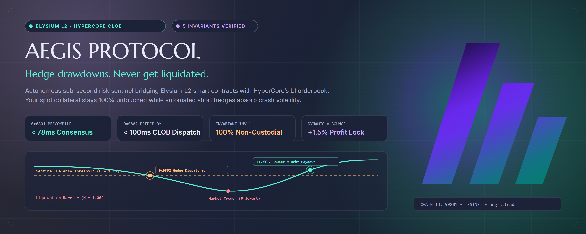

# Protocol Overview

<figure><figcaption>
Aegis: Autonomous sub-second risk engine bridging Elysium Orbit L2 smart contracts with HyperCore CLOB.
</figcaption></figure>

[-5FD9BE?style=flat-square\&logo=ethereum\&logoColor=white)](https://testnet.elysiumscan.org)  [-07705F?style=flat-square\&logo=foundry)](https://github.com/youngcrypton/Aegis) 

***

## Welcome to the AEGIS Protocol Documentation

**AEGIS** is an autonomous, non-custodial risk engine and synthetic delta-hedging protocol designed for the Elysium Orbit L2 ecosystem and HyperCore (Hyperliquid's L1 high-performance CLOB). Rather than liquidating spot collateral, AEGIS dynamically neutralizes directional downside exposure ($\Delta$) by dispatching counterbalancing short perpetual futures contracts on HyperCore before liquidation thresholds are breached.

### Core Documentation Resources

* [**Introducing AEGIS**](introducing_aegis.md)\
  The definitive introductory article covering protocol mechanics, liquidation mitigation, and zero-custody delegation.
* [**Elysium Ecosystem Integration**](elysium_article.md)\
  Deep dive into Elysium Orbit L2 architecture, precompiles `0x0801`/`0x0802`, and the Kinetiq testnet deployment.
* [**Fact-Check & Verification Dossier**](fact_check_and_verification_dossier.md)\
  Rigorous on-chain and mathematical proof catalog verifying all protocol claims and engineering benchmarks.
* [**Editorial Fact-Check Report**](editorial_fact_check_report.md)\
  Institutional verification report across code audits, math models, and upstream dependencies.
* [**Lightpaper Mirror**](aegis_lightpaper.md)\
  Markdown mirror of the official eight-chapter AEGIS Lightpaper.
* [**Publication Metadata**](publication_metadata.md)\
  Social distribution copy, SEO tags, announcement threads, and community launch assets.
