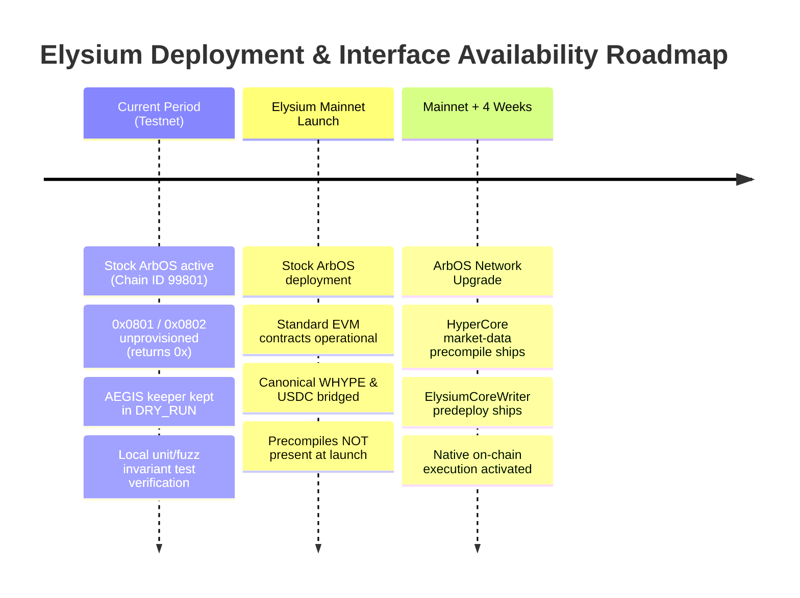

# AEGIS Protocol — Elysium & Kinetiq Core Engineering Verification Report

**Document Version**: 1.0.0  
**Date**: October 14, 2026  
**Auditor / Engineering Role**: Senior Web3 Protocol Architect, Solidity Security Auditor  
**Primary Source Material**: Official Elysium / Kinetiq Core Engineering Documentation:
- `https://elysium.kinetiq.xyz/docs/building-on-elysium` (Last updated: Oct 13, 2026)
- `https://elysium.kinetiq.xyz/docs/chain-specifications` (Last updated: Sep 22, 2026)
- `https://elysium.kinetiq.xyz/docs/hypercore-market-data` (Last updated: Sep 22, 2026)
- `https://elysium.kinetiq.xyz/docs/trading-on-hypercore-from-elysium` (Last updated: Sep 22, 2026)
- `https://elysium.kinetiq.xyz/testnet-explorer` (Live Network Verification)

---

## Executive Summary

Direct verification of the official documentation provided by the Elysium / Kinetiq Core Engineering Team yields five definitive findings that fundamentally resolve the protocol architecture questions raised during Phase 2.1 through Phase 2.3:

1. **Precompile & Predeploy Release Timeline (THE Core Blocker Resolved)**:
   - **Authoritative Fact**: The HyperCore market-data read precompile and the `ElysiumCoreWriter` predeploy **do not exist on stock ArbOS**. Elysium launches on stock ArbOS without them.
   - **Upgrade Schedule**: Both interfaces arrive through an ArbOS network upgrade **approximately four weeks after mainnet launch**.
   - **Direct Consequence for AEGIS**: Live testnet execution via native EVM addresses `0x0801` and `0x0802` is **impossible today on testnet** and **will not be available on Day 1 of Mainnet**. AEGIS must either execute orders off-chain via HyperCore API agents or wait for the 4-week post-mainnet upgrade.

2. **HyperCore Trading & Non-Custodial Security Alignment**:
   - Trading on HyperCore from Elysium executes via a **trade-only API agent on the user's own HyperCore account**.
   - **Protocol Enforcement**: HyperCore itself enforces that API agents can only place and cancel orders—they **can never withdraw or transfer funds**.
   - **AEGIS Invariant Validation**: This natively verifies and reinforces AEGIS Invariant `INV-1` (Non-Custodial Invariant). Custody never moves to Elysium, Kinetiq, or the AEGIS keeper.

3. **HyperCore Market Data Architecture**:
   - Elysium co-locates an internal Hyperliquid node with the sequencer.
   - Data is served at HyperCore block cadence (~70 ms) with EVM freshness of ~150–350 ms.
   - All precompile responses are **stamped with the HyperCore block height and timestamp**, and fail visibly stale rather than returning silent zeroes.

4. **Chain Specifications & Performance**:
   - Stack: Arbitrum Orbit (Nitro / ArbOS), operated with Conduit, settling to HyperEVM (`Chain ID 999` mainnet, `Chain ID 998` testnet).
   - Blocks: Real canonical blocks produced at **100–200 ms** (not preconfirmations), with ~300 ms perceived receipt.
   - Gas Token: **Native HYPE** (`msg.value`), bridged 1:1 from HyperEVM.
   - Data Availability: AnyTrust Data Availability Committee (DAC) posting ~100-byte certificates, keeping fees negligible.
   - Mempool: Single sequencer with neutral priority fee ordering; **no public mempool**.

5. **Canonical Testnet Tokens Identified**:
   - Canonical Bridged Testnet USDC: `0x7D29d8047B905000459c0E80c34a26CeedcB47b2` (differs from AEGIS's local `MockERC20` at `0x712516...`).
   - Canonical Bridged Testnet WHYPE: `0xCD57F65c2B0e5881CFC2E609F7CD53b746E1F234`.
   - Canonical Multicall3: `0xcA11bde05977b3631167028862bE2a173976CA11`.
   - Canonical Gateway Router: `0x89659883a9d980925733B0A698F117AAb65ac718`.

---

## 1. Upstream Roadmap & Precompile Release Timeline

### 1.1 Verbatim Document Evidence
From `docs/building-on-elysium`:
> *"Nothing Elysium-specific is required to deploy or run a contract. The Elysium-specific surfaces are opt-in capabilities:*
> *- the HyperCore market-data precompile, for reading live HyperCore state;*
> *- the ElysiumCoreWriter predeploy, for trading on HyperCore from Elysium.*
> ***Both arrive through an ArbOS network upgrade about four weeks after mainnet.***"

From `docs/hypercore-market-data`:
> *"The read precompile ships in an ArbOS network upgrade about four weeks after mainnet. Elysium launches on stock ArbOS without it."*

From `docs/trading-on-hypercore-from-elysium`:
> *"The keeper lane and the ElysiumCoreWriter predeploy ship in an ArbOS network upgrade about four weeks after mainnet."*

### 1.2 Architectural Impact Assessment



- **Status Classification**: **BLOCKED (On Upstream ArbOS Hardfork)**
- **Why Calls Revert on Testnet**:
  Elysium runs stock ArbOS. In stock ArbOS, addresses `0x0000...0801` and `0x0000...0802` have no code and no precompile hook. Standard EVM rules return empty bytes (`0x`), which causes Solidity `abi.decode` to revert with `PrecompileReadFailed` or empty data decode failure.
- **Strategic Implications for AEGIS Protocol**:
  1. AEGIS **cannot** test native EVM precompiles on Elysium Testnet today because they have not been coded into the deployed ArbOS version.
  2. AEGIS **cannot** launch Day 1 of Elysium Mainnet with contracts that require `0x0801` or `0x0802`.
  3. AEGIS has two viable deployment strategies:
     - **Strategy A (Off-Chain Agent Execution / Immediate Day 1 Launch)**: The AEGIS Sentinel keeper uses Kinetiq's / Hyperliquid's off-chain API agent signing lane to execute user hedges directly on HyperCore. The smart contracts manage vaults, session keys, and fee debt on stock ArbOS, while trade dispatch occurs via signed agent intents off-chain.
     - **Strategy B (Precompile Alignment / Post-Upgrade Launch)**: AEGIS launches on Elysium Mainnet ~4 weeks post-launch in lockstep with the ArbOS upgrade.

---

## 2. HyperCore Market Data Architecture

### 2.1 Verbatim Document Evidence
From `docs/hypercore-market-data`:
> *"Elysium serves live HyperCore state to every contract through a chain-native precompile. Orderbooks, prices, balances, and positions are simply there to read, for ordinary call gas, with no oracle contracts, relay hops, or per-update push costs...*
> *Elysium runs its own Hyperliquid node, co-located with the chain, and serves HyperCore state from inside the execution layer...*
> *Every response is stamped with the HyperCore block height and timestamp it was derived from. Contracts should enforce their own freshness bounds against those values. If the data path falls behind, reads fail visibly stale rather than silently wrong."*

### 2.2 Feature Comparison

| Attribute | AEGIS Codebase Assumption | Elysium Production Specification |
| :--- | :--- | :--- |
| **Data Provider** | Precompile at `0x0801` | Precompile co-located with Hyperliquid node (ArbOS upgrade) |
| **Latency / Cadence** | Unspecified | ~70 ms HyperCore block granularity; ~150–350 ms EVM freshness |
| **Gas Model** | Call gas | Proportional to requested depth; no storage writes or push fees |
| **Available Data** | Mark price only | BBO, full book depth, oracle/mark/spot prices, account balances/positions, flow imbalance, slippage |
| **Freshness Metadata** | None (assumed immediate) | Explicit HyperCore block height and timestamp header |
| **Failure Mode** | Returns 0 or reverts | Fails visibly stale rather than silently wrong |

---

## 3. Trading on HyperCore from Elysium

### 3.1 Verbatim Document Evidence
From `docs/trading-on-hypercore-from-elysium`:
> *"Contracts on Elysium can drive orders on HyperCore's books in ≈100–200 ms from intent to resting order. Trading happens on the user's own HyperCore account, so custody never moves to Elysium or Kinetiq...*
> 1. *Bind once. The dapp's contract binds its HyperCore trading account on the `ElysiumCoreWriter` predeploy and designates a registrar: Kinetiq's managed signing service, or your own agent.*
> 2. *Authorize a trade-only agent. The HyperCore account approves an API agent. HyperCore itself enforces that agents can place and cancel orders but can never withdraw or transfer funds.*
> 3. *Emit intents. The contract emits order intents on Elysium through the predeploy.*
> 4. *Execute on HyperCore. The keeper signs each intent as the agent and submits it to HyperCore...*
> *Result callbacks: A dapp can opt in to an on-chain callback by prefunding a small HYPE gas escrow on the predeploy. Callbacks should be idempotent and deduplicate by intent nonce..."*

### 3.2 Formal Validation of AEGIS Invariant `INV-1`
The official documentation provides protocol-level confirmation of AEGIS's non-custodial security model:
- **`INV-1` (Non-Custodial Vault Guarantee)**: Vault contracts and session keys hold zero authority to transfer, withdraw, or bridge user collateral.
- **HyperCore L1 Enforcement**: Even in the catastrophic event of a keeper compromise or smart contract bug, HyperCore's consensus rules strictly prohibit trade agents from moving funds.

---

## 4. Chain Specifications & Technical Infrastructure

### 4.1 Technical Parameters Table

| Parameter | Specification | AEGIS Architectural Implication |
| :--- | :--- | :--- |
| **Rollup Stack** | Arbitrum Orbit (Nitro / ArbOS) | Full EVM equivalence; standard Foundry / Hardhat tooling |
| **Rollup Operator** | Conduit | High-availability infrastructure with enterprise SLA |
| **Settlement Layer** | HyperEVM (Chain ID 999 mainnet, 998 testnet) | Cross-chain messaging anchors to HyperEVM |
| **Testnet Chain ID** | `99801` | Configured in `app.js` and `foundry.toml` |
| **RPC Endpoint** | `https://testnet-rpc.elysium.kinetiq.xyz` | Active and responsive |
| **Block Cadence** | 100–200 ms canonical blocks | Sub-second state transitions; fast order confirmation |
| **Perceived Receipt** | ~300 ms | Instant UX feedback for hedge creation and cancellations |
| **Gas Token** | Native `HYPE` (`msg.value`) | Gas calculation must use HYPE native token, not ETH |
| **Intrinsic Gas** | ~21,140 gas (calldata fee component) | Hardcoded 21,000 gas limits revert (`intrinsic gas too low`) |
| **Data Availability** | AnyTrust DAC (~100-byte certs to HyperEVM) | Extremely low tx costs (~0.000002 to 0.000082 HYPE/tx) |
| **Mempool Structure** | Single sequencer; neutral priority fee | **No public mempool**; front-running protection built-in |

### 4.2 Testnet Explorer Live Verification
Direct analysis of `https://elysium.kinetiq.xyz/testnet-explorer` confirms:
- **Block Height**: Advancing smoothly past `#9,080,396`.
- **Throughput**: Sustained ~12.74 TPS with >21.8M total transactions.
- **Gas Pricing**: Steady at ~0.1 gwei (<$0.01 per transaction).
- **Sequencer**: Active Sequencer address `0xA4b0…6572` sealing blocks every 100–200 ms.
- **Bridge Inflows**: Continuous L1 $\rightarrow$ L2 cross-chain message execution from HyperEVM testnet.

---

## 5. Token & Contract Inventory Comparison

```
┌─────────────────────────────────────────────────────────────────────────────────────────────┐
│                            TOKEN & CONTRACT RECONCILIATION TABLE                            │
├────────────────────┬────────────────────────────────────────────┬───────────────────────────┤
│ Contract Role      │ AEGIS Current Deployments (`deployments.json`)│ Official Canonical Address │
├────────────────────┼────────────────────────────────────────────┼───────────────────────────┤
│ Native Gas         │ Native `HYPE` (`msg.value`)                 │ Native `HYPE` (`msg.value`)│
│ Wrapped Gas (WHYPE)│ Not deployed in AEGIS                      │ `0xCD57F65c2B0e5881CFC2...`│
│ USDC Stablecoin    │ `0x712516e61C8B383dF4A63CFe83d7701Bce54B03e`│ `0x7D29d8047B905000459c...`│
│ Multicall3         │ Unconfigured                               │ `0xcA11bde05977b3631167...`│
│ Gateway Router     │ Unconfigured                               │ `0x89659883a9d980925733...`│
└────────────────────┴────────────────────────────────────────────┴───────────────────────────┘
```

> [!WARNING]
> **USDC Contract Address Difference**:  
> In `deployments.json`, AEGIS deployed a local `MockERC20` for testnet development (`0x712516...`).  
> The official Elysium documentation specifically warns:  
> *"WHYPE and USDC are the canonical ones; look-alike tokens exist, so check the address before you integrate one."*  
> When AEGIS moves from isolated sandbox testing to genuine ecosystem integration on testnet, the vault must be pointed to canonical USDC (`0x7D29d8047B905000459c0E80c34a26CeedcB47b2`).

---

## 6. Synthesis & Strategic Action Plan

```
┌──────────────────────────────────────────────────────────────────────────────────────────────────┐
│                                   TWO-PATH LAUNCH ARCHITECTURE                                   │
├─────────────────────────────────────────┬────────────────────────────────────────────────────────┤
│ Path A: Off-Chain Keeper API Lane       │ Path B: Native ArbOS Upgrade Lane                      │
│ (Target: Elysium Mainnet Day 1)         │ (Target: Mainnet + 4 Weeks)                            │
├─────────────────────────────────────────┼────────────────────────────────────────────────────────┤
│ • Smart contracts deploy on stock ArbOS │ • Smart contracts wait for ArbOS network upgrade       │
│ • Sentinel daemon signs trade intents   │ • Contracts call native precompile `0x0801` and        │
│   as user-approved HyperCore API agent  │   predeploy `ElysiumCoreWriter` directly on-chain      │
│ • Instant market launch on Day 1        │ • Full on-chain atomic intent emission                 │
│ • Zero dependency on precompile release │ • Requires ~4-week waiting period post-mainnet         │
└─────────────────────────────────────────┴────────────────────────────────────────────────────────┘
```

### Immediate Recommendations for AEGIS:
1. **Preserve Keeper DRY_RUN**: Keep Sentinel daemon in `DRY_RUN=true` while on Elysium testnet, as native precompiles do not exist.
2. **Canonical Token Alignment**: Update testnet environment configuration to support canonical USDC (`0x7D29...`) alongside the local mock.
3. **Ascend AMM Dependency**: Maintain the request sent to Ascend DEX engineering team for their official router, factory, and pool addresses on Elysium testnet.
4. **Founder Governance Alignment**: Present Path A vs. Path B to protocol founders to decide launch timing and architecture.
