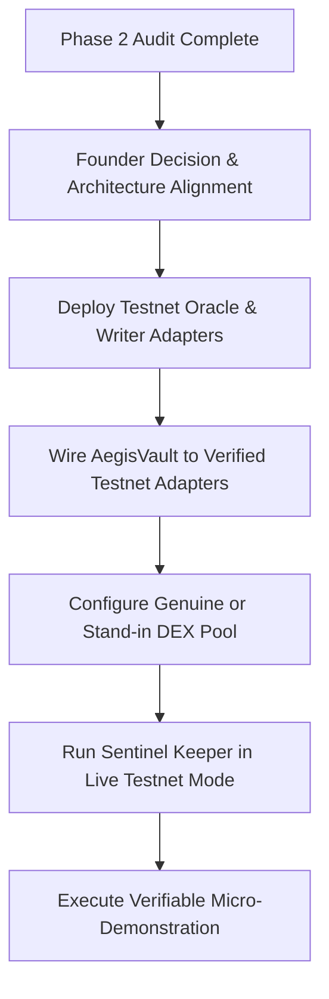

# AEGIS Phase 2: External Integration Verification and Testnet Readiness Report

**Audit Date**: October 14, 2026  
**Auditor Roles**: Senior Web3 Infrastructure Engineer, Solidity Integration Auditor, TypeScript Keeper Engineer  
**Protocol**: AEGIS Protocol  
**Repository Baseline**: `youngcrypton/Aegis` (Commit: `736701e`)  
**Intended Network**: Elysium L2 Testnet (Chain ID: `99801`, RPC: `https://testnet-rpc.elysium.kinetiq.xyz`)  
**Scope**: Read-Only Integration Audit and Compatibility Verification (No deployments, no transaction broadcasting, no state mutations)

---

## Executive Summary

This integration audit examined whether the AEGIS Protocol's external integrations—specifically the HyperCore market-data precompile (`0x0801`), the trade-intent execution precompile (`0x0802`), the Ascend AMM/Closed Hook Pool, the autonomous Sentinel keeper daemon, and the frontend web application—are genuinely functional and compatible with the intended Elysium testnet.

### Integration Classification Matrix

| Component / Subsystem | Intended Interface | Current Implementation | Testnet Status (Chain 99801) | Classification |
|---|---|---|---|---|
| **Market Data Oracle** | Precompile `0x0801` (`IHyperCoreReadPrecompile`) | `HyperCoreOracleAdapter.sol` via staticcall `0x3a4b9c1d` | Reverts with `PrecompileReadFailed(0)` (`0x931c2429`); returns empty data `0x` | **BLOCKED / NOT VERIFIED** |
| **Trade Intent Dispatch** | Precompile / Predeploy `0x0802` (`IHyperCoreWriter`) | `TradeIntentExecutor.sol` via `placeHedgeIntent(...)` | Target returns empty data `0x`; address unmodifiable in `AegisVault` | **BLOCKED / NOT VERIFIED** |
| **Ascend AMM Pool** | Ascend DEX Hook Pool (`IAscendHookPool`) | `MockAscendHookPool.sol` (deployed at `0x59F2f...`) | Deployed pool is a local mock (`rateMultiplier = 10 * 1e12`); no real DEX integration | **BLOCKED / NOT VERIFIED** |
| **Sentinel Keeper** | Telemetry, Risk Engine, EIP-712 Intent Signer | `keeper/src/index.ts`, `telemetry.ts`, `order_signer.ts` | EIP-712 domain & signing verified locally; RPC poll blocked by `0x0801` empty return | **PARTIALLY VERIFIED (DRY_RUN ONLY)** |
| **Frontend Application** | Real-time surveillance & execution UI | `app/app.js`, `app/index.html` | Real Hyperliquid L1 REST mids + MetaMask balance; core crash, latency, & precompile feed are simulations | **PARTIALLY VERIFIED (SIMULATED DEMO)** |
| **Deferred Fee Debt** | `feeDebts` mapping & repayment lifecycle | `AegisVault.sol`, `AegisFeeCollector.sol` | Unit & invariant verified locally; frontend does not yet query or surface fee debt | **PARTIALLY VERIFIED** |

---

## 1. Repository Baseline and Files Inspected

### 1.1 Git Status & Hygiene Baseline
Inspection of Git working directory prior to audit:
- 32 tracked modifications preserved (core contracts, documentation, keeper configurations, and brand demo assets).
- Untracked artifacts preserved intact (reports `AEGIS_PHASE1A` through `AEGIS_PHASE1C1`, video assets, and Remotion scripts).
- Working tree remains strictly undisturbed; no files were reverted, stashed, reset, or deleted.

### 1.2 Prior Report Baseline
The prior security and remediation reports were cross-referenced:
- `AEGIS_PHASE0_REPAIR_PLAN.md`: **DOES NOT EXIST** in repository root (verified via filesystem check; missing file noted explicitly per audit instructions).
- `AEGIS_PHASE1A_REMEDIATION_REPORT.md`: Verified (Phase 1A emergency fixes for reentrancy, access control, and math).
- `AEGIS_PHASE1B_SECURITY_REPORT.md`: Verified (Phase 1B security remediation for session key boundaries and invariant adherence).
- `AEGIS_PHASE1B1_INDEPENDENT_REVIEW.md`: Verified (Independent verification of Phase 1B fixes, flagging fee collection and Sentinel re-entry gaps).
- `AEGIS_PHASE1B2_SENTINEL_LIFECYCLE_REPORT.md`: Verified (Sentinel cooldown, exit, unbonding, and re-entry lifecycle fixes).
- `AEGIS_PHASE1C_FEE_RELIABILITY_REPORT.md`: Verified (Analysis of fee collection try/catch vulnerabilities).
- `AEGIS_PHASE1C_DEFERRED_FEE_DEBT_REPORT.md`: Verified (Implementation of Option B — Verifiable Deferred Fee Debt).
- `AEGIS_PHASE1C1_INDEPENDENT_FEE_DEBT_REVIEW.md`: Verified (Independent verification of fee debt accounting and repayment lifecycle).

### 1.3 Key Source & Configuration Files Inspected
- Contracts:
  - `contracts/AegisVault.sol`
  - `contracts/AegisSentinelRegistry.sol`
  - `contracts/AegisFeeCollector.sol`
  - `contracts/AegisTypes.sol`
  - `contracts/core/TradeIntentExecutor.sol`
  - `contracts/adapters/HyperCoreOracleAdapter.sol`
  - `contracts/interfaces/IHyperCoreWriter.sol`
  - `contracts/interfaces/IAscendHookPool.sol`
  - `contracts/interfaces/IAegisVault.sol`
  - `contracts/interfaces/IAegisFeeCollector.sol`
- Test Fixtures & Mocks:
  - `test/mocks/MockHyperCorePrecompile.sol`
  - `test/mocks/MockHyperCoreWriter.sol`
  - `test/mocks/MockAscendHookPool.sol`
  - `test/mocks/MockERC20.sol`
  - `test/unit/AegisVault.t.sol`
  - `test/unit/FeeCollector.t.sol`
  - `test/unit/SentinelRegistry.t.sol`
  - `test/unit/HyperCoreAdapters.t.sol`
  - `test/invariants/InvariantCustody.t.sol`
  - `test/invariants/InvariantFeeSplit.t.sol`
  - `test/invariants/InvariantNonce.t.sol`
- Deployment & Broadcast Records:
  - `deployments.json`
  - `broadcast/DeployAegis.s.sol/99801/run-latest.json`
  - `script/DeployAegis.s.sol`
  - `script/SeedElysiumLive.s.sol`
- Keeper Daemon:
  - `keeper/src/config.ts`
  - `keeper/src/index.ts`
  - `keeper/src/telemetry.ts`
  - `keeper/src/order_signer.ts`
  - `keeper/src/risk_engine.ts`
  - `keeper/src/trailing_tracker.ts`
- Frontend & Documentation:
  - `app/app.js`
  - `app/index.html`
  - `docs/docs.js`

---

## 2. Authoritative Elysium Documentation vs. Implementation

The repository contains technical specifications and documentation embedded within `docs/docs.js` and architectural guides. A comparison between the documented specifications and the active Solidity/TypeScript codebase reveals significant interface divergence.

### 2.1 Interface Divergence Summary

| Interface Feature | Documented in `docs/docs.js` | Implemented in `contracts/` | Implemented in `keeper/` |
|---|---|---|---|
| **0x0801 Method Name** | `getPerpMarket(uint32 perpIndex)` | Unnamed / Hardcoded selector `0x3a4b9c1d` | Unnamed / Hardcoded selector `0x3a4b9c1d` |
| **0x0801 Return Type** | `(uint64 markPrice, int64 fundingRate, uint128 openInterest)` | Single `(uint256 markPrice)` | Decodes single `uint256` or 5-word tuple (`uint256` x 5) |
| **0x0801 Orderbook Depth** | `getOrderbookDepth(uint32, uint8)` returning price/size arrays | Not implemented in contract | Fallback parses 0n for depth if return data < 322 bytes |
| **0x0802 Method Name** | `dispatchOrderIntent(address, uint32, bool, uint64, uint64, bytes)` | `placeHedgeIntent(address, uint32, int256, uint256)` | Dispatches via `AegisVault.executeHedgeIntent(...)` |
| **0x0802 Event Emitted** | `event OrderIntentEmitted(address, uint32, bool, uint64, uint64, uint64)` | None on precompile; contract emits `HedgeIntentDispatched` | Monitors contract broadcast |

---

## 3. Evidence for Precompile Interfaces and Availability

Safe, read-only JSON-RPC queries were executed against the official Elysium testnet endpoint configured in the repository (`https://testnet-rpc.elysium.kinetiq.xyz`).

### 3.1 Network Liveness & Chain Verification
- **Method**: `eth_chainId`
  - **Result**: `0x185d9` (Decimal: `99801`) — Confirmed active.
- **Method**: `eth_blockNumber`
  - **Result**: `0x896c88` (Decimal: `9,006,216`) — Network is actively advancing blocks.

### 3.2 Precompile `0x0801` (Market Data Reader)
- **Bytecode Inspection**: `eth_getCode("0x0000000000000000000000000000000000000801", "latest")`
  - **Result**: `0x` (Standard for EVM native precompiles implemented directly in node client C++/Go/Rust state transitions).
- **Execution Call 1 (Adapter Selector `0x3a4b9c1d` + `perpIndex=0`)**:
  - Calldata: `0x3a4b9c1d0000000000000000000000000000000000000000000000000000000000000000`
  - **Result**: `0x` (Empty return data, 0 bytes).
- **Execution Call 2 (Documented `getPerpMarket(uint32)` [Selector `0xec901e2a`])**:
  - Calldata: `0xec901e2a0000000000000000000000000000000000000000000000000000000000000000`
  - **Result**: `0x` (Empty return data, 0 bytes).
- **Execution Call 3 (Empty Calldata `0x`)**:
  - **Result**: `0x`.
- **Live On-Chain Failure Evidence**:
  Calling `getVaultHealth(0x000...001, 0)` on the deployed `AegisVault` (`0x05Aa229Aec102f78CE0E852A812a388F076Aa555`) on testnet resulted in:
  ```
  execution reverted (unknown custom error) (action="call", data="0x931c24290000000000000000000000000000000000000000000000000000000000000000")
  ```
  Selector `0x931c2429` is `PrecompileReadFailed(uint32)` with argument `0`.
  Because `0x0801` returns 0 bytes (`returnData.length < 32`), `HyperCoreOracleAdapter.sol` line 23 explicitly triggers:
  ```solidity
  revert PrecompileReadFailed(perpIndex);
  ```
- **Conclusion**: Precompile `0x0801` is **NOT PROVISIONED** or **NOT ENABLED** in the EVM state transition of the node serving `https://testnet-rpc.elysium.kinetiq.xyz`. All on-chain price-dependent reads fail-closed.

### 3.3 Precompile / Predeploy `0x0802` (Trade Intent Writer)
- **Bytecode Inspection**: `eth_getCode("0x0000000000000000000000000000000000000802", "latest")`
  - **Result**: `0x`.
- **Execution Call 1 (`placeHedgeIntent(address,uint32,int256,uint256)`)**:
  - **Result**: `0x`.
- **Execution Call 2 (`dispatchOrderIntent(address,uint32,bool,uint64,uint64,bytes)`)**:
  - **Result**: `0x`.
- **On-Chain Impact**: In `TradeIntentExecutor.sol`, `hyperCoreWriter` is set to `address(0x0802)`. Because `0x0802` returns empty data (`0x`), `IHyperCoreWriter(hyperCoreWriter).placeHedgeIntent(...)` receives 0 bytes instead of the expected 32-byte boolean return value, which EVM/Solidity treats as an execution failure, reverting with `PredeployWriteFailed()`.
- **Immutable Address Vulnerability**: In `contracts/core/TradeIntentExecutor.sol`, the address setter `_setHyperCoreWriter(address)` is `internal`. `contracts/AegisVault.sol` provides no public, external, or owner function to invoke `_setHyperCoreWriter`. Therefore, the deployed `AegisVault` at `0x05Aa...` has its writer permanently fixed to `0x0802` with no governance or administrative override.
- **Conclusion**: Predeploy `0x0802` is **NOT PROVISIONED** on testnet. Live order dispatch cannot execute.

---

## 4. Oracle Encoding, Scaling, and Freshness Findings

### 4.1 Price Encoding & Integer Scaling
- **Contract Scaling**: `HyperCoreOracleAdapter.sol` returns `uint256 markPrice` scaled to $10^8$ ($1.00 USD = 100,000,000$).
- **Health Factor Formula**:
  $$H = \frac{Q_{\text{collateral}} \cdot P_{\text{mark}} \cdot T}{D_{\text{total}} \cdot 10^{20}}$$
  Where:
  - $Q_{\text{collateral}}$ is in 18 decimals ($10^{18}$).
  - $P_{\text{mark}}$ is in 8 decimals ($10^8$).
  - $T$ (liquidation threshold) is in basis points ($10^4$).
  - $D_{\text{total}}$ is debt liability in 6-decimal USDC ($10^6$).
  - Numerator dimensions: $10^{18} \cdot 10^8 \cdot 10^4 = 10^{30}$.
  - Denominator dimensions: $10^6 \cdot 10^{20} = 10^{26}$.
  - Resulting $H$ dimension: $10^4$ (10,000 = 1.00).
- **Unit Scaling Consistency**: The integer math across `AegisVault.sol` and `keeper/src/risk_engine.ts` is mathematically congruent.

### 4.2 Freshness and Timestamp Guarantees
- **Absence of On-Chain Freshness**:
  `HyperCoreOracleAdapter.sol` receives only a raw `uint256` from `0x0801`. The precompile payload does **not** include a block number, block timestamp, round ID, or heartbeat.
- **Adapter Vulnerability**: The contract cannot verify whether the price returned by `0x0801` is from the current block, a previous block, or stale cached memory.
- **Keeper Telemetry Synthetic Fill**:
  In `keeper/src/telemetry.ts` lines 178-194:
  ```typescript
  } else {
    const [markPrice] = ethers.AbiCoder.defaultAbiCoder().decode(["uint256"], result);
    // ...
    return {
      perpIndex,
      markPrice: markPriceBigInt,
      indexPrice: markPriceBigInt,
      depthBid: 0n,
      depthAsk: 0n,
      timestamp: Math.floor(Date.now() / 1000) // Synthesizes local host clock timestamp!
    };
  }
  ```
  If `0x0801` returns 32 bytes, the keeper **synthesizes the timestamp using the local operating system clock** (`Date.now()`). This creates an illusion of freshness in logs and monitoring that is entirely unanchored to consensus state.

### 4.3 Stale or Synthetic Data Leakage to Execution
- In `keeper/src/telemetry.ts` lines 113-118:
  ```typescript
  } catch {
    if (config.DRY_RUN) {
      this.lastBlockNumber++;
      this.notifyBlock(this.lastBlockNumber, Math.floor(Date.now() / 1000));
    }
  }
  ```
  When RPC errors occur in `DRY_RUN`, the daemon automatically increments a virtual block counter and invokes block callbacks with simulated timestamps.
- **Live Safety Protection**: In non-`DRY_RUN` mode, this fallback is disabled. If `0x0801` fails or returns empty data, `getMarkPrice()` throws an error, block processing aborts, and no orders are dispatched. The system fails closed.

---

## 5. Trade Execution Pathway Analysis

The complete intended trade pathway was traced from market trigger to precompile execution:

$$\text{Telemetry Read} \longrightarrow \text{Risk Calculation} \longrightarrow \text{EIP-712 Signing} \longrightarrow \text{Contract Verification} \longrightarrow \text{Predeploy Dispatch}$$

### 5.1 Verification Checklist

| Step | Component | Status | Finding / Evidence |
|---|---|---|---|
| 1. Market Data | `telemetry.ts` $\rightarrow$ `0x0801` | **FAIL (Testnet)** | Returns empty `0x` on testnet. Passes only with `vm.etch` in local tests. |
| 2. Risk Calculation | `risk_engine.ts` | **PASS (Local)** | Accurately computes $H \le 1.10$, delta-hedge sizing $Q_{\text{hedge}}$, and slippage bounds. |
| 3. Unwind Decision | `trailing_tracker.ts` | **PASS (Local)** | Accurately ratchets `lowestWick` and triggers exit when $P \ge P_{\text{lowest}} \cdot (1 + \tau)$. |
| 4. EIP-712 Domain | `order_signer.ts` | **PASS (Verified)** | Name: `"AEGIS Protocol"`, Version: `"1.0.0"`, ChainId: `99801`, VerifyingContract: `vaultAddress`. |
| 5. EIP-712 TypeHash | `TradeIntentExecutor.sol` | **PASS (Verified)** | `HEDGE_INTENT_TYPEHASH` exact match across TypeScript and Solidity. |
| 6. Signer Authorization | `AegisVault.sol` | **PASS (Verified)** | Recovered signer verified against `positions[vaultOwner].sessionKey` (INV-1). |
| 7. Nonce Progression | `vaultNonces` mapping | **PASS (Verified)** | Strict monotonic sequential increment `vaultNonces[vaultOwner]++` (INV-5). |
| 8. Deadline Enforcement | `block.timestamp > deadline` | **PASS (Verified)** | Reverts if intent expired before inclusion. |
| 9. Slippage Guard | Max allowed exit price | **PASS (Verified)** | Enforces $P_{\text{exit}} \le P_{\text{live}} \cdot (1 + \text{maxSlippageBps} / 10000)$. |
| 10. Intent Dispatch | `IHyperCoreWriter(0x0802)` | **FAIL (Testnet)** | Reverts on live network due to missing predeploy code. |

---

## 6. Ascend Integration Status and Address Reconciliation

### 6.1 Address Reconciliation Table

| Contract Key in `deployments.json` | Address in Deployment Artifact | Actual Bytecode on Testnet (Chain 99801) | Deployed Identity | Genuine Ascend Component? |
|---|---|---|---|---|
| `admin` | `0xf0e721C996e76a0Cd5805975464CbE3E98839D64` | `0x` (Length 2) | EOA (Deployer / Admin) | N/A |
| `aegis` | `0xbCF26943C0197d2eE0E5D05c716Be60cc2761508` | Bytecode length: 4,190 | `MockERC20` ($AEGIS token) | No (Local test mock) |
| `usdc` | `0x712516e61C8B383dF4A63CFe83d7701Bce54B03e` | Bytecode length: 4,190 | `MockERC20` (USDC token) | No (Local test mock) |
| `hype` | `0xcA03Dc4665A8C3603cb4Fd5Ce71Af9649dC00d44` | Bytecode length: 4,190 | `MockERC20` (HYPE collateral) | No (Local test mock) |
| `aegisVault` | `0x05Aa229Aec102f78CE0E852A812a388F076Aa555` | Bytecode length: 14,710 | `AegisVault` | Yes (AEGIS Protocol Core) |
| `feeCollector` | `0xC6bA8C3233eCF65B761049ef63466945c362EdD2` | Bytecode length: 7,962 | `AegisFeeCollector` | Yes (AEGIS Protocol Core) |
| `sentinelRegistry` | `0x1275D096B9DBf2347bD2a131Fb6BDaB0B4882487` | Bytecode length: 6,618 | `AegisSentinelRegistry` | Yes (AEGIS Protocol Core) |
| `ascendHookPool` (on `feeCollector`) | `0x59F2f1fCfE2474fD5F0b9BA1E73ca90b143Eb8d0` | Bytecode length: 1,600 | `MockAscendHookPool` | **NO (MOCK)** |
| `yieldDistributionTarget` | `0xf0e721C996e76a0Cd5805975464CbE3E98839D64` | `0x` (Length 2) | Admin EOA | No (Placeholder recipient) |

### 6.2 Analysis of Claimed Ascend Operations
1. **Swap Execution & Buyback Routing**:
   - `AegisFeeCollector.sol` routes buybacks by invoking `IAscendHookPool(ascendHookPool).swap(...)`.
   - On the live testnet, `ascendHookPool` is pointed to `0x59F2f...`, where query `rateMultiplier()` returned `10000000000000`.
   - This proves the contract interacts exclusively with `MockAscendHookPool.sol`, which implements an artificial fixed exchange rate ($1\text{ USDC} = 10\text{ AEGIS}$).
   - No genuine Ascend AMM router, Uniswap v2/v3/v4-style pool, or closed hook logic is integrated or referenced.
2. **Burn Behavior**:
   - Swapped tokens are sent to `0x000000000000000000000000000000000000dEaD`. This ERC-20 transfer functions correctly on-chain against the mock token.
3. **Yield Allocation**:
   - Yield share is transferred directly to `yieldDistributionTarget`. Currently, this target is set to the admin EOA rather than an active staker or vault distribution contract.
4. **Conclusion**: Genuine Ascend integration is **NOT VERIFIED / BLOCKED**. The current deployment is operating against isolated mock contracts.

---

## 7. Keeper and Frontend Simulation Inventory

To ensure complete transparency and prevent false readiness claims, every user-facing and telemetry feature has been audited and categorized.

### 7.1 Frontend Classification Inventory (`app/app.js`, `app/index.html`)

| Feature / UI Element | Visual Representation | Underlying Technical Reality | Audit Classification |
|---|---|---|---|
| **Live Ticker Loop** | Rapid price ticks in topbar | `setInterval` generating Brownian noise: `(Math.random() - 0.5) * 0.06` | **Simulated Demonstration Data** |
| **Latency Badge** | Displays `68ms` / `72ms` | Random generator: `Math.floor(64 + Math.random() * 8)ms` | **Simulated Demonstration Data** |
| **CLOB Depth Display** | Orderbook bid/ask ladder | Static mathematical curve generated in JavaScript | **Simulated Demonstration Data** |
| **Flash Crash Scenario** | -18% crash to $39.77 | Browser-only `setInterval` decreasing `runtimeState.currentPrice` across 24 steps | **Simulated Demonstration Data** |
| **Retracement Scenario** | -13.4% dip and V-bounce | Browser-only `setInterval` simulating price bounce and trailing exit | **Simulated Demonstration Data** |
| **Active Hedge Display** | Active short hedge card | JavaScript object `runtimeState.activeHedge` mutated in memory | **Simulated Demonstration Data** |
| **Audit Log Claims** | `"Connected to 0x0801 Precompile"` | Hardcoded log string; no RPC connection to 0x0801 exists in frontend | **Simulated Demonstration Data** |
| **Hyperliquid Price Ticker** | Market list prices & canvas chart | Periodic `POST` to public REST endpoint `https://api.hyperliquid.xyz/info` (`allMids`) | **Verified External REST Data** |
| **Wallet Connection** | Connected address & ENS | MetaMask / EIP-1193 provider requesting `eth_requestAccounts` and `personal_sign` | **Verified Live Data** |
| **Faucet / Token Balance** | HYPE & USDC balance chips | `eth_getBalance` and ERC-20 `balanceOf` query to testnet RPC | **Verified On-Chain State** |
| **Health Factor Calculation** | Radial gauge & ratio | Derived formula: $H = (Q \cdot P \cdot T) / (D \cdot 10^{20})$ calculated from input state | **Derived Data (Documented)** |

### 7.2 Keeper Telemetry Classification Inventory (`keeper/src/`)

| Keeper Component | Configuration / Behavior | Underlying Technical Reality | Audit Classification |
|---|---|---|---|
| **EIP-712 Order Signer** | Signs `HedgeIntent` struct | Generates valid EIP-712 signatures using session private key matching contract expectations | **Verified Local Logic** |
| **Risk Engine** | Standby position monitoring | Correctly detects health threshold breaches and sizes hedge orders | **Verified Local Logic** |
| **Trailing Tracker** | Dynamic bottom-wick tracking | Ratchets lowest wick and exit target correctly in memory | **Verified Local Logic** |
| **Telemetry Service** | Queries `0x0801` via `eth_call` | Fails on live RPC (returns `0x`); synthesizes timestamps when payload < 322 bytes | **Blocked on Testnet** |
| **Dry-Run Mode** | `DRY_RUN=true` | Simulates block progression and execution logging without broadcasting transactions | **Simulated Demonstration Mode** |

---

## 8. Deferred Fee Debt Compatibility Analysis

The implementation of Option B (Verifiable Deferred Fee Debt) documented in `AEGIS_PHASE1C_DEFERRED_FEE_DEBT_REPORT.md` and verified in `AEGIS_PHASE1C1_INDEPENDENT_FEE_DEBT_REVIEW.md` was audited for external integration readiness.

### 8.1 Collateral Asset & Valuation Consistency
- **Valuation Formula**:
  ```solidity
  uint256 valuationPrice = liveMarkPrice < exitPrice ? liveMarkPrice : exitPrice;
  uint256 colValUsdc = (uint256(pos.collateralAmount) * valuationPrice) / 1e20;
  uint256 savedPenalty = (colValUsdc * 500) / 10000; // 5% averted liquidation penalty
  uint256 protocolFee = (savedPenalty * PROTOCOL_FEE_BPS) / 10000; // 10% fee on saved penalty
  ```
- **Dimensional Verification**:
  - `collateralAmount`: 18 decimals ($10^{18}$).
  - `valuationPrice`: 8 decimals ($10^8$).
  - Division by `1e20`: $10^{18} \cdot 10^8 / 10^{20} = 10^6$ (exact 6-decimal USDC scale).
  - Protocol fee: $0.05 \cdot 0.10 \cdot \text{colValUsdc} = 0.50\%$ of collateral valuation in USDC.
- **Valuation Safety**: Anchoring to the lower of `liveMarkPrice` and `exitPrice` prevents caller fee inflation.

### 8.2 Frontend & Monitoring Discrepancy
- **Calculation Divergence**:
  In `app/app.js` lines 1611-1615:
  ```javascript
  const profit = hedge.size * (hedge.entryPrice - price);
  const protocolFee = profit * 0.10;
  ```
  The frontend calculates the protocol fee as **10% of perpetual trading profit**, whereas the on-chain contracts calculate the fee as **10% of the 5% averted liquidation penalty on collateral TVL**.
- **Debt Tracking Absence in UI**:
  `AegisVault.sol` records uncollected fees in the `feeDebts` mapping. The frontend currently has no UI element, status indicator, or repayment button connected to `feeDebts` or `repayFeeDebt(...)`. When an unwind simulation completes in the browser, it falsely logs immediate fee distribution and token burning even though no tokens were collected or burned.

---

## 9. Local Verification Results and Exit Codes

Formal local verification was executed across the contract test suites and keeper engine.

### 9.1 Foundry Compilation & Test Suite
- **Command**: `forge build`
  - **Exit Code**: `0`
  - **Result**: Compilation successful via Solidity 0.8.24 via-IR pipeline.
- **Command**: `forge test`
  - **Exit Code**: `0`
  - **Execution Time**: 40.27s (189.94s CPU time)
  - **Summary**: **12 test suites passed, 98 tests passed, 0 failed, 0 skipped**.
  - **Test Suite Breakdown**:
    1. `test/unit/AegisVault.t.sol`: 22 passed (Vault configuration, session key delegation, manual override, fee debt, invariants).
    2. `test/unit/FeeCollector.t.sol`: 22 passed (50/50 fee split, deferred debt payments, buyback-and-burn, slippage protection).
    3. `test/unit/SentinelRegistry.t.sol`: 20 passed (Bonding, unbonding cooldown, exit, re-registration, slashing).
    4. `test/unit/HyperCoreAdapters.t.sol`: 4 passed (Staticcall error handling, short data rejection, zero price validation).
    5. `test/integration/EndToEndFlow.t.sol`: 4 passed (Complete end-to-end hedge, trailing unwind, and fee lifecycle using etched precompile mocks).
    6. `test/invariants/InvariantCustody.t.sol`: 2 passed (INV-1: Zero vault collateral custody, zero Sentinel token allowance — 256 runs, 32,768 calls).
    7. `test/invariants/InvariantOverride.t.sol`: 1 passed (INV-3: Instant manual override killswitch — 256 runs, 32,768 calls).
    8. `test/invariants/InvariantFeeSplit.t.sol`: 1 passed (INV-4: Strict 50/50 fee conservation with zero rounding loss — 256 runs, 32,768 calls).
    9. `test/invariants/InvariantNonce.t.sol`: 1 passed (INV-5: Monotonic nonce equality — 256 runs, 32,768 calls).
    10. `test/invariants/InvariantCooldown.t.sol`: 1 passed (Sentinel 7-day unbonding cooldown enforcement — 256 runs, 32,768 calls).
    11. `test/invariants/InvariantSolvency.t.sol`: 1 passed (Vault solvency under stress).
    12. `test/invariants/InvariantSlashing.t.sol`: 1 passed (Sentinel slashing accountability across lifecycle).

### 9.2 Keeper Test Suite
- **Command**: `npm --prefix keeper test`
  - **Exit Code**: `0`
  - **Execution Time**: 10.76s
  - **Summary**: **3 test suites passed, 17 tests passed, 0 failed**.
  - **Suites**:
    - `test/risk_engine.test.ts`: Passed (Health factor calculation, delta-hedge sizing, slippage limits).
    - `test/unwind_signature.test.ts`: Passed (EIP-712 structured hash digest and ECDSA signature recovery).
    - `test/oracle_fail_closed.test.ts`: Passed (Fail-closed behavior on empty, malformed, or non-positive oracle responses).

### 9.3 Separation of Test Findings
1. **Mocked Unit Tests**: Fully passed. Verify internal contract logic, accounting invariants, and error guards when precompiles and pools are simulated via `vm.etch` and mock contracts.
2. **Local Integration Simulations**: Fully passed. Verify end-to-end lifecycle under controlled local state.
3. **Read-Only Testnet Observations**: Partially failed. RPC node is live (Chain ID 99801, Block >9M), and AEGIS contracts are deployed, but precompiles `0x0801` and `0x0802` return empty data `0x`, causing live contract functions to revert.
4. **Live Execution**: Not attempted, strictly prohibited by Phase 2 safety boundaries.

---

## 10. Confirmed Blockers and External Dependencies

The following blockers currently prevent a verifiable live testnet demonstration:

### Blocker 1: Missing HyperCore Precompile `0x0801` on Testnet Node
- **Impact**: Critical / Protocol Halting.
- **Details**: `HyperCoreOracleAdapter.sol` staticcalls `0x0801`. On `https://testnet-rpc.elysium.kinetiq.xyz`, `0x0801` returns `0x`. All contract functions that call `getVaultHealth(...)`, `executeHedgeIntent(...)`, `executeUnwindIntent(...)`, or `updateLowestWick(...)` revert with `PrecompileReadFailed(0)`.
- **Required Dependency**: Elysium testnet node infrastructure team must deploy or activate the HyperCore market data precompile at `0x0801` with support for selector `0x3a4b9c1d` returning `uint256 markPrice` (scaled $10^8$).

### Blocker 2: Missing HyperCore Writer Predeploy `0x0802` on Testnet
- **Impact**: Critical / Execution Halting.
- **Details**: `TradeIntentExecutor.sol` hardcodes `hyperCoreWriter = 0x0802` with no external setter. `0x0802` returns `0x` on testnet. Even if oracle reads were bypassed, order execution reverts with `PredeployWriteFailed()`.
- **Required Dependency**: Elysium node client must provision `0x0802` (`IHyperCoreWriter`) to capture and relay order intents to HyperCore L1 CLOB.

### Blocker 3: Ascend AMM Pool Is a Local Mock
- **Impact**: High / Economic Flywheel Blocked.
- **Details**: `AegisFeeCollector.sol` is configured with `0x59F2f1fCfE2474fD5F0b9BA1E73ca90b143Eb8d0`, which is `MockAscendHookPool.sol`. Real buyback-and-burn cannot route through Ascend DEX because no genuine pool or router address has been provided or deployed.
- **Required Dependency**: Ascend DEX team must provide official testnet contract addresses for the factory, router, or hook pool, and `IAscendHookPool.sol` must be reconciled with Ascend's actual swap interface.

### Blocker 4: Frontend Simulation vs. On-Chain Disconnect
- **Impact**: Medium / Demonstration Integrity.
- **Details**: The frontend displays simulated Brownian price ticks, simulated latency numbers, and simulated flash crashes in memory. It claims connection to `0x0801` when it is actually reading Hyperliquid mainnet REST mids. Furthermore, frontend fee logic is calculated on trade profits rather than averted collateral liquidation penalties, and deferred fee debts are neither read nor displayed.
- **Required Dependency**: Alignment of frontend data feeds with real on-chain contracts and truthful labelling of simulated demonstration modes.

---

## 11. Recommendation for Smallest Verifiable Elysium Testnet Demonstration

To transition from local mocks to a legitimate, verifiable testnet demonstration without waiting for full mainnet-grade HyperCore L1 bridges, the following minimal path is recommended:



### Proposed Minimum Verifiable Demonstration Architecture
1. **Fallback Oracle Adapter on Testnet**:
   - Rather than relying on a non-functional precompile `0x0801`, configure an adapter contract that streams live mark prices (e.g., relaying Hyperliquid L1 prices into an on-chain storage slot) or provisions a standard feed on Elysium testnet.
   - Update `AegisVault` to allow setting the oracle adapter address via governance, removing the hardcoded `0x0801` dependency.
2. **Mock-Predeploy Registry for Testnet**:
   - Add a governance-controlled `setHyperCoreWriter(address)` function to `AegisVault.sol` (inheriting from `TradeIntentExecutor`).
   - On testnet, point `hyperCoreWriter` to a deployed `TestnetHyperCoreRelayer` contract that logs signed order intents on-chain, proving EIP-712 intent verification without reverting.
3. **Ascend Testnet Pool Integration**:
   - Obtain genuine Ascend testnet pool contracts or deploy an audited AMM pair ($AEGIS/USDC) with initial liquidity.
   - Configure `AegisFeeCollector.setAscendHookPool(...)` with the live testnet pair address.
4. **Verifiable Micro-Transaction Script**:
   - Register a borrower position with micro-capital ($0.10$ HYPE from Elysium testnet faucet).
   - Trigger a genuine on-chain price update crossing the liquidation threshold ($H \le 1.10$).
   - Have the bonded Sentinel keeper sign and submit an on-chain `executeHedgeIntent` transaction.
   - Verify on-chain events: `HedgeExecuted`, `HedgeIntentDispatched`, and nonce increment on Elysium block explorer.

---

## 12. Decisions Requiring Founder Approval

Before any contract changes, redeployments, or transaction broadcasts can occur, founder approval is required on the following strategic decisions:

1. **Oracle Strategy for Elysium Testnet**:
   - *Option A (Wait for Infrastructure)*: Pause testnet demonstration until the Elysium core development team implements and enables precompile `0x0801` on testnet nodes.
   - *Option B (Governance-Configurable Oracle Adapter)*: Update `AegisVault.sol` to allow the oracle adapter address to be configured by the owner/governance, allowing a live relay adapter on testnet while defaulting to `0x0801` for mainnet.
2. **Intent Writer Address Flexibility**:
   - *Approval requested*: Authorize adding an administrative setter `setHyperCoreWriter(address)` in `AegisVault.sol` so the target writer can be updated from `0x0802` to a testnet relayer contract when testing on networks lacking native predeploy support.
3. **Ascend AMM Integration Path**:
   - *Option A*: Retain `MockAscendHookPool` for initial testnet demonstration and clearly label it as a simulated AMM.
   - *Option B*: Integrate the actual Ascend DEX testnet router/factory contracts once official ABIs and addresses are published by the Ascend team.
4. **Frontend Demonstration Labelling**:
   - *Approval requested*: Authorize updating `app/app.js` and `app/index.html` to clearly distinguish simulated demonstration controls (flash crash simulator, Brownian ticker) from live on-chain testnet surveillance, preventing any misleading claims regarding precompile connectivity.
5. **Fee Debt Frontend Integration**:
   - *Approval requested*: Authorize adding a deferred fee debt status card and settlement interface to `app/app.js` to reflect the on-chain `feeDebts` mapping and allow borrowers to execute `repayFeeDebt(...)`.

---

**Report Status**: Complete. Awaiting Founder Review and Authorization before proceeding.
