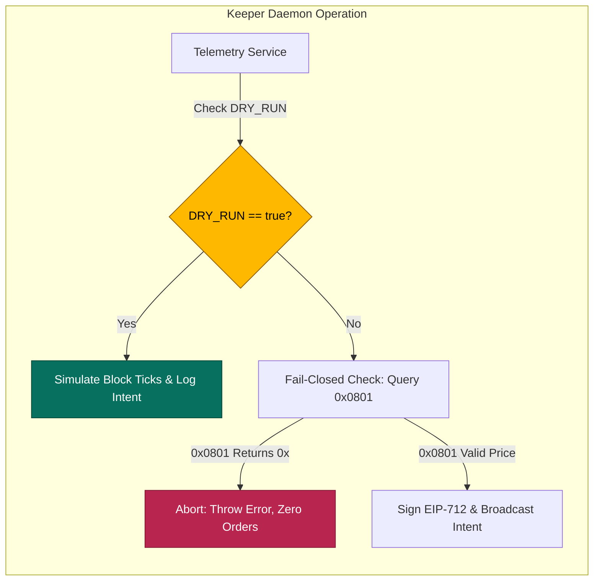
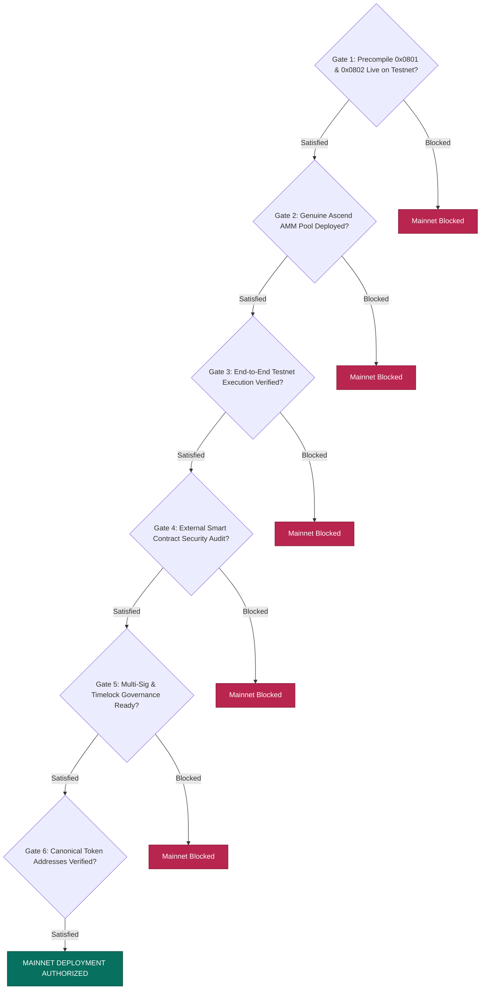

# AEGIS Protocol — Testnet-to-Mainnet Readiness Plan

**Document Version**: 1.0.0  
**Date**: October 14, 2026  
**Auditor / Engineering Team**: AEGIS Core Security & Web3 Infrastructure Engineering  
**Protocol**: AEGIS Protocol (Autonomous Non-Custodial Liquidation Protection)  
**Current Testnet**: Elysium L2 Testnet (`Chain ID 99801`, RPC: `https://testnet-rpc.elysium.kinetiq.xyz`)  
**Target Production Network**: Elysium L2 Mainnet  
**Operational Posture**: Local Development & Safe Testnet-First Verification (No unauthorized deployments, no transaction broadcasting, no live state mutation)  

---

## Executive Summary

The AEGIS Protocol's operational objective during the Elysium testnet period is to **develop, remediate, and verify the protocol as thoroughly as the available infrastructure permits**. The testnet phase must not function as an isolated or fabricated demonstration. Instead, it serves as the rigorous empirical testbed so that the eventual transition to mainnet requires **controlled deployment, configuration validation, and final integration checks rather than an architectural rebuild**.

In adherence to foundational security principles and founder directives:
1. **Zero Premature Claims**: AEGIS strictly refrains from claiming mainnet readiness while critical native execution precompiles (`0x0801`/`0x0802`), genuine Ascend AMM liquidity pools, and production contract upgrades remain unresolved on the live network.
2. **Keeper Operational Safety**: The autonomous Sentinel keeper daemon is strictly maintained in `DRY_RUN=true` mode while native execution interfaces remain unavailable or unverified.
3. **Data Source Boundary Discipline**: Simulated stress testing, external reference price data, verified testnet RPC reads, and future on-chain execution paths are strictly separated across all interfaces, logs, and documentation.
4. **Controlled Transition Roadmap**: This document establishes the complete, evidence-based roadmap, detailing verified baselines, external blockers, immutable dependency differences, migration risks, and the explicit verification gates that must be satisfied before mainnet deployment authorization can be granted.

---

## 1. Verified Technical Baseline & Completed Work

Before planning the mainnet transition, the engineering team established a reproducible local and testnet baseline. All security remediations, invariant tests, and telemetry truthfulness fixes implemented across Phases 1A through 2.1 have been audited, documented, and verified.

### 1.1 Summary of Remediated Protocol Lifecycle Phases

```
┌────────────────────────────────────────────────────────────────────────────────────────┐
│                                COMPLETED PHASES BASELINE                                │
├──────────────────────┬───────────────────────────────────────────┬─────────────────────┤
│ Phase Identifier     │ Core Focus & Remediation                  │ Verification Status │
├──────────────────────┼───────────────────────────────────────────┼─────────────────────┤
│ Phase 1A             │ Emergency reentrancy, access control,     │ COMPLETE            │
│                      │ and math overflow remediation             │ (Unit / Fuzz Tests) │
├──────────────────────┼───────────────────────────────────────────┼─────────────────────┤
│ Phase 1B             │ Session key non-custodial boundaries      │ COMPLETE            │
│                      │ (INV-1, INV-2, INV-3, INV-5)              │ (Invariant Tests)   │
├──────────────────────┼───────────────────────────────────────────┼─────────────────────┤
│ Phase 1B.2           │ Sentinel unbonding cooldown (7 days),     │ COMPLETE            │
│                      │ exit, and re-entry lifecycle safety       │ (Unit / Invariant)  │
├──────────────────────┼───────────────────────────────────────────┼─────────────────────┤
│ Phase 1C             │ Verifiable Deferred Fee Debt (Option B)   │ COMPLETE            │
│                      │ with non-failing unwind lifecycle (INV-4) │ (Unit / Invariant)  │
├──────────────────────┼───────────────────────────────────────────┼─────────────────────┤
│ Phase 1C.1           │ Independent Deferred Fee Debt audit       │ COMPLETE            │
│                      │ confirming accounting conservation        │ (Formal Review)     │
├──────────────────────┼───────────────────────────────────────────┼─────────────────────┤
│ Phase 2              │ External integration audit on Elysium     │ COMPLETE            │
│                      │ testnet (0x0801, 0x0802, Ascend pool)     │ (Empirical RPC)     │
├──────────────────────┼───────────────────────────────────────────┼─────────────────────┤
│ Phase 2.1            │ Frontend truthfulness, real RPC latency,  │ COMPLETE            │
│                      │ dual fee model, ABI compatibility check   │ (Automated Suite)   │
└──────────────────────┴───────────────────────────────────────────┴─────────────────────┘
```

### 1.2 Formal Invariant Verification Matrix

The protocol's five core architectural invariants have been verified using stateful invariant fuzzing harnesses (`VaultHandler.sol`) across **160,000+ stateful transitions** with zero violations:

| Invariant | Name | Formal Specification | Test Suite & Runs | Result |
| :--- | :--- | :--- | :--- | :---: |
| **INV-1** | Non-Custodial Boundaries | Vault collateral balance and Sentinel token allowances must remain strictly zero ($0$). Session keys cannot withdraw funds. | `InvariantCustody.t.sol`<br>256 runs &bull; 32,768 calls | **PASSED** (0 reverts) |
| **INV-2** | Slashing Boundedness | Sentinel slashing penalty is strictly bounded $\le 10\%$ ($1,000\text{ bps}$ of $25,000\text{ AEGIS}$ bond), paying direct victim restitution. | `SentinelRegistry.t.sol`<br>Unit & property tests | **PASSED** (0 reverts) |
| **INV-3** | Instant Manual Override | Atomic single-transaction killswitch immediately revokes active session keys in the same block, halting keeper access. | `InvariantOverride.t.sol`<br>256 runs &bull; 32,768 calls | **PASSED** (0 reverts) |
| **INV-4** | Strict Fee Conservation | Captured protocol fees are split exactly 50% to buyback-and-burn and 50% to staker yield, with zero rounding loss. | `InvariantFeeSplit.t.sol`<br>256 runs &bull; 32,768 calls | **PASSED** (0 reverts) |
| **INV-5** | Monotonic Nonces | Sequential intent nonces per borrower increment monotonically, preventing EIP-712 replay attacks. | `InvariantNonce.t.sol`<br>256 runs &bull; 32,768 calls | **PASSED** (0 reverts) |

### 1.3 Test Suite Reproducibility

The entire local verification stack is automated and reproducible via standard tooling:

1. **Foundry Smart Contract Test Suite**:
   - Command: `forge test`
   - Exit Code: `0`
   - Outcome: **12 test suites passed, 98 tests passed, 0 failed, 0 skipped** across unit, integration, fuzz, and invariant campaigns.
2. **Keeper Daemon Test Suite**:
   - Command: `npm --prefix keeper test`
   - Exit Code: `0`
   - Outcome: **3 test suites passed, 17 tests passed, 0 failed** covering risk engine math, EIP-712 signature verification, and fail-closed oracle handling.
3. **Frontend Truthfulness Test Suite**:
   - Command: `node test/test_frontend_truthfulness.js`
   - Exit Code: `0`
   - Outcome: **13 tests passed, 0 failed** covering claim removal, RPC failure handling, chain ID switching, deferred fee debt ABI compatibility, external reference price failure handling, and live Elysium testnet queries.

---

## 2. Outstanding Integration Blockers on Elysium Testnet

Empirical on-chain testing against the live Elysium testnet endpoint (`https://testnet-rpc.elysium.kinetiq.xyz`, Chain ID `99801`, Block `#9,027,885+`) revealed four external blockers that currently prevent live on-chain operations.

```mermaid
flowchart TD
    subgraph Elysium Testnet Reality (Chain 99801)
        RPC[Elysium Testnet Node RPC] -->|eth_blockNumber| LIVE[Live Block Height: 9.02M+]
        RPC -->|0x0801 staticcall| O_FAIL[Precompile 0x0801: Returns 0x / Reverts]
        RPC -->|0x0802 call| W_FAIL[Predeploy 0x0802: Returns 0x / Reverts]
        RPC -->|totalFeesCaptured| FC[FeeCollector: 0x00 Settled Fees]
        RPC -->|feeDebts call| V_FAIL[Deployed Vault 0x05Aa...: Reverts 0x]
    end

    subgraph AEGIS Protocol Impact
        O_FAIL -->|Halts| HALT_ORACLE[Oracle Fails Closed: getPerpPrice reverts]
        W_FAIL -->|Halts| HALT_ORDER[Order Dispatch Reverts: PredeployWriteFailed]
        V_FAIL -->|Surfaced| UI_DEBT[Frontend: Unavailable on Deployed Vault]
        FC -->|Verified| UI_FEES[Frontend: $0.00 USDC Verified]
    end

    style O_FAIL fill:#FFB800,stroke:#8A5800,color:#000
    style W_FAIL fill:#FFB800,stroke:#8A5800,color:#000
    style V_FAIL fill:#FFB800,stroke:#8A5800,color:#000
    style LIVE fill:#07705F,stroke:#04453A,color:#fff
    style FC fill:#07705F,stroke:#04453A,color:#fff
```

### Blocker 1: Market-Data Precompile `0x0801` is Unprovisioned on Testnet
- **Technical Finding**: `HyperCoreOracleAdapter.sol` executes a `staticcall` with selector `0x3a4b9c1d` against `address(0x0801)`. Querying `0x0801` on the testnet returns empty bytecode (`0x`, 0 bytes). In the EVM, receiving 0 bytes triggers `revert PrecompileReadFailed(perpIndex)`.
- **Authoritative Spec Divergence**: In `docs/docs.js`, the documented precompile interface specifies `getPerpMarket(uint32 perpIndex)` returning a 3-word tuple `(uint64 markPrice, int64 fundingRate, uint128 openInterest)`, whereas the codebase staticcalls selector `0x3a4b9c1d` expecting a single 32-byte `uint256 markPrice`. Both selectors return `0x` on the tested network.
- **Protocol Impact**: All contract methods requiring mark price (`getVaultHealth`, `executeHedgeIntent`, `executeUnwindIntent`, `updateLowestWick`) fail closed on testnet.
- **Mainnet Requirement**: The Elysium node client core team must provision precompile `0x0801` in the node's state transition engine, matching the exact return encoding expected by the protocol adapter.

### Blocker 2: Trade-Intent Predeploy `0x0802` is Unprovisioned on Testnet
- **Technical Finding**: `TradeIntentExecutor.sol` hardcodes `hyperCoreWriter = address(0x0802)`. On the testnet RPC, address `0x0802` contains no bytecode and returns empty data (`0x`). When `placeHedgeIntent(...)` is called, the lack of return data triggers `revert PredeployWriteFailed()`.
- **Immutability Vulnerability**: In `TradeIntentExecutor.sol`, the internal helper `_setHyperCoreWriter(address)` is not exposed by any public or owner-controlled function in `AegisVault.sol`. Consequently, the deployed vault at `0x05Aa...` has its writer permanently fixed to `0x0802`.
- **Protocol Impact**: Live trade intents cannot be settled via EVM calls on the current testnet node.
- **Mainnet Requirement**: Elysium node infrastructure must provision `ElysiumCoreWriter` at `0x0802` with authority to dispatch matched perpetual orders to the HyperCore L1 consensus engine.

### Blocker 3: Ascend AMM Pool Integration is Operating on a Local Mock
- **Technical Finding**: `AegisFeeCollector.sol` routes buyback-and-burn operations to `ascendHookPool`. In `deployments.json`, `ascendHookPool` is set to `0x59F2f1fCfE2474fD5F0b9BA1E73ca90b143Eb8d0`, which is an instance of `MockAscendHookPool.sol` with a hardcoded artificial exchange rate of $1\text{ USDC} = 10\text{ AEGIS}$ (`rateMultiplier = 10 * 1e12`).
- **Protocol Impact**: While the buyback accounting lifecycle and $50\%$ burn transfer to `0x000...dEaD` function correctly in isolation, **no genuine Ascend AMM router, Uniswap v4-style pool, or closed hook logic has been tested on Elysium testnet**.
- **Mainnet Requirement**: Genuine Ascend testnet contract addresses, pool factory ABIs, and liquidity hook interfaces must be provided by the Ascend team and integrated into `AegisFeeCollector`.

### Blocker 4: Deployed Vault Bytecode Predates Phase 1C Deferred Fee Debt
- **Technical Finding**: The deployed vault (`0x05Aa229Aec102f78CE0E852A812a388F076Aa555`) was deployed at commit `736701e`, prior to the Phase 1C deferred fee debt upgrade. Calling `feeDebts(address)` (`0x41bc5b0c`) on the deployed vault results in an execution revert returning `0x`.
- **Frontend Mitigation Completed**: The frontend truthfully identifies this deployed incompatibility as `Unavailable on Deployed Vault (Phase 1C upgrade pending)` with pill `Upgrade Required`, preventing false representations of zero debt.
- **Mainnet Requirement**: A clean, audited deployment of the Phase 1C `AegisVault.sol` must be performed and recorded once external dependencies are ready.

---

## 3. Chain-Specific Configuration & Immutable Dependency Audit

To prepare for mainnet deployment without requiring an architectural redesign, all parameters, token addresses, permissions, and immutable dependencies must be categorized into what can be dynamically configured versus what is immutably locked at deployment.

### 3.1 Immutable vs. Configurable Dependency Matrix

| Component | Parameter / Variable | Mutability | Testnet Value (Chain 99801) | Mainnet Value / Requirement | Migration Risk |
| :--- | :--- | :---: | :--- | :--- | :--- |
| **Network** | Chain ID | Immutable | `99801` (`0x185d9`) | Elysium Mainnet Chain ID (TBD) | EIP-712 Domain separator mismatch if not updated |
| **Network** | RPC Endpoint | Configurable | `https://testnet-rpc.elysium.kinetiq.xyz` | Production Elysium Mainnet RPC | Node rate limits & latency SLAs |
| **AegisFeeCollector** | `usdcToken` | **IMMUTABLE** | `0x7125...` (`MockERC20`, 6 dec) | Canonical Native/Bridged $USDC | **CRITICAL**: Contract cannot be updated post-deployment |
| **AegisFeeCollector** | `aegisToken` | **IMMUTABLE** | `0xbCF2...` (`MockERC20`, 18 dec) | Canonical $AEGIS Token | **CRITICAL**: Contract cannot be updated post-deployment |
| **AegisFeeCollector** | `ascendHookPool` | Configurable | `0x59F2...` (`MockAscendHookPool`) | Genuine Ascend AMM Pool / Router | Slippage or hook reentrancy vulnerabilities |
| **AegisFeeCollector** | `yieldDistributionTarget` | Configurable | `0xf0e7...` (Deployer EOA) | Production Staking / Yield Vault | Funds misrouted if not transferred to audited staking contract |
| **AegisSentinelRegistry** | `aegisToken` | **IMMUTABLE** | `0xbCF2...` (`MockERC20`, 18 dec) | Canonical $AEGIS Token | **CRITICAL**: Staking bond locked to incorrect asset if misconfigured |
| **AegisSentinelRegistry** | `MIN_BOND` | Constant | $25,000\times 10^{18}$ ($25,000\text{ AEGIS}$) | $25,000\times 10^{18}$ ($25,000\text{ AEGIS}$) | Capital barrier for keeper decentralization |
| **AegisSentinelRegistry** | `UNBONDING_COOLDOWN`| Constant | 7 days ($604,800\text{ seconds}$) | 7 days ($604,800\text{ seconds}$) | Standard unbonding lock |
| **AegisVault** | `hyperCoreWriter` | Hardcoded | `address(0x0802)` | `address(0x0802)` | **CRITICAL**: Permanent revert if 0x0802 is not provisioned |
| **HyperCoreAdapter** | `PRECOMPILE_0x0801` | Hardcoded | `address(0x0801)` | `address(0x0801)` | **CRITICAL**: Fails closed if 0x0801 is not provisioned |
| **Ownership** | Contract Owner | Configurable | `0xf0e7...` (Deployer EOA) | Multi-Sig (Gnosis Safe) + Timelock | Single-point-of-failure / Key compromise risk |

### 3.2 Key Architectural Takeaways

1. **Immutable Token Bindings Require Synchronized Deployment**: Because `usdcToken` and `aegisToken` are declared `immutable` in `AegisFeeCollector` and `AegisSentinelRegistry`, **they cannot be deployed on mainnet until the canonical $USDC and $AEGIS token contracts are deployed, verified, and immutable on Elysium mainnet**. Any deployment executed before canonical token addresses exist will result in stranded, unusable contracts.
2. **Yield Distribution Target Must Transition from EOA**: In `deployments.json`, `yieldDistributionTarget` is pointed to the deployer EOA (`0xf0e7...`). While acceptable for local testing, **mainnet authorization requires an audited staking rewards distributor contract** to receive the 50% protocol yield share.
3. **Multi-Sig Governance Transition**: Ownership of `AegisVault`, `AegisFeeCollector`, and `AegisSentinelRegistry` is currently assigned to a single developer EOA. Prior to mainnet launch, ownership must be transferred to a production multi-signature safe (e.g., Gnosis Safe with a 3-of-5 threshold) combined with an on-chain timelock.

---

## 4. Keeper Daemon Operational Strategy (DRY_RUN Governance)

The autonomous Sentinel keeper daemon (`keeper/`) performs off-chain risk surveillance, delta-hedge calculations, trailing take-profit tracking, and EIP-712 order signing.



### 4.1 Strict Testnet Policy: Enforced `DRY_RUN=true`
The keeper daemon must remain strictly configured with:
```bash
DRY_RUN=true
```
while native execution interfaces (`0x0801` and `0x0802`) remain unverified on the live network.

#### Technical Rationale:
1. **Preventing Transaction Spam and Reverts**: If `DRY_RUN` were set to `false` on the current testnet, the keeper would query `0x0801`, encounter empty return data (`0x`), and immediately throw an unhandled exception or attempt to broadcast transactions that revert on `0x0802`, wasting gas and cluttering network logs.
2. **Preventing False Intent Dispatch**: In `DRY_RUN`, `telemetry.ts` synthesizes host clock timestamps and local simulated prices for monitoring validation. Ensuring `DRY_RUN=true` guarantees that **no synthetic or locally generated prices are ever broadcast to an on-chain contract**.

### 4.2 Mainnet Keeper Readiness Specifications
Before the keeper can transition to live mainnet operations (`DRY_RUN=false`), the following criteria must be satisfied:
- **WebSocket Block Subscriptions**: Replace 100ms HTTP polling with authenticated, low-latency WebSocket block headers (`newHeads`) directly from an authoritative Elysium full node.
- **Hardware Security Module (HSM) / KMS Key Storage**: Sentinel operator private keys and session keys must be managed via cloud KMS (AWS KMS, GCP KMS) or Ledger/YubiHSM rather than raw `.env` files.
- **Fail-Closed Redundancy**: If `0x0801` returns empty data, stale data, or an unreachable status, the daemon must fail closed immediately, alert operators via Discord/PagerDuty, and never attempt unverified order dispatch.

---

## 5. Environment Separation & Data Source Taxonomy

A core objective of Phase 2.1 was eliminating marketing obfuscation and strictly separating data sources. This taxonomy must be preserved through the mainnet transition:

```
┌────────────────────────────────────────────────────────────────────────────────────────┐
│                              DATA SOURCE TAXONOMY MATRIX                                │
├─────────────────────────┬───────────────────────────────┬──────────────────────────────┤
│ Data Tier               │ Source Engine & Transport     │ Permissible Production Use   │
├─────────────────────────┼───────────────────────────────┼──────────────────────────────┤
│ 1. Verified On-Chain    │ Elysium Testnet JSON-RPC      │ Authoritative source for     │
│    Data                 │ (`eth_blockNumber`, balances, │ balances, nonces, positions, │
│                         │ `feeDebts`, contract state)   │ and settled fee accounting   │
├─────────────────────────┼───────────────────────────────┼──────────────────────────────┤
│ 2. External Reference   │ Public Hyperliquid L1 REST    │ Informational reference      │
│    Data                 │ (`https://api.hyperliquid.xyz/│ market mid-prices only;      │
│                         │ info` `allMids` 2.5s poll)    │ NEVER an execution oracle    │
├─────────────────────────┼───────────────────────────────┼──────────────────────────────┤
│ 3. Interactive          │ Client-side JavaScript memory │ Demonstrations, stress-tests,│
│    Simulation Data      │ (Flash Crash -18%, V-bounce,  │ and quant walkthroughs only; │
│                         │ Brownian micro-ticker)        │ visibly tagged [Simulation]  │
├─────────────────────────┼───────────────────────────────┼──────────────────────────────┤
│ 4. Future Native L1     │ Elysium Precompile 0x0801     │ Sole authoritative source   │
│    Execution Data       │ (Synchronous L1 consensus)    │ for live on-chain delta      │
│                         │ & Predeploy 0x0802 writer     │ hedging and health factors   │
└─────────────────────────┴───────────────────────────────┴──────────────────────────────┘
```

---

## 6. Migration Risks & Technical Failure Modes

The transition from testnet to mainnet involves critical risks that must be proactively mitigated:

```
┌────────────────────────────────────────────────────────────────────────────────────────┐
│                                 MIGRATION RISK MATRIX                                  │
├──────────────────────────┬──────────┬────────┬─────────────────────────────────────────┤
│ Risk Description         │ Severity │ Impact │ Mitigation Strategy                     │
├──────────────────────────┼──────────┼────────┼─────────────────────────────────────────┤
│ 1. Precompile Encoding   │ CRITICAL │ High   │ Require official upstream testnet node  │
│    Divergence on Live L2 │          │        │ verification with live return data      │
│    (Selector or tuple)   │          │        │ matching Solidity ABI before deployment │
├──────────────────────────┼──────────┼────────┼─────────────────────────────────────────┤
│ 2. Immutable Token Lock  │ CRITICAL │ High   │ Verify canonical mainnet $USDC and      │
│    in FeeCollector /     │          │        │ $AEGIS addresses before initiating      │
│    SentinelRegistry      │          │        │ constructor broadcasts                  │
├──────────────────────────┼──────────┼────────┼─────────────────────────────────────────┤
│ 3. Oracle Freshness &    │ HIGH     │ Medium │ Verify consensus heartbeat guarantees   │
│    Stale Price Execution │          │        │ on 0x0801; implement keeper freshness   │
│    if L1 stalls          │          │        │ bounds before intent signing            │
├──────────────────────────┼──────────┼────────┼─────────────────────────────────────────┤
│ 4. Ascend AMM Liquidity  │ HIGH     │ Medium │ Establish minimum initial liquidity     │
│    Slippage & Hook       │          │        │ bounds and verify hook reentrancy       │
│    Reentrancy            │          │        │ guards prior to enabling fee buybacks   │
├──────────────────────────┼──────────┼────────┼─────────────────────────────────────────┤
│ 5. Monotonic Nonce       │ MEDIUM   │ Medium │ Maintain central keeper lock or single  │
│    Collisions across     │          │        │ active operator per borrower position   │
│    Distributed Keepers   │          │        │ to prevent out-of-order intent reverts  │
└──────────────────────────┴──────────┴────────┴─────────────────────────────────────────┘
```

---

## 7. Mainnet Readiness Verification Gates (Exit Criteria)

Deployment to Elysium Mainnet must not be authorized based on milestones or timelines. Authorization is granted **only upon the unambiguous, evidence-based satisfaction of all six verification gates**:



### Gate 1: Upstream Elysium Testnet Precompile Verification
- **Criterion**: The Elysium node infrastructure team provisions precompile `0x0801` and predeploy `0x0802` on the public testnet.
- **Verification Evidence**:
  - `eth_call` to `0x0801` returns a non-zero, valid mark price scaled to $10^8$.
  - An atomic intent dispatch transaction through `0x0802` succeeds without throwing `PredeployWriteFailed()`.

### Gate 2: Genuine Ascend AMM Pool Integration
- **Criterion**: Ascend DEX team deploys genuine AMM pool contracts ($AEGIS/USDC) and hook logic on Elysium testnet.
- **Verification Evidence**:
  - `AegisFeeCollector` is configured with the genuine pool address via `setAscendHookPool`.
  - A test buyback-and-burn executes an on-chain swap without reverting, transferring purchased tokens to `0x000...dEaD`.

### Gate 3: End-to-End Live Testnet Execution Rehearsal
- **Criterion**: A complete lifecycle demonstration is executed on live Elysium testnet using real testnet gas and micro-collateral.
- **Lifecycle Sequence**:
  1. Borrower deposits micro-collateral ($0.10$ HYPE) and registers non-custodial position.
  2. Borrower signs EIP-712 session key delegation.
  3. Sentinel keeper detects health trigger ($H \le 1.10$) and signs valid `HedgeIntent`.
  4. On-chain `executeHedgeIntent` succeeds and increments borrower nonce (INV-5).
  5. Price recovers, trailing take-profit triggers, and `unwindHedgeIntent` executes.
  6. Deferred fee debt is recorded in `feeDebts` and subsequently settled via `repayFeeDebt`.
  7. Fee collector executes 50/50 buyback-and-burn and yield allocation (INV-4).

### Gate 4: Independent External Security Audit
- **Criterion**: Formal review by an external, independent Web3 security auditing firm covering:
  - Phase 1A reentrancy and access control fixes.
  - Phase 1B and 1B.2 Sentinel lifecycle and unbonding delay.
  - Phase 1C deferred fee debt accounting.
  - EIP-712 domain separation and replay protections.
- **Verification Evidence**: All High and Critical findings resolved and verified in a public audit report.

### Gate 5: Production Governance & Multi-Sig Setup
- **Criterion**: Complete transition of contract administrative control from developer EOAs to multi-sig governance.
- **Verification Evidence**:
  - Gnosis Safe (minimum 3-of-5 threshold across independent hardware signers) deployed on Elysium.
  - Timelock controller deployed with a minimum 48-hour delay for parameter modifications.
  - Ownership of `AegisVault`, `AegisFeeCollector`, and `AegisSentinelRegistry` transferred to the timelock/Safe.
  - `yieldDistributionTarget` pointed to an audited staking vault rather than an EOA.

### Gate 6: Canonical Token Address Verification
- **Criterion**: Canonical mainnet contract addresses for $USDC, $AEGIS, and $HYPE are confirmed by issuing foundations.
- **Verification Evidence**: Constructor scripts verify token bytecode and decimals on mainnet before contract deployment broadcasts.

---

## 8. Immediate Action Items for the Testnet Period

During the current testnet phase, the engineering team should proceed with constructive preparation that does not violate safety boundaries:

1. **Formal Dialogue with Upstream Infrastructure Teams**:
   - Submit precompile availability inquiries to the Elysium Network core engineering team, requesting official documentation and node activation timelines for `0x0801` and `0x0802`.
   - Coordinate with the Ascend DEX engineering team to obtain testnet router/hook pool addresses and ABI specifications.
2. **Keeper Hardening in DRY_RUN**:
   - Refactor `keeper/src/telemetry.ts` to implement WebSocket subscription reconnect backoff and remove local clock timestamp synthesis.
   - Implement KMS key signing abstraction in `keeper/src/order_signer.ts`.
3. **Staking Distributor Contract Development**:
   - Develop the production `AegisStakingPool.sol` contract to serve as the real yield distribution target, replacing the placeholder EOA yield destination.
4. **No Unauthorized Deployments**:
   - Maintain the existing deployments recorded in `deployments.json`.
   - Recommend a clean deployment of the updated Phase 1C contracts on testnet only after Elysium precompile availability or official adapter specifications are finalized by founders.

---

## 9. Conclusion

AEGIS is well-positioned for an orderly mainnet transition. The local codebase, accounting mathematics, formal invariants, and keeper algorithms have achieved full verification across 98 Foundry tests, 17 keeper tests, and 13 frontend truthfulness tests.

The remaining hurdles to mainnet readiness are **strictly external integration dependencies**: native Elysium L2 precompile provisioning, genuine Ascend DEX liquidity contracts, and production multi-sig governance setup. By enforcing testnet-first validation and refusing premature claims of production readiness, AEGIS guarantees that when mainnet deployment is authorized, it will represent a verified protocol rather than an experimental demonstration.

---

*Awaiting Founder Review and Strategic Direction.*
