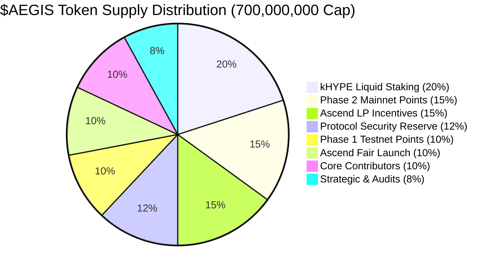

# Hard-Capped Supply & Burn Flywheel


**Protocol Roadmap Notice (Phase 3 Integration):**  
Throughout the active Elysium testnet phase and V1 Mainnet launch, **AEGIS operates strictly as a lean, pure autonomous delta-hedging engine**. To minimize security attack surface and avoid premature smart contract bloat, all token staking, fee collection, and real-yield mechanics described below are scheduled for **Phase 3** on the official protocol roadmap.



**Tokenomics Guarantee:** Hard-capped supply of 700,000,000 $AEGIS with zero inflationary minting capability in smart contracts.


## 1. The Counter-Cyclical Deflationary Flywheel

Unlike typical DeFi governance tokens that rely on continuous inflationary emissions to subsidize temporary liquidity, AEGIS implements an anti-dilutive, counter-cyclical economic engine:

```
[Market Volatility Spike]
          │
          ▼
[Hedges Triggered on HyperCore]
          │
          ▼
[Liquidation Loss Averted for Borrower]
          │
          ▼
[10% Performance Fee Captured by AegisFeeCollector.sol]
          │
          ├─────────────────────────────────────────────┐
          ▼ (50%)                                       ▼ (50%)
[Ascend Hook Pool Market Buy & Burn]           [Real USDC Staking Yield]
- Purchased via Ascend AMM                     - Distributed to bonded Sentinels
- Permanently burned to 0x0...dEaD             - Real cash flow; zero token dilution
```

During market crashes—precisely when other protocols suffer insolvency—AEGIS captures maximum performance fee revenue.

---

## 2. Strict 50/50 Fee Conservation (Invariant INV-4)

The protocol fee is strictly capped at **10% of averted liquidation losses**. This fee is programmatically allocated with mathematical symmetry:

$$\text{Fee}_{\text{collected}} = \text{Burn}_{50\%} + \text{Yield}_{50\%}$$

* **50% Buyback-and-Burn:** Programmatically routed to Ascend Closed Hook Pools to purchase $AEGIS tokens from the open market and burn them permanently.
* **50% Sentinel Real Yield:** Distributed in canonical USDC debt tokens directly to bonded node operators based on verified uptime and latency performance.

---

## 3. The Ascend User Reward Flywheel (100% Community Allocation)

In addition to the internal liquidation protection engine, AEGIS integrates directly with Ascend's native Elysium DEX architecture (`UniversalRouter` at `0x90332B0ECbb2c9517F405627b0Dd5D5265246563`, `CLPoolManager`, and `ReferralTreasury` at `0xc2113eBa197C97628a4CA58CEC21eFa8B6EfC764`).

All external fees, referral shares, and pool creator rebates returned to AEGIS from Ascend trading activity are governed by a strict community-first rule:

$$\text{Ascend Fees}_{\text{returned}} \implies 100\% \text{ User \& Community Reward Pool}$$

* **Zero Treasury Retention:** Neither the core team nor developer accounts retain Ascend fee flows.
* **Borrower Cash-Back:** Active vault borrowers who delegate risk sentinels receive automated fee rebates funded by Ascend pool volume.
* **Testnet & Early Adopter Yield:** Testers and pro-traders utilizing the terminal accumulate verified loyalty rewards and protocol fee dividends.
* **Concentrated Liquidity Staking:** Stakers and liquidity providers for the official `$AEGIS / USDC` pool on Ascend earn real yield generated by Elysium ecosystem trading.

---

## 4. Community-First Supply Allocation (700M Hard Cap)

The 700,000,000 $AEGIS token supply prioritizes community participants, active testnet/mainnet users, and liquidity providers:



| Strategic Allocation | Share (%) | Token Quantity | TGE Release | Cliff | Vesting Schedule |
| :--- | :---: | :---: | :---: | :---: | :--- |
| **Phase 1: Testnet Points Reward** | **10.0%** | **70,000,000** | **100.0% (70M)** | 0 mos | **100% Unlocked at Ascend TGE** (Elysium & testnet points earners) |
| **Phase 2: Mainnet Hedging Points** | **15.0%** | **105,000,000** | **100.0% (105M)** | 0 mos | **100% Unlocked at Ascend TGE** (Live autonomous delta hedgers) |
| **Ascend Launchpad Fair Launch** | **10.0%** | **70,000,000** | **100.0% (70M)** | 0 mos | **100% Unlocked at Ascend TGE** (Day-1 public pool liquidity) |
| **kHYPE Liquid Staking Rewards** | **20.0%** | **140,000,000** | 0.0% | 0 mos | 24 mos linear (Emissions to native kHYPE stakers on Kinetiq) |
| **Ascend LP Incentives (POL)** | **15.0%** | **105,000,000** | 0.0% | 0 mos | 36 mos linear (Deep liquidity in $AEGIS/USDC & $AEGIS/HYPE) |
| **Protocol Security & Insurance** | **12.0%** | **84,000,000** | 0.0% | 12 mos | 36 mos linear (DAO multi-sig black swan emergency reserve) |
| **Core Contributors & Builders** | **10.0%** | **70,000,000** | **0.0%** | **24 mos** | **36 mos linear** (Strict 2-year hard cliff, 5-year total horizon) |
| **Strategic Ecosystem & Audits** | **8.0%** | **56,000,000** | 0.0% | 12 mos | 24 mos linear (Audit grants, security bounties, foundation growth) |
| **TOTAL** | **100.0%** | **700,000,000** | **35.0% (245M)** | — | **Zero inflationary minting. 100% Day-1 float to Community.** |

### 4.1 Two-Phase User Points Engine
1. **Phase 1 (Active Public Testnet):** All users interacting with the AEGIS terminal on Elysium L2—registering vaults, testing simulated flash crashes, and delegating trade-only session keys—earn Phase 1 Points. This converts into a direct share of the **70,000,000 $AEGIS** allocation, 100% unlocked at Ascend TGE.
2. **Phase 2 (Mainnet Production):** Borrowers who connect active lending vaults and maintain autonomous delta-hedging protection earn Phase 2 Points based on protected collateral volume and averted liquidation events. This converts into the **105,000,000 $AEGIS** allocation, 100% unlocked at Ascend TGE.
3. **Ascend TGE Distribution:** Both Phase 1 and Phase 2 allocations are distributed directly at TGE on Ascend Launchpad with zero lockup or vesting for the users who earned them.

